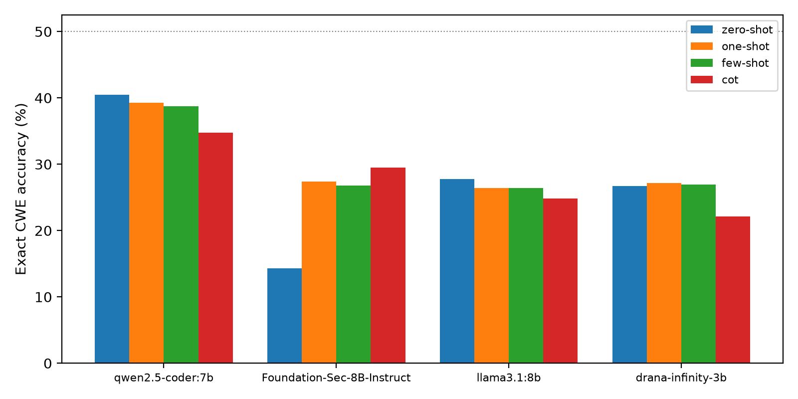
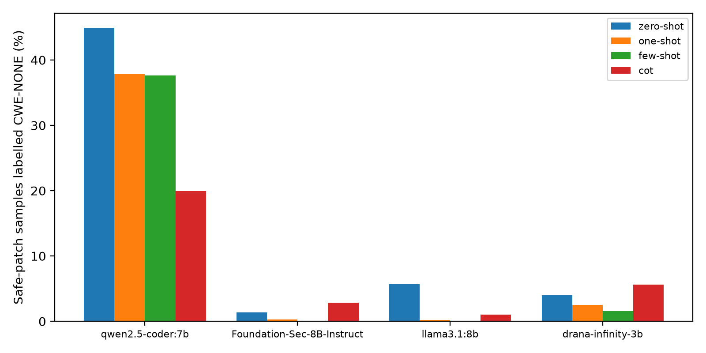

# Prompting Paradigm Comparison for CWE Classification on Dataset V4 — v1-0

**Date:** 2026-11-14 · **Dataset/Context:** Dataset V4 (1,911 Python/JavaScript/TypeScript functions, 967 vulnerable and 944 safe patches), four local LLMs, four prompting paradigms, run tag `AllMode_AllModel_SmallSample` · **Series:** CodeDEE Neural Oracle model and prompt selection; the series supports the choice of the LLM and prompt used in the neuro-symbolic verification pipeline.

---

## 1. Introduction

Selecting the prompting paradigm for the CodeDEE Neural Oracle remains an open decision: demonstrations and step-by-step reasoning are widely assumed to improve CWE classification, yet no measurement on balanced vulnerable-versus-patched code exists in this project. A wrong choice wastes prompt tokens and latency or, worse, pushes the Oracle toward labelling safe code as vulnerable, which defeats the false-positive reduction that the symbolic verification stage is meant to deliver.

This report evaluates four local models under four prompting paradigms on Dataset V4, where half of the samples are patched (safe) code, so that over-flagging is penalised. Three questions are answered:

- **Q1 — Paradigm Effect on Accuracy.** Does adding one demonstration, three demonstrations, or a four-step reasoning protocol change exact CWE accuracy relative to zero-shot prompting, for each model?
- **Q2 — Safe-Patch Discrimination.** How often does each model-paradigm combination label patched (safe) code as `CWE-NONE`, and how does the paradigm shift the trade-off between catching vulnerable code and clearing safe code?
- **Q3 — Output-Format Failures.** Which model-paradigm combinations fail to produce a usable CWE label, and what causes the failures?

## 2. Materials and Method

### 2.1 Materials

- **Dataset:** `datasets/combined/dataset_v4_multifunc_with_safe_patches_1911.jsonl`, 1,911 multi-function records: 967 vulnerable samples across 26 CWE classes (CWE-79 has 268 samples, the largest class) and 944 safe patched versions labelled `CWE-NONE`. Each prompt receives only the language and the source code (`original_code`); the label is withheld.
- **Models (served by Ollama, used as released):** `qwen2.5-coder:7b`, `Foundation-Sec-8B-Instruct`, `llama3.1:8b`, and `IHA089/drana-infinity-3b:3b`.
- **Pipeline under test:** `scripts/run_full_scale_benchmark.py`. Every prompt contains a retrieval block (ChromaDB, top-5 distinct CWE rules with 500-character reference snippets, hybrid vector and sink-signature ranking), followed by the paradigm-specific content, the code, and step-by-step instructions. The system prompt fixes the role, the constraints, and a JSON schema (`cwe_id`, `vulnerability_detected`, `reason`; the reasoning paradigm adds `cot_steps`). No confidence score is requested.
- **Hardware:** Intel Core Ultra 9 275HX, NVIDIA GeForce RTX 5080 Laptop GPU (16 GB VRAM). The sum of measured per-sample latencies over all 16 runs is 60.6 s per sample, about 32.2 h for 30,576 inferences.
- **Source documents:** per-sample checkpoints in `benchmarks_full_scale/runs/AllMode_AllModel_SmallSample/checkpoints/`, and the generated master report in the same run folder.

### 2.2 Prompting Paradigms

Four paradigms differ only in the block placed between the retrieval block and the code:

- **Zero-shot:** no demonstration.
- **One-shot:** one demonstration of a vulnerable function with expected JSON output.
- **Few-shot:** three demonstrations (two vulnerable, one safe with a sanitised flow).
- **Chain-of-thought (cot):** one demonstration containing a four-step audit (sources, propagation and sinks, sanitiser audit, verdict) and instructions to fill `cot_steps` before the verdict.

All demonstrations use the symbolic placeholders `CWE-ALPHA` and `CWE-BETA` instead of real CWE identifiers, to avoid biasing the model toward any real class. The paradigm is the only variable that changes; the retrieval block, system prompt role, and decoding settings stay constant.

### 2.3 Metrics and Paired Statistics

- **Exact CWE accuracy:** share of the 1,911 samples whose predicted `cwe_id` equals the true label (a safe patch counts as correct only when predicted `CWE-NONE`).
- **Safe-patch specificity:** share of the 944 safe samples predicted `CWE-NONE`.
- **Vulnerable flag recall:** share of the 967 vulnerable samples predicted as any CWE other than `CWE-NONE`, `UNKNOWN`, or `ERROR`.
- **Vulnerable exact recall:** share of the 967 vulnerable samples predicted as the correct CWE.

Each model was run on the same 1,911 samples under every paradigm, so per-sample correctness (0 or 1) pairs across paradigms. Every non-zero-shot paradigm is compared with zero-shot of the same model, reporting the mean delta in percentage points (pp), the number of samples better and worse, and the paired t-test and Wilcoxon signed-rank p-values. Twelve comparisons are made, so a Bonferroni-adjusted threshold of 0.05 / 12 = 0.0042 is used for the statement of significance. Analysis code: `analysis/analyze_run.py`.

## 3. Findings

### 3.1 Q1 — Demonstrations and Reasoning Lower Accuracy for Three of Four Models, While Rescuing Foundation-Sec from Format Collapse

Zero-shot is the best or statistically tied paradigm for `qwen2.5-coder:7b`, `llama3.1:8b`, and `drana-infinity-3b`, and the worst paradigm for `Foundation-Sec-8B-Instruct`. Table 1 gives exact accuracy for all 16 runs, and Figure 1 plots the same values.

| Model | Zero-Shot | One-Shot | Few-Shot | CoT |
|:--------------------|:------:|:------:|:------:|:------:|
| qwen2.5-coder:7b | **40.50** | 39.30 | 38.78 | 34.75 |
| Foundation-Sec-8B-Instruct | 14.29 | 27.42 | 26.79 | **29.51** |
| llama3.1:8b | **27.73** | 26.43 | 26.43 | 24.86 |
| drana-infinity-3b | 26.69 | **27.16** | 26.95 | 22.14 |

*Table 1 — Exact CWE accuracy (%) per model and prompting paradigm on Dataset V4 (n = 1,911 per run), computed from the per-sample checkpoints. Bold marks the best paradigm per model.*

*Figure 1 — Exact CWE accuracy (%) per model and paradigm; the dotted line marks 50%. Only `qwen2.5-coder:7b` approaches 40%, and the chain-of-thought bars drop below zero-shot for three of the four models.*

Table 2 gives the paired comparison against zero-shot of the same model.

| Model | Paradigm | Delta (pp) | Better / Worse | p (t-test) | p (Wilcoxon) |
|:----------------------|:------|------:|:-------:|:-------:|:-------:|
| qwen2.5-coder:7b | one-shot | −1.20 | 78 / 101 | 0.086 | 0.086 |
| qwen2.5-coder:7b | few-shot | −1.73 | 87 / 120 | 0.022 | 0.022 |
| qwen2.5-coder:7b | cot | −5.76 | 259 / 369 | <0.00001 | <0.00001 |
| Foundation-Sec-8B-Instruct | one-shot | +13.13 | 285 / 34 | <0.00001 | <0.00001 |
| Foundation-Sec-8B-Instruct | few-shot | +12.51 | 275 / 36 | <0.00001 | <0.00001 |
| Foundation-Sec-8B-Instruct | cot | +15.23 | 341 / 50 | <0.00001 | <0.00001 |
| llama3.1:8b | one-shot | −1.31 | 67 / 92 | 0.047 | 0.047 |
| llama3.1:8b | few-shot | −1.31 | 69 / 94 | 0.050 | 0.050 |
| llama3.1:8b | cot | −2.88 | 94 / 149 | 0.0004 | 0.0004 |
| drana-infinity-3b | one-shot | +0.47 | 73 / 64 | 0.442 | 0.442 |
| drana-infinity-3b | few-shot | +0.26 | 72 / 67 | 0.672 | 0.672 |
| drana-infinity-3b | cot | −4.55 | 114 / 201 | <0.00001 | <0.00001 |

*Table 2 — Paired change in exact accuracy relative to the zero-shot run of the same model, over the same 1,911 samples. Delta is in percentage points; Better / Worse counts samples correct in the paradigm and wrong in zero-shot, and the reverse. Output of `analysis/analyze_run.py` (`stats.json`).*

Chain-of-thought lowers accuracy significantly for `qwen2.5-coder:7b` (−5.76 pp), `llama3.1:8b` (−2.88 pp), and `drana-infinity-3b` (−4.55 pp) after the Bonferroni adjustment (p below 0.0042). One-shot and few-shot lower accuracy by 1.2 to 1.7 pp for `qwen2.5-coder:7b` and `llama3.1:8b`, but only the few-shot change for `qwen2.5-coder:7b` (p = 0.022) and the one-shot change for `llama3.1:8b` (p = 0.047) pass the unadjusted 0.05 threshold, and none passes the adjusted threshold. For `drana-infinity-3b`, one-shot and few-shot are statistically indistinguishable from zero-shot (p = 0.442 and 0.672). The gains of `Foundation-Sec-8B-Instruct` (+12.5 to +15.2 pp) are the largest effects in the run, but Section 3.3 shows that the gains come from repairing output-format failures in zero-shot rather than from better classification.

### 3.2 Q2 — Every Model-Paradigm Combination Labels Most Safe Patches as Vulnerable, and Demonstrations Worsen the Trade-Off

No combination clears more than 44.9% of safe patches (best: `qwen2.5-coder:7b`, zero-shot), and `llama3.1:8b` and `Foundation-Sec-8B-Instruct` label essentially every safe patch as vulnerable under one-shot and few-shot. Table 3 gives safe-patch specificity beside vulnerable-sample recall.

| Model | Paradigm | Safe Specificity | Vuln. Flag Recall | Vuln. Exact Recall |
|:----------------------|:------|:------:|:------:|:------:|
| qwen2.5-coder:7b | zero-shot | 44.9 | 52.5 | 36.2 |
| qwen2.5-coder:7b | one-shot | 37.8 | 57.7 | 40.7 |
| qwen2.5-coder:7b | few-shot | 37.6 | 58.6 | 39.9 |
| qwen2.5-coder:7b | cot | 19.9 | 83.4 | 49.2 |
| Foundation-Sec-8B-Instruct | zero-shot | 1.4 | 50.2 | 26.9 |
| Foundation-Sec-8B-Instruct | one-shot | 0.3 | 99.4 | 53.9 |
| Foundation-Sec-8B-Instruct | few-shot | 0.0 | 98.6 | 53.0 |
| Foundation-Sec-8B-Instruct | cot | 2.9 | 96.2 | 55.5 |
| llama3.1:8b | zero-shot | 5.7 | 93.0 | 49.2 |
| llama3.1:8b | one-shot | 0.2 | 99.9 | 52.0 |
| llama3.1:8b | few-shot | 0.0 | 99.7 | 52.2 |
| llama3.1:8b | cot | 1.1 | 98.1 | 48.1 |
| drana-infinity-3b | zero-shot | 4.0 | 90.3 | 48.8 |
| drana-infinity-3b | one-shot | 2.5 | 96.0 | 51.2 |
| drana-infinity-3b | few-shot | 1.6 | 97.1 | 51.7 |
| drana-infinity-3b | cot | 5.6 | 91.6 | 38.3 |

*Table 3 — Safe-patch specificity (share of the 944 safe samples predicted `CWE-NONE`), vulnerable flag recall (share of the 967 vulnerable samples predicted as any CWE), and vulnerable exact recall (share predicted as the correct CWE), all in percent, from the per-sample checkpoints.*

*Figure 2 — Share of safe patches labelled `CWE-NONE` (%) per model and paradigm. Only `qwen2.5-coder:7b` clears a meaningful share of safe code, and every added demonstration or reasoning step lowers that share.*

For `qwen2.5-coder:7b`, each step away from zero-shot trades specificity for recall: safe specificity falls from 44.9% to 37.8%, 37.6%, and 19.9%, while vulnerable exact recall rises from 36.2% to 40.7%, 39.9%, and 49.2%. Exact accuracy falls because the two classes weigh equally in Dataset V4 and the specificity loss (up to 25.0 pp of 944 safe samples) outweighs the recall gain (up to 13.0 pp of 967 vulnerable samples). The three other models sit near the always-flag extreme under every paradigm, with specificity at or below 5.7% in all 12 runs and vulnerable flag recall between 90.3% and 99.9% in 11 of the 12 runs (the exception, zero-shot `Foundation-Sec-8B-Instruct` at 50.2%, reflects the 948 unusable labels discussed in Section 3.3). The one-shot demonstration shows only a vulnerable example and the few-shot set holds two vulnerable examples against one safe example; the observed shift toward flagging is consistent with this positive-class skew, but the run did not vary the demonstration balance, so the cause is not isolated.

### 3.3 Q3 — Zero-Shot Fails to Produce a Label for Half of the Foundation-Sec Samples, and Chain-of-Thought Triggers Placeholder Copying in the 3B Model

`Foundation-Sec-8B-Instruct` returns an unusable label (`UNKNOWN`) for 948 of 1,911 samples under zero-shot, and `drana-infinity-3b` outputs the demonstration placeholder `CWE-ALPHA` or `CWE-BETA` for 294 samples under chain-of-thought. Table 4 lists every run with at least one unusable or placeholder label.

| Model | Paradigm | `UNKNOWN` / `ERROR` Labels | Placeholder Labels (`CWE-ALPHA`, `CWE-BETA`) |
|:----------------------|:------|:------:|:------:|
| Foundation-Sec-8B-Instruct | zero-shot | 948 | 0 |
| Foundation-Sec-8B-Instruct | one-shot | 2 | 13 |
| Foundation-Sec-8B-Instruct | few-shot | 39 | 16 |
| Foundation-Sec-8B-Instruct | cot | 22 | 2 |
| qwen2.5-coder:7b | cot | 61 | 2 |
| llama3.1:8b | cot | 20 | 1 |
| drana-infinity-3b | one-shot | 0 | 1 |
| drana-infinity-3b | cot | 85 | 294 |

*Table 4 — Count of unusable (`UNKNOWN`, `ERROR`) and placeholder predictions among 1,911 samples per run. Runs with zero counts are omitted. Counts come from the per-sample checkpoints.*

The 948 unusable labels under zero-shot explain the 14.29% accuracy of `Foundation-Sec-8B-Instruct`; the same model reaches 26.8% to 29.5% once a demonstration is present and the unusable count drops to at most 39. The zero-shot prompt carries no example of the required JSON output, and the model does not follow the schema without one. Placeholder copying in `drana-infinity-3b` (294 labels, 15.4% of samples) accounts for the 4.55 pp drop in chain-of-thought accuracy shown in Table 2: the chain-of-thought demonstration contains `CWE-ALPHA`, and the smallest model reproduces the placeholder literally. Both failure modes are properties of the prompt design rather than of classification ability, and both inflate the apparent paradigm effects in Q1.

## 4. Reflection and Recommendations

### 4.1 Reflection

The run contains a clear measurement of the paradigm effect on balanced data for four models, and the measurement contradicts the assumption that more prompt context helps: for `qwen2.5-coder:7b`, `llama3.1:8b`, and `drana-infinity-3b`, zero-shot with retrieval matches or beats every richer paradigm. The retrieval block already supplies reference flaw and fix snippets for five candidate CWEs, which plausibly makes generic demonstrations redundant; this explanation is consistent with the data but was not tested by removing the retrieval block.

The run does not contain a model that separates vulnerable code from patched code. The best specificity is 44.9% with 52.5% vulnerable flag recall, close to chance, and the other three models flag nearly everything. Exact accuracy therefore mostly reflects the share of vulnerable samples classified correctly, plus a small share of safe samples. A pure LLM verdict cannot serve as the final label in CodeDEE; the symbolic taint and verification stages must carry the safe-versus-vulnerable decision.

The limits are as follows. The run name contains "SmallSample", but each run used all 1,911 samples; only four of the seven planned models were evaluated. Each condition was run once with temperature 0.1 and no fixed seed, so run-to-run variance is unmeasured and the paired p-values describe sample-level pairing within one run, not repeatability. The demonstration balance, placeholder strategy, and instruction wording changed together with the paradigm, so the causes proposed for the specificity loss and for the placeholder copying remain hypotheses. Twelve comparisons were made, and the borderline p-values (0.022 to 0.050) do not survive adjustment.

### 4.2 Recommendations and Next Direction

1. Use zero-shot with retrieval as the baseline prompt for `qwen2.5-coder:7b`, the only model with usable safe-patch discrimination, and drop chain-of-thought for this model (−5.76 pp, specificity 19.9%).
2. Add a one-line JSON output example (without a CWE placeholder) to the zero-shot prompt before evaluating `Foundation-Sec-8B-Instruct` again, and replace `CWE-ALPHA` and `CWE-BETA` with a neutral format token or normalise placeholders to `UNKNOWN` in the parser, so that format failures stop confounding paradigm comparisons.
3. Rebalance few-shot demonstrations to an equal number of vulnerable and safe examples, and add an explicit instruction to return `CWE-NONE` when a sanitiser or validation lies anywhere along the call chain; then rerun one model to test whether the specificity loss is a positive-class skew.
4. Rerun the best configuration with three fixed seeds to measure run-to-run variance before reporting differences below 2 pp as findings.
5. Next direction: run the remaining planned models (`drana-infinity-7b`, `vulntune-deepseek-coder-6.7b`, `deepseek-r1:8b`) on the corrected prompts, then feed the best zero-shot configuration into the symbolic reconciliation stage and measure the false-positive reduction against the pure LLM verdicts reported here.

## 5. Source Materials / References

- **Scripts:** `scripts/run_full_scale_benchmark.py` (benchmark, prompts, parser); `analysis/analyze_run.py` inside `Source-Prompting_Paradigm_Benchmark_v1-0/` (paired statistics and figures).
- **Results:** run tag `AllMode_AllModel_SmallSample` at `benchmarks_full_scale/runs/AllMode_AllModel_SmallSample/` (checkpoints, per-run reports, confusion matrices, `reports/master_benchmark_report_latest.md`); derived statistics in `Prompting_Paradigm_Benchmark_v1-0_figs/stats.json`.
- **Dataset:** `datasets/combined/dataset_v4_multifunc_with_safe_patches_1911.jsonl`.
- **Hardware and runtime:** Intel Core Ultra 9 275HX, RTX 5080 Laptop GPU (16 GB); about 32.2 h summed per-sample latency for 30,576 inferences.

## Appendix A. Model and Experiment Configuration

| Parameter | Value |
|:---------------------|:----------------------------------------|
| Inference server | Ollama, `/api/generate`, non-streaming |
| `temperature` | 0.1 |
| `top_p` | 0.9 |
| `num_predict` | 1024 |
| `num_ctx` | 8192 |
| Output format | `format=json` on attempts 1–2; free text on attempt 3 (retries: 3, timeout 180 s) |
| Retrieval | ChromaDB `codedee_knowledge_base`, language filter, top-5 distinct CWE rules, 500-character reference snippets, up to 12 query chunks of 900 characters |
| Parser tiers | strict JSON, regex JSON block, regex CWE fallback, failed (`UNKNOWN`) |
| Samples per run | 1,911 (967 vulnerable, 944 safe) |
| Seeds | not set; determinism not verified |
| Model sources | Ollama tags listed in Section 2.1; used as released, no fine-tuning by this project |

*Table A1 — Configuration shared by all 16 runs, taken from `scripts/run_full_scale_benchmark.py` and the generated master report.*

| Model | Zero-Shot | One-Shot | Few-Shot | CoT |
|:--------------------|:----:|:----:|:----:|:----:|
| qwen2.5-coder:7b | 3.25 | 3.28 | 3.31 | 4.92 |
| Foundation-Sec-8B-Instruct | 4.76 | 3.90 | 3.99 | 6.24 |
| llama3.1:8b | 3.43 | 3.34 | 3.36 | 4.50 |
| drana-infinity-3b | 2.87 | 2.89 | 2.94 | 3.64 |

*Table A2 — Mean wall-clock latency per sample (s) per model and paradigm, measured by the benchmark script on the hardware listed in Section 2.1. Chain-of-thought adds 0.8 to 1.7 s per sample relative to zero-shot for all four models; the lower one-shot and few-shot latency of `Foundation-Sec-8B-Instruct` follows from fewer generated tokens once the schema is demonstrated.*
