# CodeDEE: Full-Scale Multi-Prompt & Multi-Model Evaluation Report

- **Dataset Evaluated:** `v4` (1911 Samples per run)
- **RAG Retrieval:** ChromaDB Vector Store (`top_k=5`, 500-char KB snippets, separated from prompt demonstrations)
- **Prompting Modes Evaluated:** `zero-shot`, `one-shot`, `few-shot`, `cot`
- **Models Evaluated:** 4 Models (16 total Model × Prompt runs)
- **Hardware Environment:** Intel Core Ultra 9 275HX, NVIDIA GeForce RTX 5080 Laptop GPU (16 GB VRAM)
- **Inference Platform:** Ollama (`num_ctx=8192`, `temperature=0.1`, `top_p=0.9`)

## 1. Prompting Paradigm Comparison Matrix (Model × Prompt Mode)

Comparison of **Exact CWE Accuracy (Macro-F1)** and **Generation Speed (tok/s)** across prompting strategies:

| Model | ZERO-SHOT Acc (Macro-F1) | ONE-SHOT Acc (Macro-F1) | FEW-SHOT Acc (Macro-F1) | COT Acc (Macro-F1) | Best Mode | Avg Speed (tok/s) |
| :--- | :---: | :---: | :---: | :---: | :---: | :---: |
| **Foundation-Sec-8B-Instruct** | 14.29% (14.99%) | 27.42% (27.34%) | 26.79% (25.73%) | 29.51% (29.52%) | `cot` (29.51%) | 65.59 |
| **IHA089/drana-infinity-3b:3b** | 26.69% (26.23%) | 27.16% (26.06%) | 26.95% (26.34%) | 22.14% (26.71%) | `one-shot` (27.16%) | 184.01 |
| **llama3.1:8b** | 27.73% (25.74%) | 26.43% (25.38%) | 26.43% (25.44%) | 24.86% (25.72%) | `zero-shot` (27.73%) | 100.84 |
| **qwen2.5-coder:7b** | 40.50% (35.14%) | 39.30% (35.77%) | 38.78% (33.89%) | 34.75% (33.28%) | `zero-shot` (40.50%) | 109.14 |

## 2. Master Performance Leaderboard (All Model × Prompt Combinations)

| Rank | Model | Prompt Mode | Exact CWE Acc | Macro-F1 | Binary F1 | Binary Prec / Rec | FPR | Py / JS / TS Acc | Avg Lat (P95) | Gen Speed (tok/s) | Prompt Speed (tok/s) | Avg Tokens (In/Out) | Fallback Rate |
| :---: | :--- | :---: | :---: | :---: | :---: | :---: | :---: | :---: | :---: | :---: | :---: | :---: | :---: |
| 1 | **qwen2.5-coder:7b** | `zero-shot` | **40.50%** | 35.14% | 50.93% | 49.42% / 52.53% | 55.08% | 41.83% / 36.96% / 46.03% | 3.25s (3.67s) | **110.36** | 6932.52 | 1936.8 / 88.0 | 0.21% |
| 2 | **qwen2.5-coder:7b** | `one-shot` | **39.30%** | 35.77% | 52.84% | 48.73% / 57.70% | 62.18% | 41.69% / 35.29% / 43.84% | 3.28s (3.67s) | **109.37** | 6792.11 | 2139.4 / 86.3 | 0.26% |
| 3 | **qwen2.5-coder:7b** | `few-shot` | **38.78%** | 33.89% | 53.41% | 49.05% / 58.63% | 62.39% | 40.28% / 35.41% / 43.56% | 3.31s (3.67s) | **108.42** | 6588.96 | 2453.5 / 79.8 | 0.37% |
| 4 | **qwen2.5-coder:7b** | `cot` | **34.75%** | 33.28% | 63.74% | 51.60% / 83.35% | 80.08% | 35.07% / 35.05% / 33.42% | 4.92s (5.99s) | **108.4** | 6880.87 | 2345.0 / 259.3 | 1.15% |
| 5 | **Foundation-Sec-8B-Instruct** | `cot` | **29.51%** | 29.52% | 66.10% | 50.35% / 96.17% | 97.14% | 30.00% / 29.78% / 27.95% | 6.24s (7.67s) | **67.34** | 5613.92 | 1974.1 / 248.3 | 0.10% |
| 6 | **llama3.1:8b** | `zero-shot` | **27.73%** | 25.74% | 65.24% | 50.25% / 92.97% | 94.28% | 28.03% / 28.23% / 26.03% | 3.43s (3.9s) | **101.47** | 6516.2 | 1903.1 / 94.7 | 0.21% |
| 7 | **Foundation-Sec-8B-Instruct** | `one-shot` | **27.42%** | 27.34% | 66.99% | 50.53% / 99.38% | 99.68% | 28.73% / 28.35% / 22.74% | 3.9s (4.51s) | **65.94** | 5587.06 | 1893.2 / 90.4 | 0.00% |
| 8 | **IHA089/drana-infinity-3b:3b** | `one-shot` | **27.16%** | 26.06% | 65.93% | 50.22% / 95.97% | 97.46% | 27.04% / 28.71% / 23.84% | 2.89s (3.17s) | **181.25** | 11933.42 | 2139.4 / 98.0 | 1.05% |
| 9 | **IHA089/drana-infinity-3b:3b** | `few-shot` | **26.95%** | 26.34% | 66.24% | 50.27% / 97.10% | 98.41% | 26.76% / 28.47% / 23.84% | 2.94s (3.22s) | **180.09** | 11683.37 | 2453.5 / 99.7 | 1.26% |
| 10 | **Foundation-Sec-8B-Instruct** | `few-shot` | **26.79%** | 25.73% | 66.55% | 50.24% / 98.55% | 100.00% | 27.61% / 28.35% / 21.64% | 3.99s (4.64s) | **63.03** | 5565.26 | 2205.3 / 87.1 | 0.00% |
| 11 | **IHA089/drana-infinity-3b:3b** | `zero-shot` | **26.69%** | 26.23% | 63.58% | 49.07% / 90.28% | 95.97% | 27.61% / 27.75% / 22.47% | 2.87s (3.15s) | **183.58** | 12008.24 | 1936.8 / 99.6 | 0.99% |
| 12 | **llama3.1:8b** | `few-shot` | **26.43%** | 25.44% | 67.06% | 50.52% / 99.69% | 100.00% | 26.76% / 28.11% / 21.92% | 3.36s (3.71s) | **99.98** | 5889.65 | 2415.7 / 73.0 | 0.47% |
| 13 | **llama3.1:8b** | `one-shot` | **26.43%** | 25.38% | 67.20% | 50.63% / 99.90% | 99.79% | 26.34% / 27.99% / 23.01% | 3.34s (3.67s) | **100.52** | 6104.99 | 2101.6 / 79.6 | 0.63% |
| 14 | **llama3.1:8b** | `cot` | **24.86%** | 25.72% | 66.60% | 50.40% / 98.14% | 98.94% | 26.06% / 25.24% / 21.64% | 4.5s (5.12s) | **101.41** | 6505.08 | 2307.1 / 194.2 | 0.10% |
| 15 | **IHA089/drana-infinity-3b:3b** | `cot` | **22.14%** | 26.71% | 64.58% | 49.86% / 91.62% | 94.39% | 20.70% / 23.09% / 22.74% | 3.64s (4.32s) | **191.11** | 12463.38 | 2345.0 / 243.1 | 3.30% |
| 16 | **Foundation-Sec-8B-Instruct** | `zero-shot` | **14.29%** | 14.99% | 40.70% | 34.25% / 50.16% | 98.62% | 3.52% / 24.40% / 12.05% | 4.76s (7.19s) | **66.07** | 5449.79 | 1692.5 / 149.2 | 0.47% |

## 3. Sub-Leaderboards by Prompting Paradigm

### 3.1 `ZERO-SHOT` — Zero-Shot Prompting (0 Task Demos + RAG)

| Model | Exact CWE Acc | Macro-F1 | Binary F1 | Python Acc | JS Acc | TS Acc | Avg Latency (P95) | Gen Speed (tok/s) | Fallback Rate |
| :--- | :---: | :---: | :---: | :---: | :---: | :---: | :---: | :---: | :---: |
| **qwen2.5-coder:7b** | **40.50%** | 35.14% | 50.93% | 41.83% | 36.96% | 46.03% | 3.25s (3.67s) | **110.36** | 0.21% |
| **llama3.1:8b** | **27.73%** | 25.74% | 65.24% | 28.03% | 28.23% | 26.03% | 3.43s (3.9s) | **101.47** | 0.21% |
| **IHA089/drana-infinity-3b:3b** | **26.69%** | 26.23% | 63.58% | 27.61% | 27.75% | 22.47% | 2.87s (3.15s) | **183.58** | 0.99% |
| **Foundation-Sec-8B-Instruct** | **14.29%** | 14.99% | 40.70% | 3.52% | 24.40% | 12.05% | 4.76s (7.19s) | **66.07** | 0.47% |

### 3.2 `ONE-SHOT` — One-Shot Prompting (1 Task Demo + RAG)

| Model | Exact CWE Acc | Macro-F1 | Binary F1 | Python Acc | JS Acc | TS Acc | Avg Latency (P95) | Gen Speed (tok/s) | Fallback Rate |
| :--- | :---: | :---: | :---: | :---: | :---: | :---: | :---: | :---: | :---: |
| **qwen2.5-coder:7b** | **39.30%** | 35.77% | 52.84% | 41.69% | 35.29% | 43.84% | 3.28s (3.67s) | **109.37** | 0.26% |
| **Foundation-Sec-8B-Instruct** | **27.42%** | 27.34% | 66.99% | 28.73% | 28.35% | 22.74% | 3.9s (4.51s) | **65.94** | 0.00% |
| **IHA089/drana-infinity-3b:3b** | **27.16%** | 26.06% | 65.93% | 27.04% | 28.71% | 23.84% | 2.89s (3.17s) | **181.25** | 1.05% |
| **llama3.1:8b** | **26.43%** | 25.38% | 67.20% | 26.34% | 27.99% | 23.01% | 3.34s (3.67s) | **100.52** | 0.63% |

### 3.3 `FEW-SHOT` — Few-Shot Prompting (3 Task Demos + RAG)

| Model | Exact CWE Acc | Macro-F1 | Binary F1 | Python Acc | JS Acc | TS Acc | Avg Latency (P95) | Gen Speed (tok/s) | Fallback Rate |
| :--- | :---: | :---: | :---: | :---: | :---: | :---: | :---: | :---: | :---: |
| **qwen2.5-coder:7b** | **38.78%** | 33.89% | 53.41% | 40.28% | 35.41% | 43.56% | 3.31s (3.67s) | **108.42** | 0.37% |
| **IHA089/drana-infinity-3b:3b** | **26.95%** | 26.34% | 66.24% | 26.76% | 28.47% | 23.84% | 2.94s (3.22s) | **180.09** | 1.26% |
| **Foundation-Sec-8B-Instruct** | **26.79%** | 25.73% | 66.55% | 27.61% | 28.35% | 21.64% | 3.99s (4.64s) | **63.03** | 0.00% |
| **llama3.1:8b** | **26.43%** | 25.44% | 67.06% | 26.76% | 28.11% | 21.92% | 3.36s (3.71s) | **99.98** | 0.47% |

### 3.4 `COT` — Chain-of-Thought Prompting (4-Step Audit + RAG)

| Model | Exact CWE Acc | Macro-F1 | Binary F1 | Python Acc | JS Acc | TS Acc | Avg Latency (P95) | Gen Speed (tok/s) | Fallback Rate |
| :--- | :---: | :---: | :---: | :---: | :---: | :---: | :---: | :---: | :---: |
| **qwen2.5-coder:7b** | **34.75%** | 33.28% | 63.74% | 35.07% | 35.05% | 33.42% | 4.92s (5.99s) | **108.4** | 1.15% |
| **Foundation-Sec-8B-Instruct** | **29.51%** | 29.52% | 66.10% | 30.00% | 29.78% | 27.95% | 6.24s (7.67s) | **67.34** | 0.10% |
| **llama3.1:8b** | **24.86%** | 25.72% | 66.60% | 26.06% | 25.24% | 21.64% | 4.5s (5.12s) | **101.41** | 0.10% |
| **IHA089/drana-infinity-3b:3b** | **22.14%** | 26.71% | 64.58% | 20.70% | 23.09% | 22.74% | 3.64s (4.32s) | **191.11** | 3.30% |

## 4. Per-(Model, Prompt) Confusion Matrices & Diagnostic Findings

### qwen2.5-coder:7b — `ZERO-SHOT`

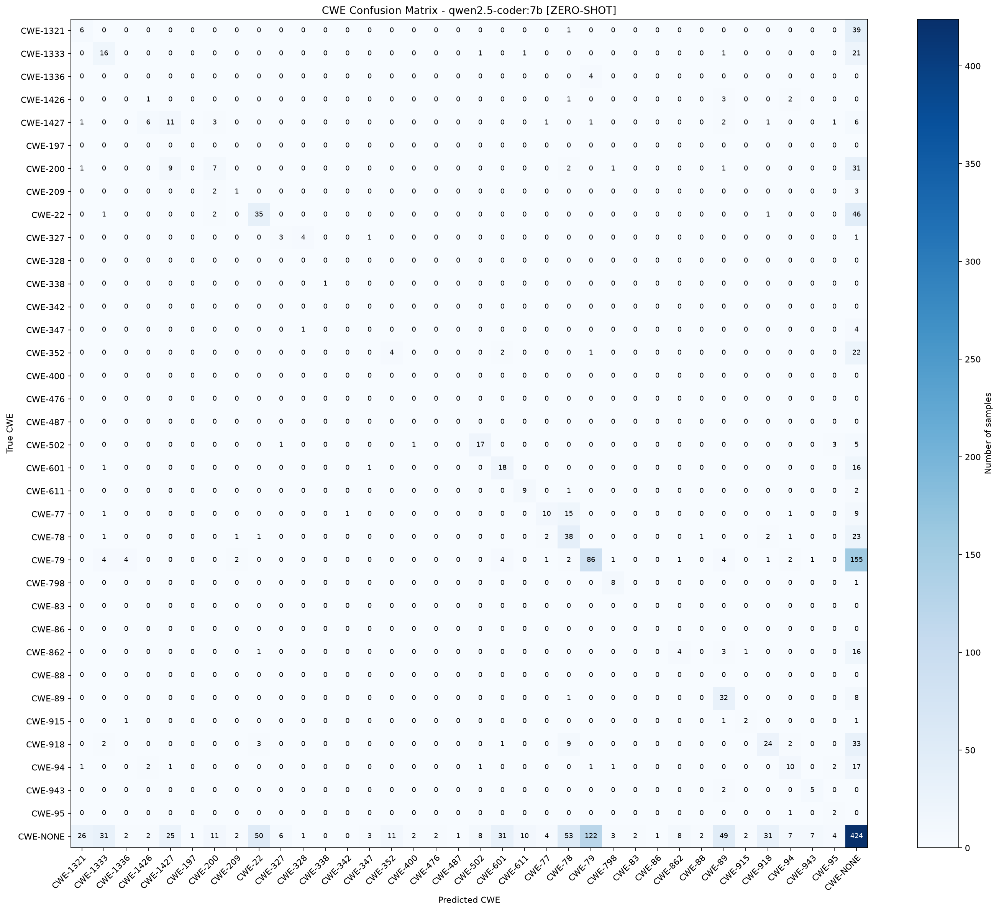

- **Prompting Mode:** `zero-shot` (Zero-Shot Prompting (0 Task Demos + RAG))
- **Exact CWE Accuracy:** 40.50% (774/1911) | **Macro-F1:** 35.14%
- **Binary Vulnerability Detection:** Precision: 49.42% | Recall: 52.53% | Binary F1: **50.93%** | FPR: 55.08%
- **Speed & Token Metrics:** Avg Latency: 3.25s (P95: 3.67s) | Gen Speed: **110.36 tok/s** | Prompt Eval Speed: 6932.52 tok/s | Avg Tokens (In/Out): 1936.8 / 88.0
- **Reliability:** Strict JSON Rate: 99.79% | Parse Fallback Rate: 0.21% | CWE-NONE Predictions: 883/1911 (46.21%)
- **Most frequent misclassifications:** CWE-79 -> CWE-NONE (155); CWE-NONE -> CWE-79 (122); CWE-NONE -> CWE-78 (53); CWE-NONE -> CWE-22 (50); CWE-NONE -> CWE-89 (49).

### qwen2.5-coder:7b — `ONE-SHOT`

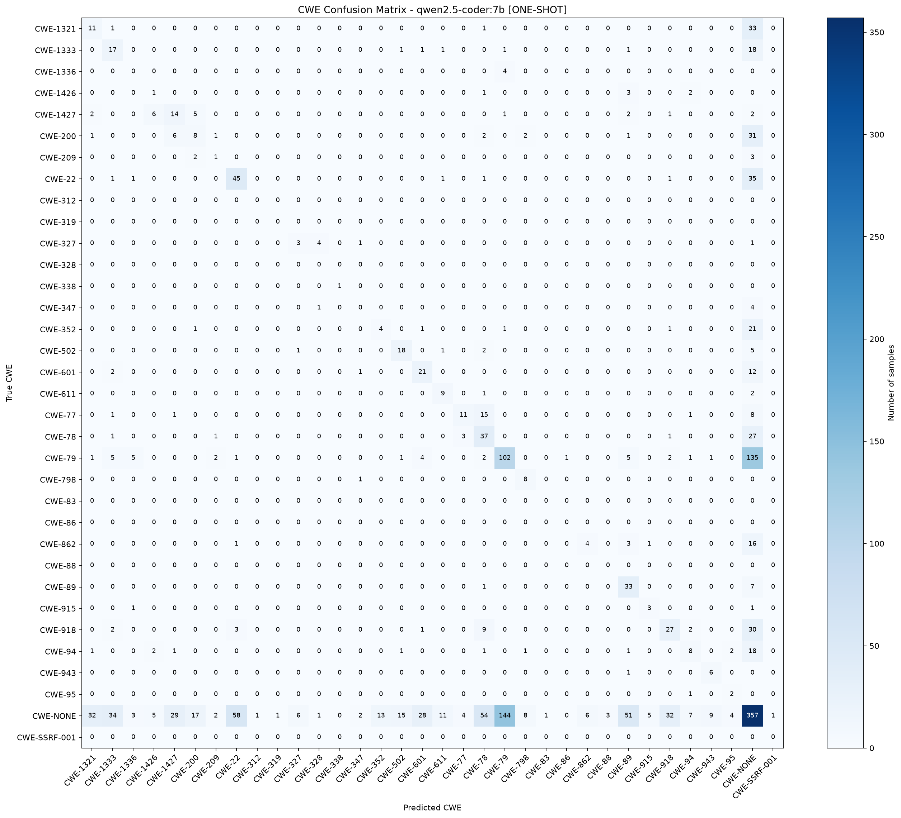

- **Prompting Mode:** `one-shot` (One-Shot Prompting (1 Task Demo + RAG))
- **Exact CWE Accuracy:** 39.30% (751/1911) | **Macro-F1:** 35.77%
- **Binary Vulnerability Detection:** Precision: 48.73% | Recall: 57.70% | Binary F1: **52.84%** | FPR: 62.18%
- **Speed & Token Metrics:** Avg Latency: 3.28s (P95: 3.67s) | Gen Speed: **109.37 tok/s** | Prompt Eval Speed: 6792.11 tok/s | Avg Tokens (In/Out): 2139.4 / 86.3
- **Reliability:** Strict JSON Rate: 99.74% | Parse Fallback Rate: 0.26% | CWE-NONE Predictions: 766/1911 (40.08%)
- **Most frequent misclassifications:** CWE-NONE -> CWE-79 (144); CWE-79 -> CWE-NONE (135); CWE-NONE -> CWE-22 (58); CWE-NONE -> CWE-78 (54); CWE-NONE -> CWE-89 (51).

### qwen2.5-coder:7b — `FEW-SHOT`

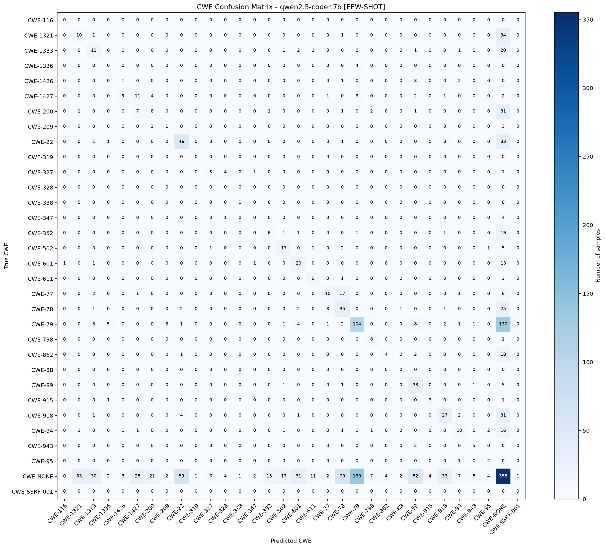

- **Prompting Mode:** `few-shot` (Few-Shot Prompting (3 Task Demos + RAG))
- **Exact CWE Accuracy:** 38.78% (741/1911) | **Macro-F1:** 33.89%
- **Binary Vulnerability Detection:** Precision: 49.05% | Recall: 58.63% | Binary F1: **53.41%** | FPR: 62.39%
- **Speed & Token Metrics:** Avg Latency: 3.31s (P95: 3.67s) | Gen Speed: **108.42 tok/s** | Prompt Eval Speed: 6588.96 tok/s | Avg Tokens (In/Out): 2453.5 / 79.8
- **Reliability:** Strict JSON Rate: 99.63% | Parse Fallback Rate: 0.37% | CWE-NONE Predictions: 755/1911 (39.51%)
- **Most frequent misclassifications:** CWE-NONE -> CWE-79 (139); CWE-79 -> CWE-NONE (130); CWE-NONE -> CWE-78 (60); CWE-NONE -> CWE-22 (59); CWE-NONE -> CWE-89 (52).

### qwen2.5-coder:7b — `COT`

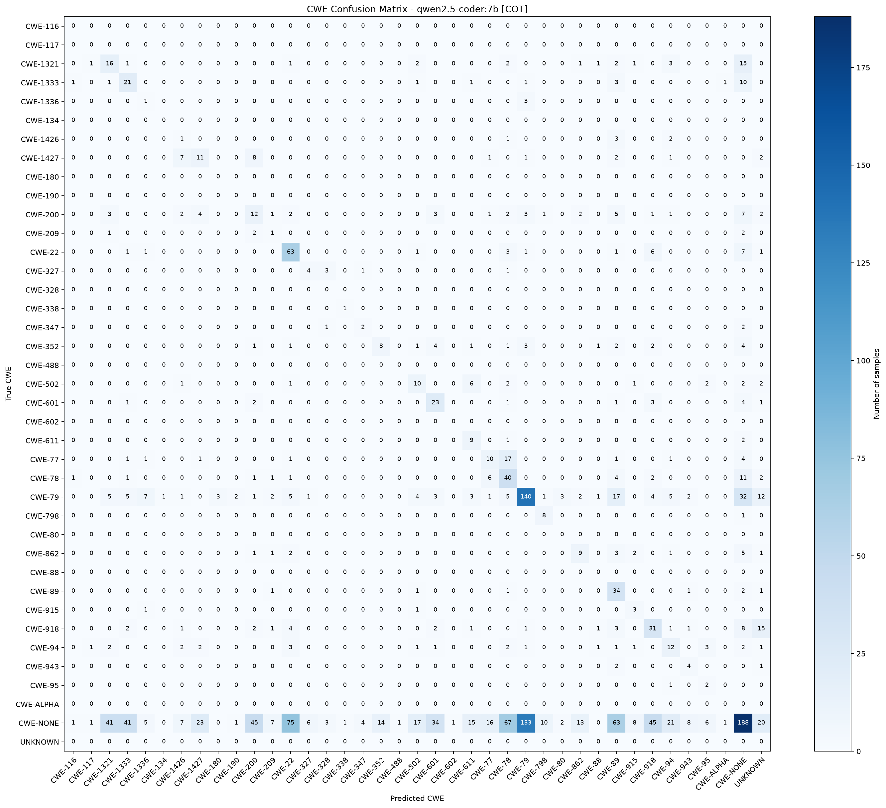

- **Prompting Mode:** `cot` (Chain-of-Thought Prompting (4-Step Audit + RAG))
- **Exact CWE Accuracy:** 34.75% (664/1911) | **Macro-F1:** 33.28%
- **Binary Vulnerability Detection:** Precision: 51.60% | Recall: 83.35% | Binary F1: **63.74%** | FPR: 80.08%
- **Speed & Token Metrics:** Avg Latency: 4.92s (P95: 5.99s) | Gen Speed: **108.4 tok/s** | Prompt Eval Speed: 6880.87 tok/s | Avg Tokens (In/Out): 2345.0 / 259.3
- **Reliability:** Strict JSON Rate: 98.85% | Parse Fallback Rate: 1.15% | CWE-NONE Predictions: 308/1911 (16.12%)
- **Most frequent misclassifications:** CWE-NONE -> CWE-79 (133); CWE-NONE -> CWE-22 (75); CWE-NONE -> CWE-78 (67); CWE-NONE -> CWE-89 (63); CWE-NONE -> CWE-918 (45).

### Foundation-Sec-8B-Instruct — `COT`

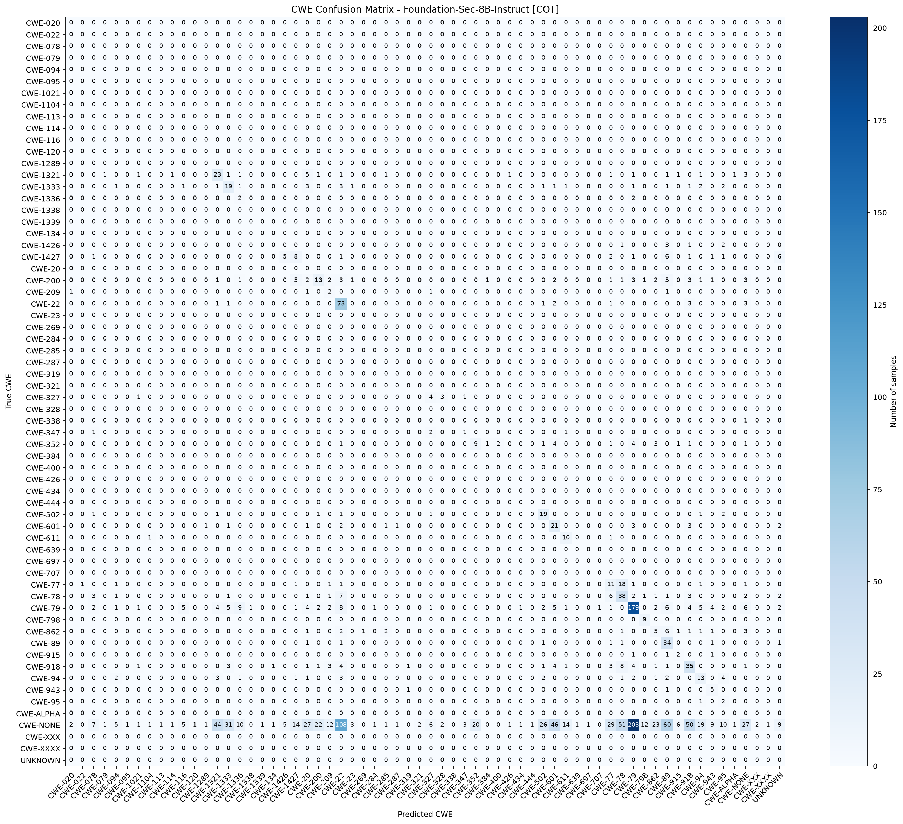

- **Prompting Mode:** `cot` (Chain-of-Thought Prompting (4-Step Audit + RAG))
- **Exact CWE Accuracy:** 29.51% (564/1911) | **Macro-F1:** 29.52%
- **Binary Vulnerability Detection:** Precision: 50.35% | Recall: 96.17% | Binary F1: **66.10%** | FPR: 97.14%
- **Speed & Token Metrics:** Avg Latency: 6.24s (P95: 7.67s) | Gen Speed: **67.34 tok/s** | Prompt Eval Speed: 5613.92 tok/s | Avg Tokens (In/Out): 1974.1 / 248.3
- **Reliability:** Strict JSON Rate: 99.90% | Parse Fallback Rate: 0.10% | CWE-NONE Predictions: 51/1911 (2.67%)
- **Most frequent misclassifications:** CWE-NONE -> CWE-79 (203); CWE-NONE -> CWE-22 (108); CWE-NONE -> CWE-89 (60); CWE-NONE -> CWE-78 (51); CWE-NONE -> CWE-918 (50).

### llama3.1:8b — `ZERO-SHOT`

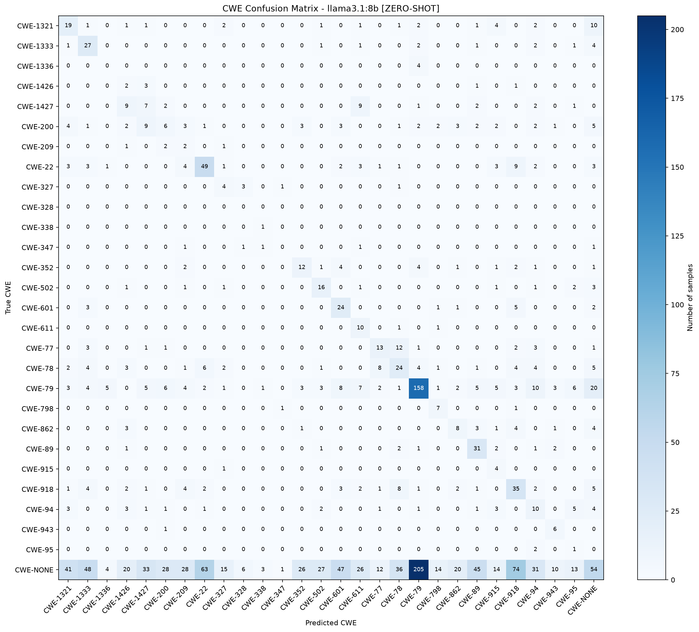

- **Prompting Mode:** `zero-shot` (Zero-Shot Prompting (0 Task Demos + RAG))
- **Exact CWE Accuracy:** 27.73% (530/1911) | **Macro-F1:** 25.74%
- **Binary Vulnerability Detection:** Precision: 50.25% | Recall: 92.97% | Binary F1: **65.24%** | FPR: 94.28%
- **Speed & Token Metrics:** Avg Latency: 3.43s (P95: 3.9s) | Gen Speed: **101.47 tok/s** | Prompt Eval Speed: 6516.2 tok/s | Avg Tokens (In/Out): 1903.1 / 94.7
- **Reliability:** Strict JSON Rate: 99.79% | Parse Fallback Rate: 0.21% | CWE-NONE Predictions: 122/1911 (6.38%)
- **Most frequent misclassifications:** CWE-NONE -> CWE-79 (205); CWE-NONE -> CWE-918 (74); CWE-NONE -> CWE-22 (63); CWE-NONE -> CWE-1333 (48); CWE-NONE -> CWE-601 (47).

### Foundation-Sec-8B-Instruct — `ONE-SHOT`

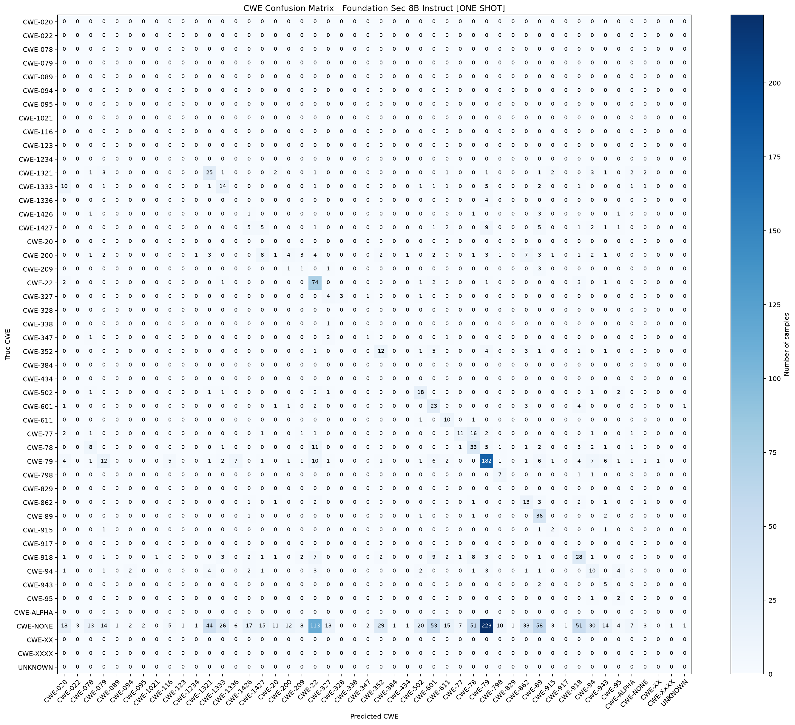

- **Prompting Mode:** `one-shot` (One-Shot Prompting (1 Task Demo + RAG))
- **Exact CWE Accuracy:** 27.42% (524/1911) | **Macro-F1:** 27.34%
- **Binary Vulnerability Detection:** Precision: 50.53% | Recall: 99.38% | Binary F1: **66.99%** | FPR: 99.68%
- **Speed & Token Metrics:** Avg Latency: 3.9s (P95: 4.51s) | Gen Speed: **65.94 tok/s** | Prompt Eval Speed: 5587.06 tok/s | Avg Tokens (In/Out): 1893.2 / 90.4
- **Reliability:** Strict JSON Rate: 100.00% | Parse Fallback Rate: 0.00% | CWE-NONE Predictions: 8/1911 (0.42%)
- **Most frequent misclassifications:** CWE-NONE -> CWE-79 (223); CWE-NONE -> CWE-22 (113); CWE-NONE -> CWE-89 (58); CWE-NONE -> CWE-601 (53); CWE-NONE -> CWE-918 (51).

### IHA089/drana-infinity-3b:3b — `ONE-SHOT`

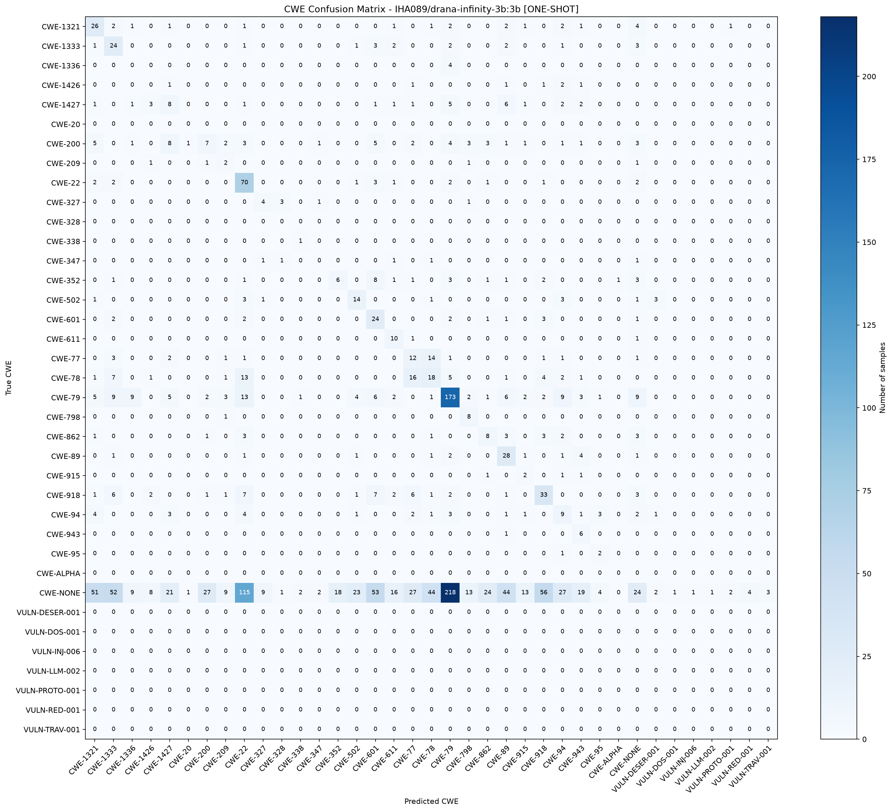

- **Prompting Mode:** `one-shot` (One-Shot Prompting (1 Task Demo + RAG))
- **Exact CWE Accuracy:** 27.16% (519/1911) | **Macro-F1:** 26.06%
- **Binary Vulnerability Detection:** Precision: 50.22% | Recall: 95.97% | Binary F1: **65.93%** | FPR: 97.46%
- **Speed & Token Metrics:** Avg Latency: 2.89s (P95: 3.17s) | Gen Speed: **181.25 tok/s** | Prompt Eval Speed: 11933.42 tok/s | Avg Tokens (In/Out): 2139.4 / 98.0
- **Reliability:** Strict JSON Rate: 98.95% | Parse Fallback Rate: 1.05% | CWE-NONE Predictions: 63/1911 (3.30%)
- **Most frequent misclassifications:** CWE-NONE -> CWE-79 (218); CWE-NONE -> CWE-22 (115); CWE-NONE -> CWE-918 (56); CWE-NONE -> CWE-601 (53); CWE-NONE -> CWE-1333 (52).

### IHA089/drana-infinity-3b:3b — `FEW-SHOT`

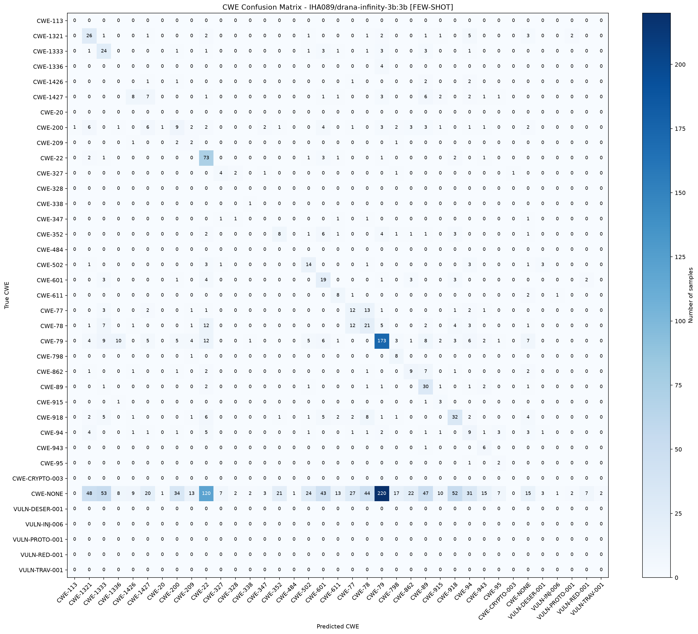

- **Prompting Mode:** `few-shot` (Few-Shot Prompting (3 Task Demos + RAG))
- **Exact CWE Accuracy:** 26.95% (515/1911) | **Macro-F1:** 26.34%
- **Binary Vulnerability Detection:** Precision: 50.27% | Recall: 97.10% | Binary F1: **66.24%** | FPR: 98.41%
- **Speed & Token Metrics:** Avg Latency: 2.94s (P95: 3.22s) | Gen Speed: **180.09 tok/s** | Prompt Eval Speed: 11683.37 tok/s | Avg Tokens (In/Out): 2453.5 / 99.7
- **Reliability:** Strict JSON Rate: 98.74% | Parse Fallback Rate: 1.26% | CWE-NONE Predictions: 43/1911 (2.25%)
- **Most frequent misclassifications:** CWE-NONE -> CWE-79 (220); CWE-NONE -> CWE-22 (120); CWE-NONE -> CWE-1333 (53); CWE-NONE -> CWE-918 (52); CWE-NONE -> CWE-1321 (48).

### Foundation-Sec-8B-Instruct — `FEW-SHOT`

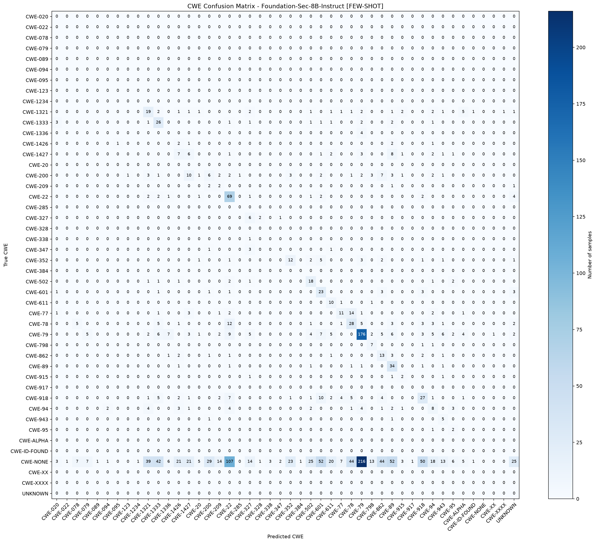

- **Prompting Mode:** `few-shot` (Few-Shot Prompting (3 Task Demos + RAG))
- **Exact CWE Accuracy:** 26.79% (512/1911) | **Macro-F1:** 25.73%
- **Binary Vulnerability Detection:** Precision: 50.24% | Recall: 98.55% | Binary F1: **66.55%** | FPR: 100.00%
- **Speed & Token Metrics:** Avg Latency: 3.99s (P95: 4.64s) | Gen Speed: **63.03 tok/s** | Prompt Eval Speed: 5565.26 tok/s | Avg Tokens (In/Out): 2205.3 / 87.1
- **Reliability:** Strict JSON Rate: 100.00% | Parse Fallback Rate: 0.00% | CWE-NONE Predictions: 0/1911 (0.00%)
- **Most frequent misclassifications:** CWE-NONE -> CWE-79 (216); CWE-NONE -> CWE-22 (107); CWE-NONE -> CWE-89 (52); CWE-NONE -> CWE-601 (52); CWE-NONE -> CWE-918 (50).

### IHA089/drana-infinity-3b:3b — `ZERO-SHOT`

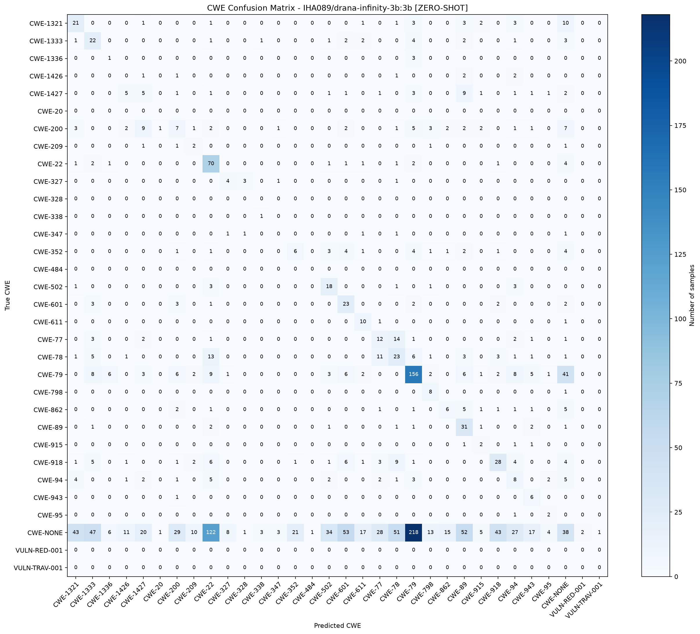

- **Prompting Mode:** `zero-shot` (Zero-Shot Prompting (0 Task Demos + RAG))
- **Exact CWE Accuracy:** 26.69% (510/1911) | **Macro-F1:** 26.23%
- **Binary Vulnerability Detection:** Precision: 49.07% | Recall: 90.28% | Binary F1: **63.58%** | FPR: 95.97%
- **Speed & Token Metrics:** Avg Latency: 2.87s (P95: 3.15s) | Gen Speed: **183.58 tok/s** | Prompt Eval Speed: 12008.24 tok/s | Avg Tokens (In/Out): 1936.8 / 99.6
- **Reliability:** Strict JSON Rate: 99.01% | Parse Fallback Rate: 0.99% | CWE-NONE Predictions: 132/1911 (6.91%)
- **Most frequent misclassifications:** CWE-NONE -> CWE-79 (218); CWE-NONE -> CWE-22 (122); CWE-NONE -> CWE-601 (53); CWE-NONE -> CWE-89 (52); CWE-NONE -> CWE-78 (51).

### llama3.1:8b — `ONE-SHOT`

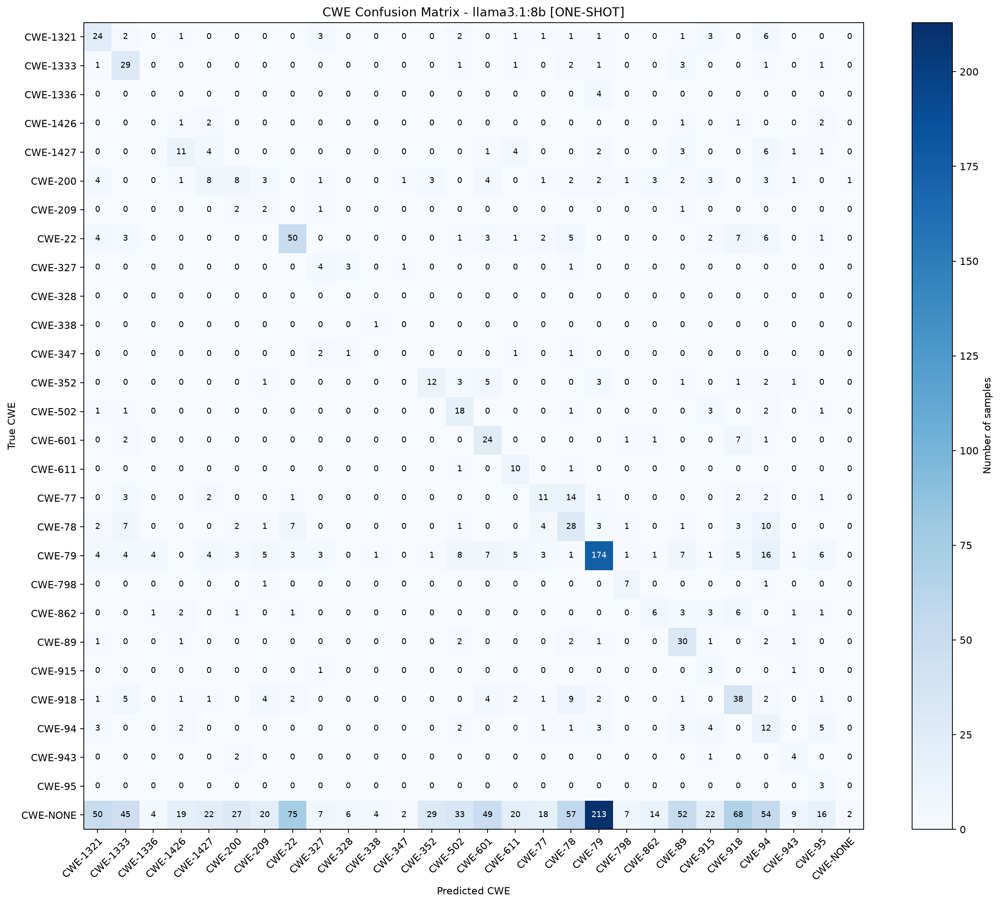

- **Prompting Mode:** `one-shot` (One-Shot Prompting (1 Task Demo + RAG))
- **Exact CWE Accuracy:** 26.43% (505/1911) | **Macro-F1:** 25.38%
- **Binary Vulnerability Detection:** Precision: 50.63% | Recall: 99.90% | Binary F1: **67.20%** | FPR: 99.79%
- **Speed & Token Metrics:** Avg Latency: 3.34s (P95: 3.67s) | Gen Speed: **100.52 tok/s** | Prompt Eval Speed: 6104.99 tok/s | Avg Tokens (In/Out): 2101.6 / 79.6
- **Reliability:** Strict JSON Rate: 99.37% | Parse Fallback Rate: 0.63% | CWE-NONE Predictions: 3/1911 (0.16%)
- **Most frequent misclassifications:** CWE-NONE -> CWE-79 (213); CWE-NONE -> CWE-22 (75); CWE-NONE -> CWE-918 (68); CWE-NONE -> CWE-78 (57); CWE-NONE -> CWE-94 (54).

### llama3.1:8b — `FEW-SHOT`

- **Prompting Mode:** `few-shot` (Few-Shot Prompting (3 Task Demos + RAG))
- **Exact CWE Accuracy:** 26.43% (505/1911) | **Macro-F1:** 25.44%
- **Binary Vulnerability Detection:** Precision: 50.52% | Recall: 99.69% | Binary F1: **67.06%** | FPR: 100.00%
- **Speed & Token Metrics:** Avg Latency: 3.36s (P95: 3.71s) | Gen Speed: **99.98 tok/s** | Prompt Eval Speed: 5889.65 tok/s | Avg Tokens (In/Out): 2415.7 / 73.0
- **Reliability:** Strict JSON Rate: 99.53% | Parse Fallback Rate: 0.47% | CWE-NONE Predictions: 3/1911 (0.16%)
- **Most frequent misclassifications:** CWE-NONE -> CWE-79 (202); CWE-NONE -> CWE-918 (72); CWE-NONE -> CWE-22 (70); CWE-NONE -> CWE-1333 (64); CWE-NONE -> CWE-601 (53).

### llama3.1:8b — `COT`

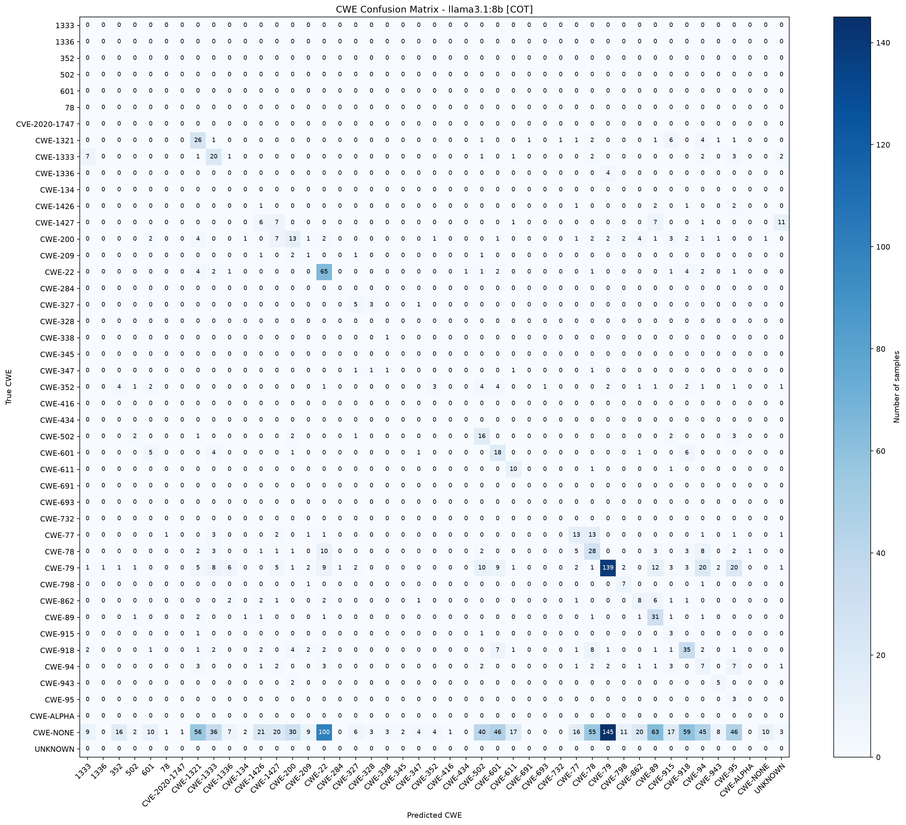

- **Prompting Mode:** `cot` (Chain-of-Thought Prompting (4-Step Audit + RAG))
- **Exact CWE Accuracy:** 24.86% (475/1911) | **Macro-F1:** 25.72%
- **Binary Vulnerability Detection:** Precision: 50.40% | Recall: 98.14% | Binary F1: **66.60%** | FPR: 98.94%
- **Speed & Token Metrics:** Avg Latency: 4.5s (P95: 5.12s) | Gen Speed: **101.41 tok/s** | Prompt Eval Speed: 6505.08 tok/s | Avg Tokens (In/Out): 2307.1 / 194.2
- **Reliability:** Strict JSON Rate: 99.90% | Parse Fallback Rate: 0.10% | CWE-NONE Predictions: 11/1911 (0.58%)
- **Most frequent misclassifications:** CWE-NONE -> CWE-79 (145); CWE-NONE -> CWE-22 (100); CWE-NONE -> CWE-89 (63); CWE-NONE -> CWE-918 (59); CWE-NONE -> CWE-1321 (56).

### IHA089/drana-infinity-3b:3b — `COT`

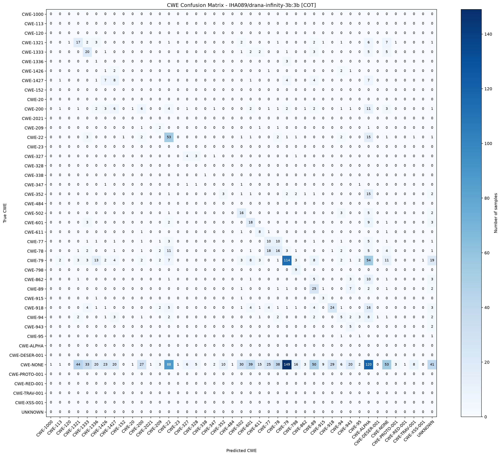

- **Prompting Mode:** `cot` (Chain-of-Thought Prompting (4-Step Audit + RAG))
- **Exact CWE Accuracy:** 22.14% (423/1911) | **Macro-F1:** 26.71%
- **Binary Vulnerability Detection:** Precision: 49.86% | Recall: 91.62% | Binary F1: **64.58%** | FPR: 94.39%
- **Speed & Token Metrics:** Avg Latency: 3.64s (P95: 4.32s) | Gen Speed: **191.11 tok/s** | Prompt Eval Speed: 12463.38 tok/s | Avg Tokens (In/Out): 2345.0 / 243.1
- **Reliability:** Strict JSON Rate: 96.70% | Parse Fallback Rate: 3.30% | CWE-NONE Predictions: 90/1911 (4.71%)
- **Most frequent misclassifications:** CWE-NONE -> CWE-79 (149); CWE-NONE -> CWE-ALPHA (120); CWE-NONE -> CWE-22 (88); CWE-79 -> CWE-ALPHA (54); CWE-NONE -> CWE-89 (50).

### Foundation-Sec-8B-Instruct — `ZERO-SHOT`

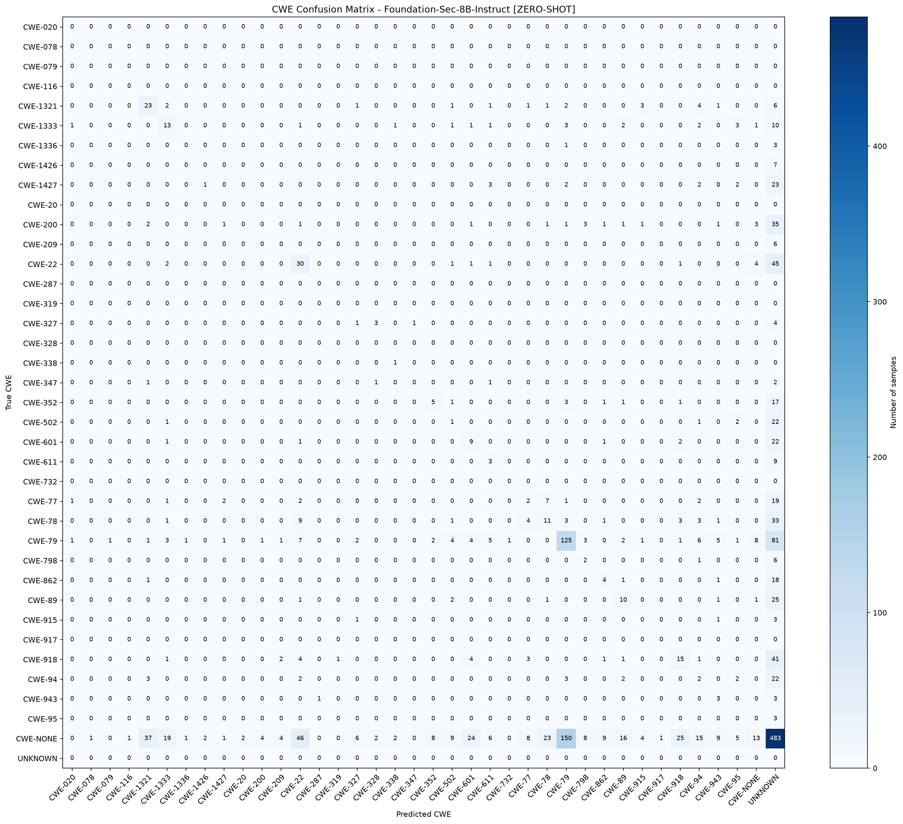

- **Prompting Mode:** `zero-shot` (Zero-Shot Prompting (0 Task Demos + RAG))
- **Exact CWE Accuracy:** 14.29% (273/1911) | **Macro-F1:** 14.99%
- **Binary Vulnerability Detection:** Precision: 34.25% | Recall: 50.16% | Binary F1: **40.70%** | FPR: 98.62%
- **Speed & Token Metrics:** Avg Latency: 4.76s (P95: 7.19s) | Gen Speed: **66.07 tok/s** | Prompt Eval Speed: 5449.79 tok/s | Avg Tokens (In/Out): 1692.5 / 149.2
- **Reliability:** Strict JSON Rate: 99.53% | Parse Fallback Rate: 0.47% | CWE-NONE Predictions: 30/1911 (1.57%)
- **Most frequent misclassifications:** CWE-NONE -> UNKNOWN (483); CWE-NONE -> CWE-79 (150); CWE-79 -> UNKNOWN (81); CWE-NONE -> CWE-22 (46); CWE-22 -> UNKNOWN (45).

