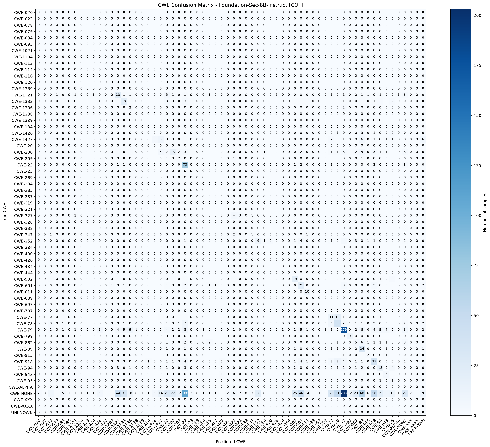

# CodeDEE Individual Evaluation Report: Foundation-Sec-8B-Instruct (COT)

- **Prompting Mode:** `cot` (Chain-of-Thought Prompting (4-Step Audit + RAG))
- **Exact CWE Accuracy:** 29.51% (564/1911) | **Macro-F1:** 29.52%
- **Binary Vulnerability Detection:** Precision: 50.35% | Recall: 96.17% | Binary F1: **66.10%** | FPR: 97.14%
- **Speed & Token Metrics:** Avg Latency: 6.24s (P95: 7.67s) | Gen Speed: **67.34 tok/s** | Prompt Eval Speed: 5613.92 tok/s | Avg Tokens (In/Out): 1974.1 / 248.3
- **Reliability:** Strict JSON Rate: 99.90% | Parse Fallback Rate: 0.10% | CWE-NONE Predictions: 51/1911 (2.67%)
- **Most frequent misclassifications:** CWE-NONE -> CWE-79 (203); CWE-NONE -> CWE-22 (108); CWE-NONE -> CWE-89 (60); CWE-NONE -> CWE-78 (51); CWE-NONE -> CWE-918 (50).

## Summary Metrics Table

| Metric | Value |
| :--- | :---: |
| **Model** | Foundation-Sec-8B-Instruct |
| **Prompting Mode** | cot |
| **Total Samples Evaluated** | 1911 |
| **Exact CWE Accuracy** | 29.51% |
| **Macro-F1 (28 CWEs)** | 29.52% |
| **Python CWE Accuracy** | 30.00% |
| **JavaScript CWE Accuracy** | 29.78% |
| **TypeScript CWE Accuracy** | 27.95% |
| **Binary Precision (Vuln vs Safe)** | 50.35% |
| **Binary Recall / TPR** | 96.17% |
| **Binary F1-Score** | 66.10% |
| **Specificity / TNR** | 2.86% |
| **False Positive Rate (FPR)** | 97.14% |
| **Avg Inference Latency (s)** | 6.24s |
| **P95 Inference Latency (s)** | 7.67s |
| **Output Generation Speed (tok/s)** | 67.34 tok/s |
| **Prompt Evaluation Speed (tok/s)** | 5613.92 tok/s |
| **Avg Input Prompt Tokens** | 1974.1 |
| **Avg Output Generated Tokens** | 248.3 |
| **Strict JSON Compliance Rate** | 99.90% |
| **JSON Parse Fallback Rate** | 0.10% |

## Confusion Matrix

