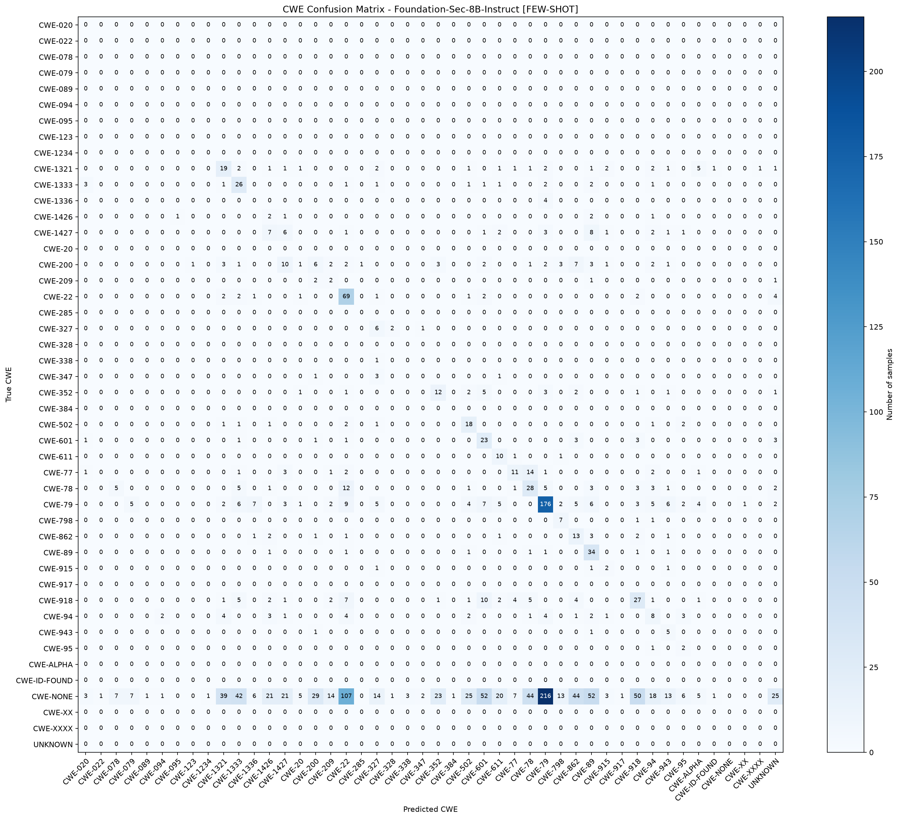

# CodeDEE Individual Evaluation Report: Foundation-Sec-8B-Instruct (FEW-SHOT)

- **Prompting Mode:** `few-shot` (Few-Shot Prompting (3 Task Demos + RAG))
- **Exact CWE Accuracy:** 26.79% (512/1911) | **Macro-F1:** 25.73%
- **Binary Vulnerability Detection:** Precision: 50.24% | Recall: 98.55% | Binary F1: **66.55%** | FPR: 100.00%
- **Speed & Token Metrics:** Avg Latency: 3.99s (P95: 4.64s) | Gen Speed: **63.03 tok/s** | Prompt Eval Speed: 5565.26 tok/s | Avg Tokens (In/Out): 2205.3 / 87.1
- **Reliability:** Strict JSON Rate: 100.00% | Parse Fallback Rate: 0.00% | CWE-NONE Predictions: 0/1911 (0.00%)
- **Most frequent misclassifications:** CWE-NONE -> CWE-79 (216); CWE-NONE -> CWE-22 (107); CWE-NONE -> CWE-89 (52); CWE-NONE -> CWE-601 (52); CWE-NONE -> CWE-918 (50).

## Summary Metrics Table

| Metric | Value |
| :--- | :---: |
| **Model** | Foundation-Sec-8B-Instruct |
| **Prompting Mode** | few-shot |
| **Total Samples Evaluated** | 1911 |
| **Exact CWE Accuracy** | 26.79% |
| **Macro-F1 (28 CWEs)** | 25.73% |
| **Python CWE Accuracy** | 27.61% |
| **JavaScript CWE Accuracy** | 28.35% |
| **TypeScript CWE Accuracy** | 21.64% |
| **Binary Precision (Vuln vs Safe)** | 50.24% |
| **Binary Recall / TPR** | 98.55% |
| **Binary F1-Score** | 66.55% |
| **Specificity / TNR** | 0.00% |
| **False Positive Rate (FPR)** | 100.00% |
| **Avg Inference Latency (s)** | 3.99s |
| **P95 Inference Latency (s)** | 4.64s |
| **Output Generation Speed (tok/s)** | 63.03 tok/s |
| **Prompt Evaluation Speed (tok/s)** | 5565.26 tok/s |
| **Avg Input Prompt Tokens** | 2205.3 |
| **Avg Output Generated Tokens** | 87.1 |
| **Strict JSON Compliance Rate** | 100.00% |
| **JSON Parse Fallback Rate** | 0.00% |

## Confusion Matrix

