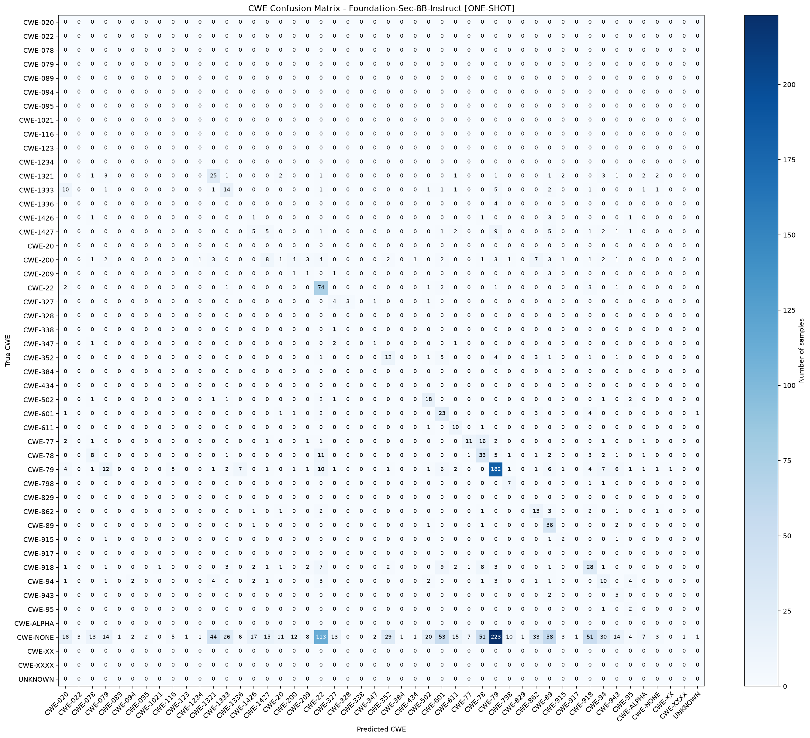

# CodeDEE Individual Evaluation Report: Foundation-Sec-8B-Instruct (ONE-SHOT)

- **Prompting Mode:** `one-shot` (One-Shot Prompting (1 Task Demo + RAG))
- **Exact CWE Accuracy:** 27.42% (524/1911) | **Macro-F1:** 27.34%
- **Binary Vulnerability Detection:** Precision: 50.53% | Recall: 99.38% | Binary F1: **66.99%** | FPR: 99.68%
- **Speed & Token Metrics:** Avg Latency: 3.9s (P95: 4.51s) | Gen Speed: **65.94 tok/s** | Prompt Eval Speed: 5587.06 tok/s | Avg Tokens (In/Out): 1893.2 / 90.4
- **Reliability:** Strict JSON Rate: 100.00% | Parse Fallback Rate: 0.00% | CWE-NONE Predictions: 8/1911 (0.42%)
- **Most frequent misclassifications:** CWE-NONE -> CWE-79 (223); CWE-NONE -> CWE-22 (113); CWE-NONE -> CWE-89 (58); CWE-NONE -> CWE-601 (53); CWE-NONE -> CWE-918 (51).

## Summary Metrics Table

| Metric | Value |
| :--- | :---: |
| **Model** | Foundation-Sec-8B-Instruct |
| **Prompting Mode** | one-shot |
| **Total Samples Evaluated** | 1911 |
| **Exact CWE Accuracy** | 27.42% |
| **Macro-F1 (28 CWEs)** | 27.34% |
| **Python CWE Accuracy** | 28.73% |
| **JavaScript CWE Accuracy** | 28.35% |
| **TypeScript CWE Accuracy** | 22.74% |
| **Binary Precision (Vuln vs Safe)** | 50.53% |
| **Binary Recall / TPR** | 99.38% |
| **Binary F1-Score** | 66.99% |
| **Specificity / TNR** | 0.32% |
| **False Positive Rate (FPR)** | 99.68% |
| **Avg Inference Latency (s)** | 3.9s |
| **P95 Inference Latency (s)** | 4.51s |
| **Output Generation Speed (tok/s)** | 65.94 tok/s |
| **Prompt Evaluation Speed (tok/s)** | 5587.06 tok/s |
| **Avg Input Prompt Tokens** | 1893.2 |
| **Avg Output Generated Tokens** | 90.4 |
| **Strict JSON Compliance Rate** | 100.00% |
| **JSON Parse Fallback Rate** | 0.00% |

## Confusion Matrix

