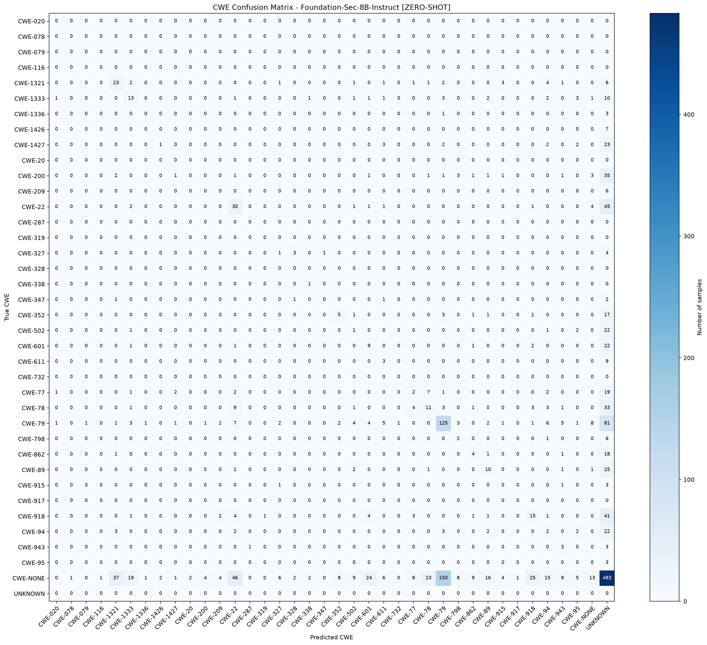

# CodeDEE Individual Evaluation Report: Foundation-Sec-8B-Instruct (ZERO-SHOT)

- **Prompting Mode:** `zero-shot` (Zero-Shot Prompting (0 Task Demos + RAG))
- **Exact CWE Accuracy:** 14.29% (273/1911) | **Macro-F1:** 14.99%
- **Binary Vulnerability Detection:** Precision: 34.25% | Recall: 50.16% | Binary F1: **40.70%** | FPR: 98.62%
- **Speed & Token Metrics:** Avg Latency: 4.76s (P95: 7.19s) | Gen Speed: **66.07 tok/s** | Prompt Eval Speed: 5449.79 tok/s | Avg Tokens (In/Out): 1692.5 / 149.2
- **Reliability:** Strict JSON Rate: 99.53% | Parse Fallback Rate: 0.47% | CWE-NONE Predictions: 30/1911 (1.57%)
- **Most frequent misclassifications:** CWE-NONE -> UNKNOWN (483); CWE-NONE -> CWE-79 (150); CWE-79 -> UNKNOWN (81); CWE-NONE -> CWE-22 (46); CWE-22 -> UNKNOWN (45).

## Summary Metrics Table

| Metric | Value |
| :--- | :---: |
| **Model** | Foundation-Sec-8B-Instruct |
| **Prompting Mode** | zero-shot |
| **Total Samples Evaluated** | 1911 |
| **Exact CWE Accuracy** | 14.29% |
| **Macro-F1 (28 CWEs)** | 14.99% |
| **Python CWE Accuracy** | 3.52% |
| **JavaScript CWE Accuracy** | 24.40% |
| **TypeScript CWE Accuracy** | 12.05% |
| **Binary Precision (Vuln vs Safe)** | 34.25% |
| **Binary Recall / TPR** | 50.16% |
| **Binary F1-Score** | 40.70% |
| **Specificity / TNR** | 1.38% |
| **False Positive Rate (FPR)** | 98.62% |
| **Avg Inference Latency (s)** | 4.76s |
| **P95 Inference Latency (s)** | 7.19s |
| **Output Generation Speed (tok/s)** | 66.07 tok/s |
| **Prompt Evaluation Speed (tok/s)** | 5449.79 tok/s |
| **Avg Input Prompt Tokens** | 1692.5 |
| **Avg Output Generated Tokens** | 149.2 |
| **Strict JSON Compliance Rate** | 99.53% |
| **JSON Parse Fallback Rate** | 0.47% |

## Confusion Matrix

