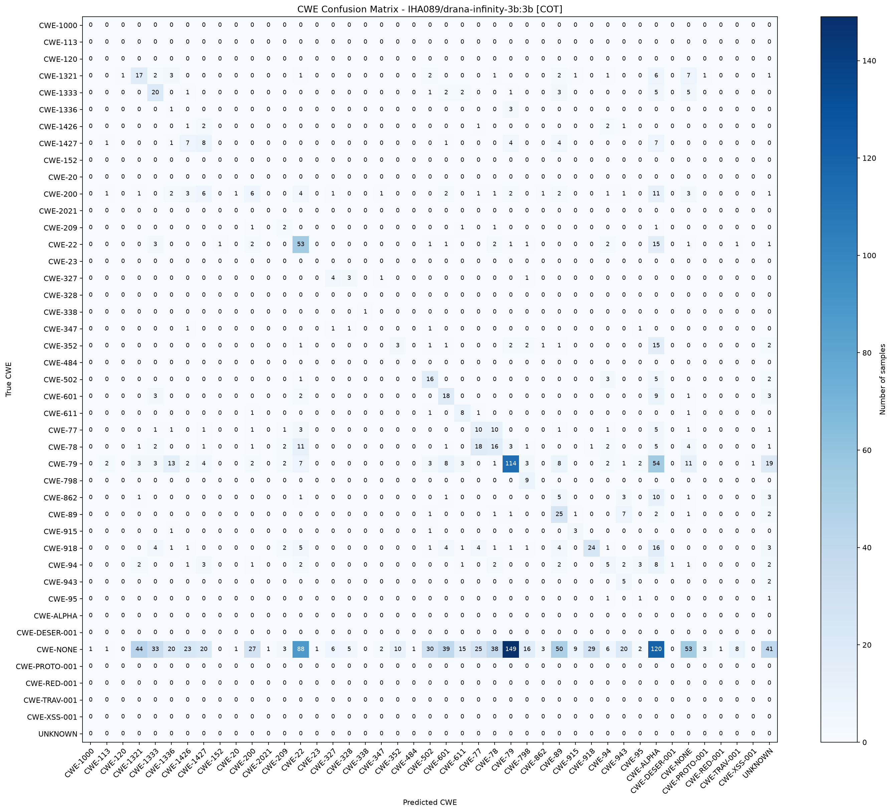

# CodeDEE Individual Evaluation Report: IHA089/drana-infinity-3b:3b (COT)

- **Prompting Mode:** `cot` (Chain-of-Thought Prompting (4-Step Audit + RAG))
- **Exact CWE Accuracy:** 22.14% (423/1911) | **Macro-F1:** 26.71%
- **Binary Vulnerability Detection:** Precision: 49.86% | Recall: 91.62% | Binary F1: **64.58%** | FPR: 94.39%
- **Speed & Token Metrics:** Avg Latency: 3.64s (P95: 4.32s) | Gen Speed: **191.11 tok/s** | Prompt Eval Speed: 12463.38 tok/s | Avg Tokens (In/Out): 2345.0 / 243.1
- **Reliability:** Strict JSON Rate: 96.70% | Parse Fallback Rate: 3.30% | CWE-NONE Predictions: 90/1911 (4.71%)
- **Most frequent misclassifications:** CWE-NONE -> CWE-79 (149); CWE-NONE -> CWE-ALPHA (120); CWE-NONE -> CWE-22 (88); CWE-79 -> CWE-ALPHA (54); CWE-NONE -> CWE-89 (50).

## Summary Metrics Table

| Metric | Value |
| :--- | :---: |
| **Model** | IHA089/drana-infinity-3b:3b |
| **Prompting Mode** | cot |
| **Total Samples Evaluated** | 1911 |
| **Exact CWE Accuracy** | 22.14% |
| **Macro-F1 (28 CWEs)** | 26.71% |
| **Python CWE Accuracy** | 20.70% |
| **JavaScript CWE Accuracy** | 23.09% |
| **TypeScript CWE Accuracy** | 22.74% |
| **Binary Precision (Vuln vs Safe)** | 49.86% |
| **Binary Recall / TPR** | 91.62% |
| **Binary F1-Score** | 64.58% |
| **Specificity / TNR** | 5.61% |
| **False Positive Rate (FPR)** | 94.39% |
| **Avg Inference Latency (s)** | 3.64s |
| **P95 Inference Latency (s)** | 4.32s |
| **Output Generation Speed (tok/s)** | 191.11 tok/s |
| **Prompt Evaluation Speed (tok/s)** | 12463.38 tok/s |
| **Avg Input Prompt Tokens** | 2345.0 |
| **Avg Output Generated Tokens** | 243.1 |
| **Strict JSON Compliance Rate** | 96.70% |
| **JSON Parse Fallback Rate** | 3.30% |

## Confusion Matrix

