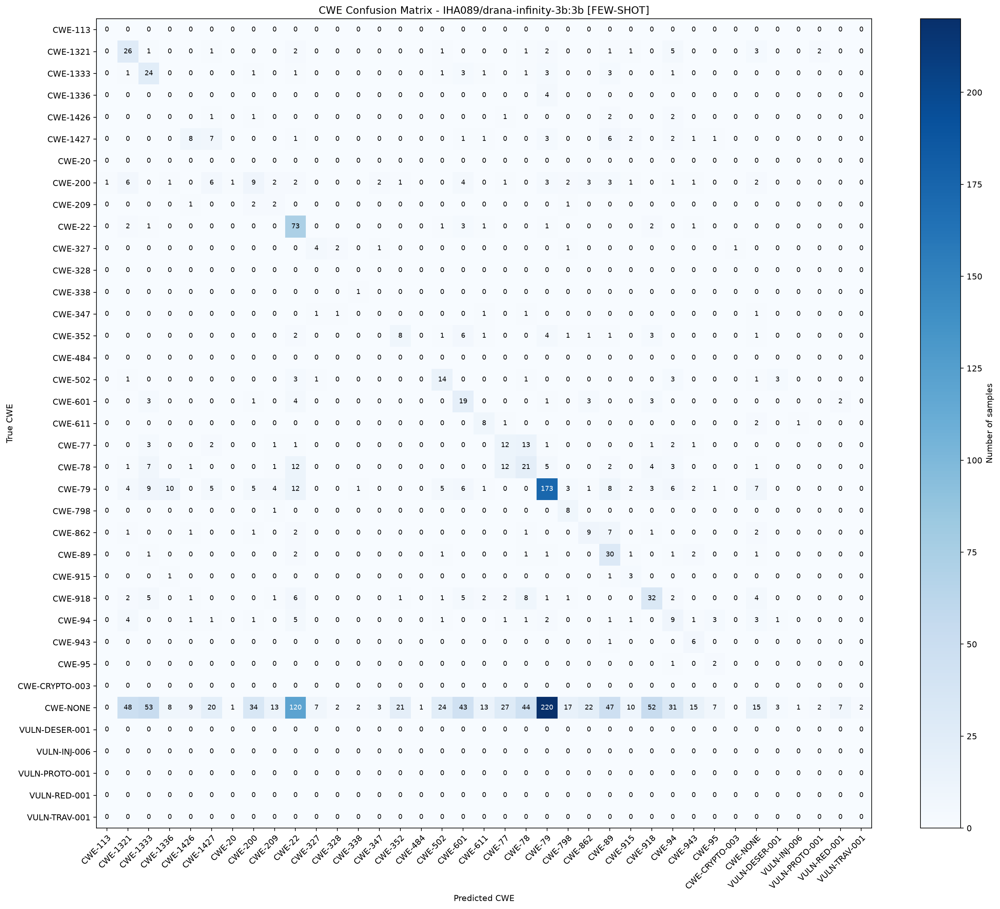

# CodeDEE Individual Evaluation Report: IHA089/drana-infinity-3b:3b (FEW-SHOT)

- **Prompting Mode:** `few-shot` (Few-Shot Prompting (3 Task Demos + RAG))
- **Exact CWE Accuracy:** 26.95% (515/1911) | **Macro-F1:** 26.34%
- **Binary Vulnerability Detection:** Precision: 50.27% | Recall: 97.10% | Binary F1: **66.24%** | FPR: 98.41%
- **Speed & Token Metrics:** Avg Latency: 2.94s (P95: 3.22s) | Gen Speed: **180.09 tok/s** | Prompt Eval Speed: 11683.37 tok/s | Avg Tokens (In/Out): 2453.5 / 99.7
- **Reliability:** Strict JSON Rate: 98.74% | Parse Fallback Rate: 1.26% | CWE-NONE Predictions: 43/1911 (2.25%)
- **Most frequent misclassifications:** CWE-NONE -> CWE-79 (220); CWE-NONE -> CWE-22 (120); CWE-NONE -> CWE-1333 (53); CWE-NONE -> CWE-918 (52); CWE-NONE -> CWE-1321 (48).

## Summary Metrics Table

| Metric | Value |
| :--- | :---: |
| **Model** | IHA089/drana-infinity-3b:3b |
| **Prompting Mode** | few-shot |
| **Total Samples Evaluated** | 1911 |
| **Exact CWE Accuracy** | 26.95% |
| **Macro-F1 (28 CWEs)** | 26.34% |
| **Python CWE Accuracy** | 26.76% |
| **JavaScript CWE Accuracy** | 28.47% |
| **TypeScript CWE Accuracy** | 23.84% |
| **Binary Precision (Vuln vs Safe)** | 50.27% |
| **Binary Recall / TPR** | 97.10% |
| **Binary F1-Score** | 66.24% |
| **Specificity / TNR** | 1.59% |
| **False Positive Rate (FPR)** | 98.41% |
| **Avg Inference Latency (s)** | 2.94s |
| **P95 Inference Latency (s)** | 3.22s |
| **Output Generation Speed (tok/s)** | 180.09 tok/s |
| **Prompt Evaluation Speed (tok/s)** | 11683.37 tok/s |
| **Avg Input Prompt Tokens** | 2453.5 |
| **Avg Output Generated Tokens** | 99.7 |
| **Strict JSON Compliance Rate** | 98.74% |
| **JSON Parse Fallback Rate** | 1.26% |

## Confusion Matrix

