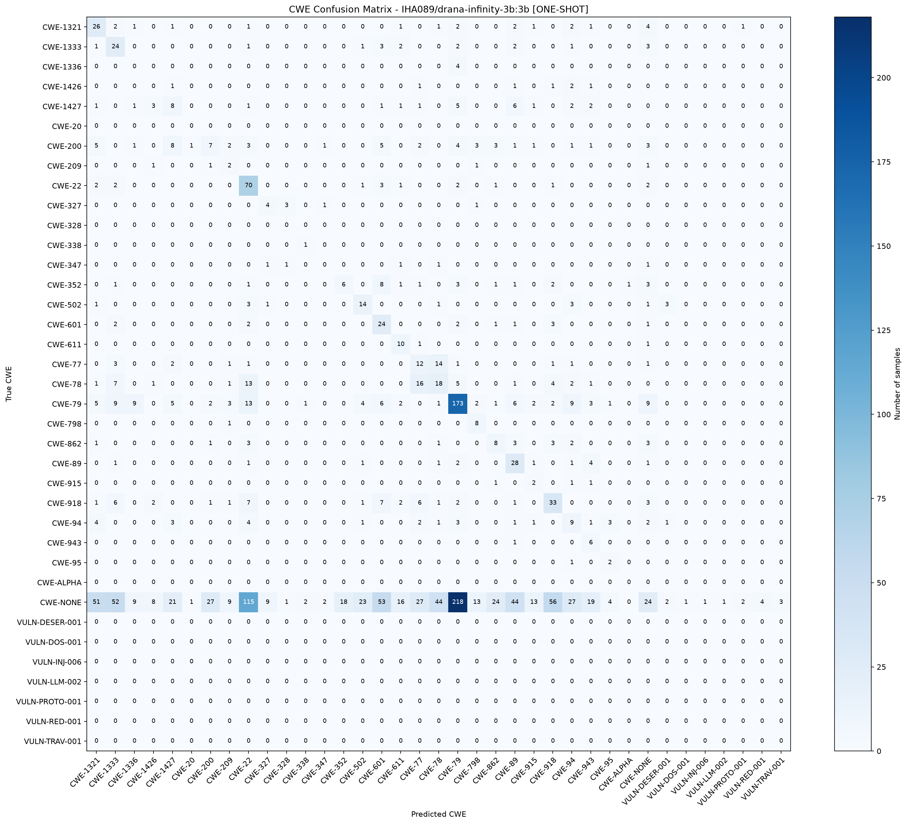

# CodeDEE Individual Evaluation Report: IHA089/drana-infinity-3b:3b (ONE-SHOT)

- **Prompting Mode:** `one-shot` (One-Shot Prompting (1 Task Demo + RAG))
- **Exact CWE Accuracy:** 27.16% (519/1911) | **Macro-F1:** 26.06%
- **Binary Vulnerability Detection:** Precision: 50.22% | Recall: 95.97% | Binary F1: **65.93%** | FPR: 97.46%
- **Speed & Token Metrics:** Avg Latency: 2.89s (P95: 3.17s) | Gen Speed: **181.25 tok/s** | Prompt Eval Speed: 11933.42 tok/s | Avg Tokens (In/Out): 2139.4 / 98.0
- **Reliability:** Strict JSON Rate: 98.95% | Parse Fallback Rate: 1.05% | CWE-NONE Predictions: 63/1911 (3.30%)
- **Most frequent misclassifications:** CWE-NONE -> CWE-79 (218); CWE-NONE -> CWE-22 (115); CWE-NONE -> CWE-918 (56); CWE-NONE -> CWE-601 (53); CWE-NONE -> CWE-1333 (52).

## Summary Metrics Table

| Metric | Value |
| :--- | :---: |
| **Model** | IHA089/drana-infinity-3b:3b |
| **Prompting Mode** | one-shot |
| **Total Samples Evaluated** | 1911 |
| **Exact CWE Accuracy** | 27.16% |
| **Macro-F1 (28 CWEs)** | 26.06% |
| **Python CWE Accuracy** | 27.04% |
| **JavaScript CWE Accuracy** | 28.71% |
| **TypeScript CWE Accuracy** | 23.84% |
| **Binary Precision (Vuln vs Safe)** | 50.22% |
| **Binary Recall / TPR** | 95.97% |
| **Binary F1-Score** | 65.93% |
| **Specificity / TNR** | 2.54% |
| **False Positive Rate (FPR)** | 97.46% |
| **Avg Inference Latency (s)** | 2.89s |
| **P95 Inference Latency (s)** | 3.17s |
| **Output Generation Speed (tok/s)** | 181.25 tok/s |
| **Prompt Evaluation Speed (tok/s)** | 11933.42 tok/s |
| **Avg Input Prompt Tokens** | 2139.4 |
| **Avg Output Generated Tokens** | 98.0 |
| **Strict JSON Compliance Rate** | 98.95% |
| **JSON Parse Fallback Rate** | 1.05% |

## Confusion Matrix

