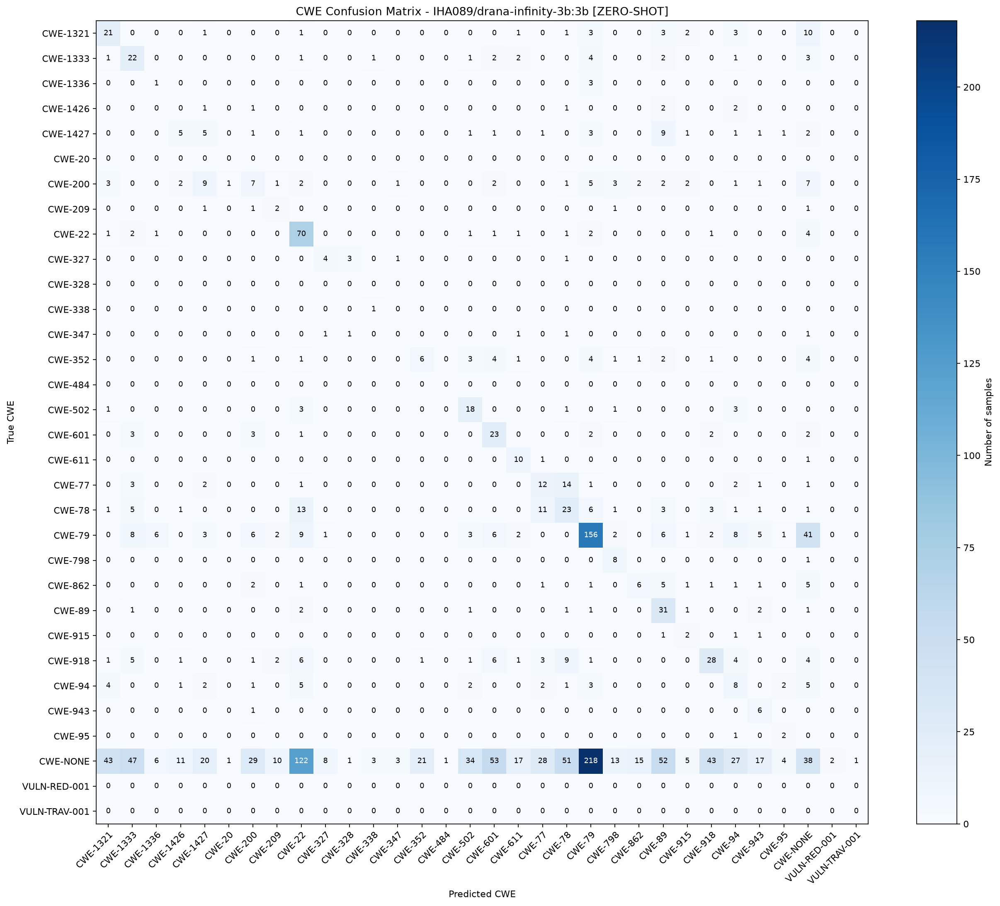

# CodeDEE Individual Evaluation Report: IHA089/drana-infinity-3b:3b (ZERO-SHOT)

- **Prompting Mode:** `zero-shot` (Zero-Shot Prompting (0 Task Demos + RAG))
- **Exact CWE Accuracy:** 26.69% (510/1911) | **Macro-F1:** 26.23%
- **Binary Vulnerability Detection:** Precision: 49.07% | Recall: 90.28% | Binary F1: **63.58%** | FPR: 95.97%
- **Speed & Token Metrics:** Avg Latency: 2.87s (P95: 3.15s) | Gen Speed: **183.58 tok/s** | Prompt Eval Speed: 12008.24 tok/s | Avg Tokens (In/Out): 1936.8 / 99.6
- **Reliability:** Strict JSON Rate: 99.01% | Parse Fallback Rate: 0.99% | CWE-NONE Predictions: 132/1911 (6.91%)
- **Most frequent misclassifications:** CWE-NONE -> CWE-79 (218); CWE-NONE -> CWE-22 (122); CWE-NONE -> CWE-601 (53); CWE-NONE -> CWE-89 (52); CWE-NONE -> CWE-78 (51).

## Summary Metrics Table

| Metric | Value |
| :--- | :---: |
| **Model** | IHA089/drana-infinity-3b:3b |
| **Prompting Mode** | zero-shot |
| **Total Samples Evaluated** | 1911 |
| **Exact CWE Accuracy** | 26.69% |
| **Macro-F1 (28 CWEs)** | 26.23% |
| **Python CWE Accuracy** | 27.61% |
| **JavaScript CWE Accuracy** | 27.75% |
| **TypeScript CWE Accuracy** | 22.47% |
| **Binary Precision (Vuln vs Safe)** | 49.07% |
| **Binary Recall / TPR** | 90.28% |
| **Binary F1-Score** | 63.58% |
| **Specificity / TNR** | 4.03% |
| **False Positive Rate (FPR)** | 95.97% |
| **Avg Inference Latency (s)** | 2.87s |
| **P95 Inference Latency (s)** | 3.15s |
| **Output Generation Speed (tok/s)** | 183.58 tok/s |
| **Prompt Evaluation Speed (tok/s)** | 12008.24 tok/s |
| **Avg Input Prompt Tokens** | 1936.8 |
| **Avg Output Generated Tokens** | 99.6 |
| **Strict JSON Compliance Rate** | 99.01% |
| **JSON Parse Fallback Rate** | 0.99% |

## Confusion Matrix

