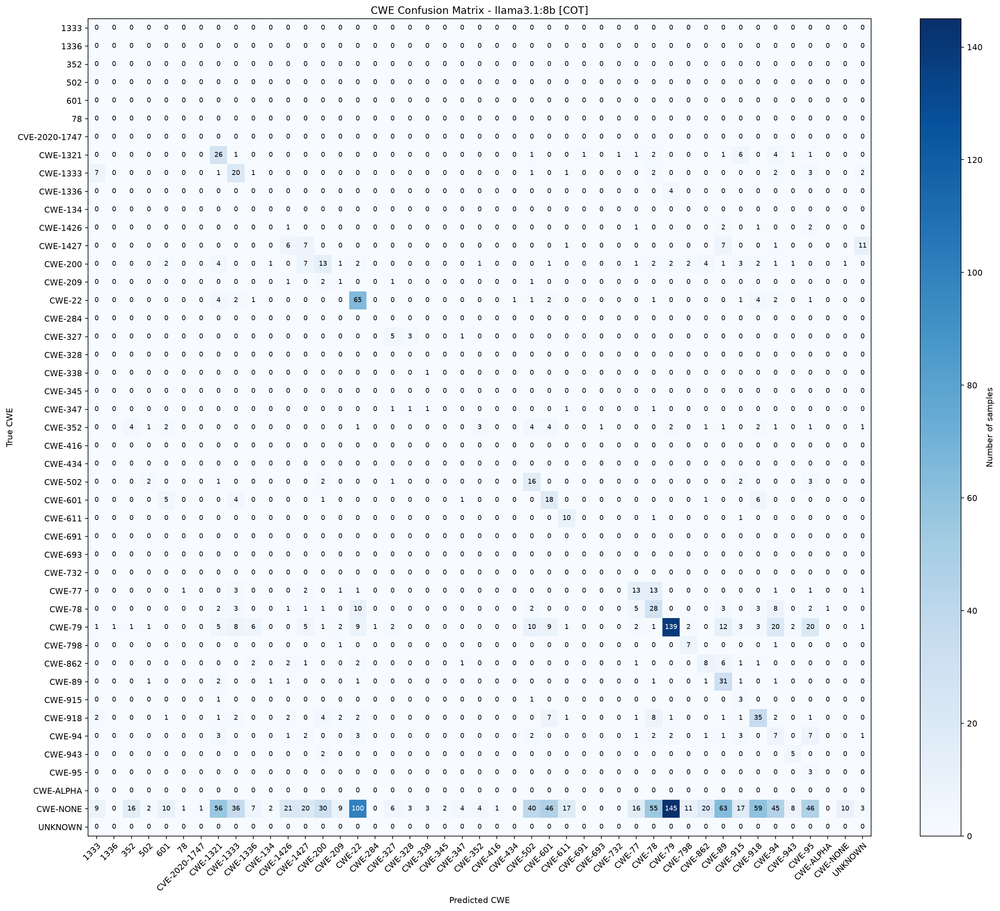

# CodeDEE Individual Evaluation Report: llama3.1:8b (COT)

- **Prompting Mode:** `cot` (Chain-of-Thought Prompting (4-Step Audit + RAG))
- **Exact CWE Accuracy:** 24.86% (475/1911) | **Macro-F1:** 25.72%
- **Binary Vulnerability Detection:** Precision: 50.40% | Recall: 98.14% | Binary F1: **66.60%** | FPR: 98.94%
- **Speed & Token Metrics:** Avg Latency: 4.5s (P95: 5.12s) | Gen Speed: **101.41 tok/s** | Prompt Eval Speed: 6505.08 tok/s | Avg Tokens (In/Out): 2307.1 / 194.2
- **Reliability:** Strict JSON Rate: 99.90% | Parse Fallback Rate: 0.10% | CWE-NONE Predictions: 11/1911 (0.58%)
- **Most frequent misclassifications:** CWE-NONE -> CWE-79 (145); CWE-NONE -> CWE-22 (100); CWE-NONE -> CWE-89 (63); CWE-NONE -> CWE-918 (59); CWE-NONE -> CWE-1321 (56).

## Summary Metrics Table

| Metric | Value |
| :--- | :---: |
| **Model** | llama3.1:8b |
| **Prompting Mode** | cot |
| **Total Samples Evaluated** | 1911 |
| **Exact CWE Accuracy** | 24.86% |
| **Macro-F1 (28 CWEs)** | 25.72% |
| **Python CWE Accuracy** | 26.06% |
| **JavaScript CWE Accuracy** | 25.24% |
| **TypeScript CWE Accuracy** | 21.64% |
| **Binary Precision (Vuln vs Safe)** | 50.40% |
| **Binary Recall / TPR** | 98.14% |
| **Binary F1-Score** | 66.60% |
| **Specificity / TNR** | 1.06% |
| **False Positive Rate (FPR)** | 98.94% |
| **Avg Inference Latency (s)** | 4.5s |
| **P95 Inference Latency (s)** | 5.12s |
| **Output Generation Speed (tok/s)** | 101.41 tok/s |
| **Prompt Evaluation Speed (tok/s)** | 6505.08 tok/s |
| **Avg Input Prompt Tokens** | 2307.1 |
| **Avg Output Generated Tokens** | 194.2 |
| **Strict JSON Compliance Rate** | 99.90% |
| **JSON Parse Fallback Rate** | 0.10% |

## Confusion Matrix

