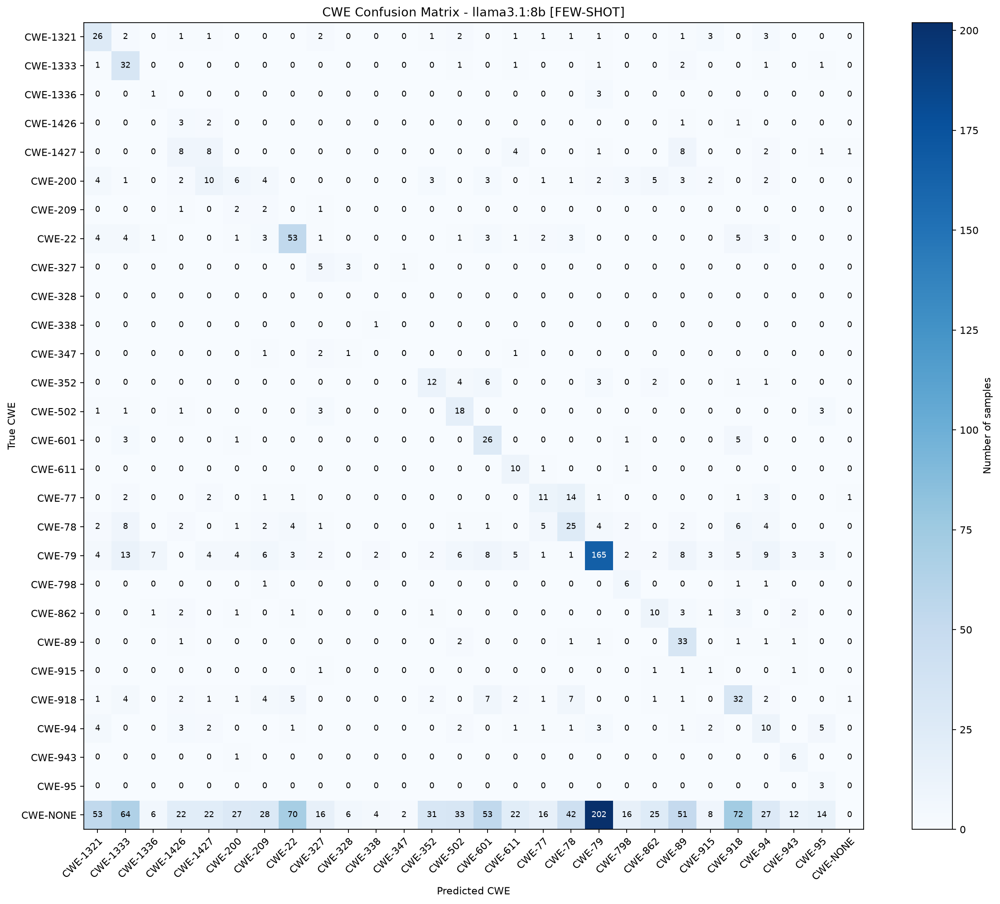

# CodeDEE Individual Evaluation Report: llama3.1:8b (FEW-SHOT)

- **Prompting Mode:** `few-shot` (Few-Shot Prompting (3 Task Demos + RAG))
- **Exact CWE Accuracy:** 26.43% (505/1911) | **Macro-F1:** 25.44%
- **Binary Vulnerability Detection:** Precision: 50.52% | Recall: 99.69% | Binary F1: **67.06%** | FPR: 100.00%
- **Speed & Token Metrics:** Avg Latency: 3.36s (P95: 3.71s) | Gen Speed: **99.98 tok/s** | Prompt Eval Speed: 5889.65 tok/s | Avg Tokens (In/Out): 2415.7 / 73.0
- **Reliability:** Strict JSON Rate: 99.53% | Parse Fallback Rate: 0.47% | CWE-NONE Predictions: 3/1911 (0.16%)
- **Most frequent misclassifications:** CWE-NONE -> CWE-79 (202); CWE-NONE -> CWE-918 (72); CWE-NONE -> CWE-22 (70); CWE-NONE -> CWE-1333 (64); CWE-NONE -> CWE-601 (53).

## Summary Metrics Table

| Metric | Value |
| :--- | :---: |
| **Model** | llama3.1:8b |
| **Prompting Mode** | few-shot |
| **Total Samples Evaluated** | 1911 |
| **Exact CWE Accuracy** | 26.43% |
| **Macro-F1 (28 CWEs)** | 25.44% |
| **Python CWE Accuracy** | 26.76% |
| **JavaScript CWE Accuracy** | 28.11% |
| **TypeScript CWE Accuracy** | 21.92% |
| **Binary Precision (Vuln vs Safe)** | 50.52% |
| **Binary Recall / TPR** | 99.69% |
| **Binary F1-Score** | 67.06% |
| **Specificity / TNR** | 0.00% |
| **False Positive Rate (FPR)** | 100.00% |
| **Avg Inference Latency (s)** | 3.36s |
| **P95 Inference Latency (s)** | 3.71s |
| **Output Generation Speed (tok/s)** | 99.98 tok/s |
| **Prompt Evaluation Speed (tok/s)** | 5889.65 tok/s |
| **Avg Input Prompt Tokens** | 2415.7 |
| **Avg Output Generated Tokens** | 73.0 |
| **Strict JSON Compliance Rate** | 99.53% |
| **JSON Parse Fallback Rate** | 0.47% |

## Confusion Matrix

