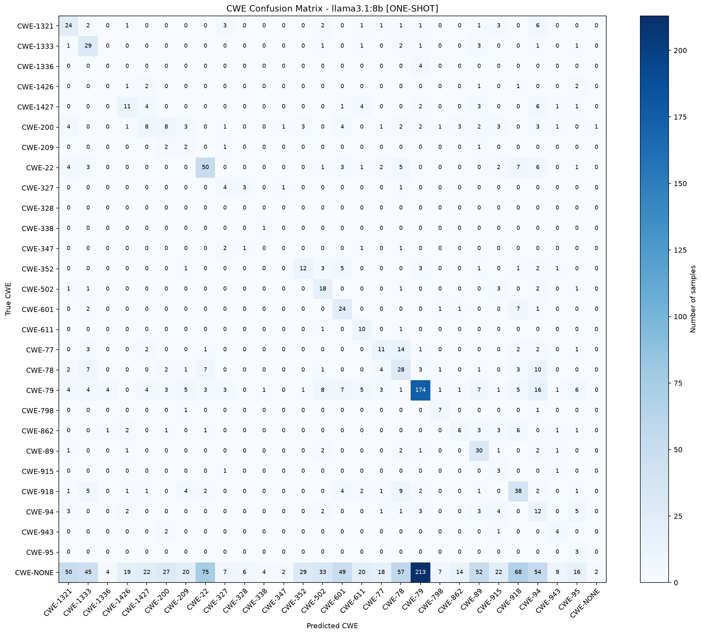

# CodeDEE Individual Evaluation Report: llama3.1:8b (ONE-SHOT)

- **Prompting Mode:** `one-shot` (One-Shot Prompting (1 Task Demo + RAG))
- **Exact CWE Accuracy:** 26.43% (505/1911) | **Macro-F1:** 25.38%
- **Binary Vulnerability Detection:** Precision: 50.63% | Recall: 99.90% | Binary F1: **67.20%** | FPR: 99.79%
- **Speed & Token Metrics:** Avg Latency: 3.34s (P95: 3.67s) | Gen Speed: **100.52 tok/s** | Prompt Eval Speed: 6104.99 tok/s | Avg Tokens (In/Out): 2101.6 / 79.6
- **Reliability:** Strict JSON Rate: 99.37% | Parse Fallback Rate: 0.63% | CWE-NONE Predictions: 3/1911 (0.16%)
- **Most frequent misclassifications:** CWE-NONE -> CWE-79 (213); CWE-NONE -> CWE-22 (75); CWE-NONE -> CWE-918 (68); CWE-NONE -> CWE-78 (57); CWE-NONE -> CWE-94 (54).

## Summary Metrics Table

| Metric | Value |
| :--- | :---: |
| **Model** | llama3.1:8b |
| **Prompting Mode** | one-shot |
| **Total Samples Evaluated** | 1911 |
| **Exact CWE Accuracy** | 26.43% |
| **Macro-F1 (28 CWEs)** | 25.38% |
| **Python CWE Accuracy** | 26.34% |
| **JavaScript CWE Accuracy** | 27.99% |
| **TypeScript CWE Accuracy** | 23.01% |
| **Binary Precision (Vuln vs Safe)** | 50.63% |
| **Binary Recall / TPR** | 99.90% |
| **Binary F1-Score** | 67.20% |
| **Specificity / TNR** | 0.21% |
| **False Positive Rate (FPR)** | 99.79% |
| **Avg Inference Latency (s)** | 3.34s |
| **P95 Inference Latency (s)** | 3.67s |
| **Output Generation Speed (tok/s)** | 100.52 tok/s |
| **Prompt Evaluation Speed (tok/s)** | 6104.99 tok/s |
| **Avg Input Prompt Tokens** | 2101.6 |
| **Avg Output Generated Tokens** | 79.6 |
| **Strict JSON Compliance Rate** | 99.37% |
| **JSON Parse Fallback Rate** | 0.63% |

## Confusion Matrix

