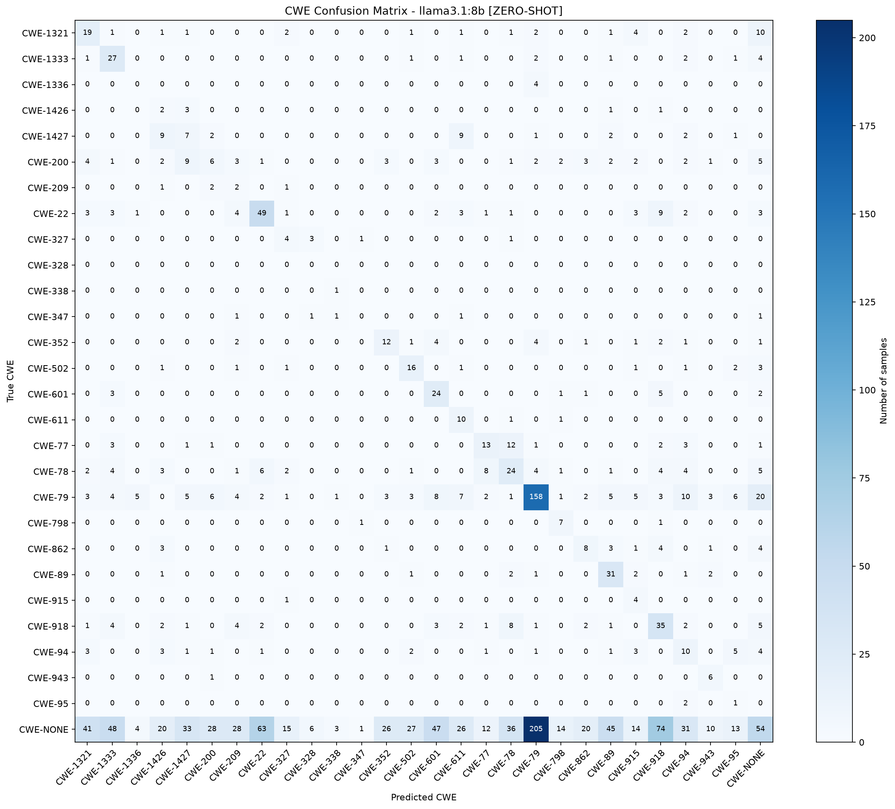

# CodeDEE Individual Evaluation Report: llama3.1:8b (ZERO-SHOT)

- **Prompting Mode:** `zero-shot` (Zero-Shot Prompting (0 Task Demos + RAG))
- **Exact CWE Accuracy:** 27.73% (530/1911) | **Macro-F1:** 25.74%
- **Binary Vulnerability Detection:** Precision: 50.25% | Recall: 92.97% | Binary F1: **65.24%** | FPR: 94.28%
- **Speed & Token Metrics:** Avg Latency: 3.43s (P95: 3.9s) | Gen Speed: **101.47 tok/s** | Prompt Eval Speed: 6516.2 tok/s | Avg Tokens (In/Out): 1903.1 / 94.7
- **Reliability:** Strict JSON Rate: 99.79% | Parse Fallback Rate: 0.21% | CWE-NONE Predictions: 122/1911 (6.38%)
- **Most frequent misclassifications:** CWE-NONE -> CWE-79 (205); CWE-NONE -> CWE-918 (74); CWE-NONE -> CWE-22 (63); CWE-NONE -> CWE-1333 (48); CWE-NONE -> CWE-601 (47).

## Summary Metrics Table

| Metric | Value |
| :--- | :---: |
| **Model** | llama3.1:8b |
| **Prompting Mode** | zero-shot |
| **Total Samples Evaluated** | 1911 |
| **Exact CWE Accuracy** | 27.73% |
| **Macro-F1 (28 CWEs)** | 25.74% |
| **Python CWE Accuracy** | 28.03% |
| **JavaScript CWE Accuracy** | 28.23% |
| **TypeScript CWE Accuracy** | 26.03% |
| **Binary Precision (Vuln vs Safe)** | 50.25% |
| **Binary Recall / TPR** | 92.97% |
| **Binary F1-Score** | 65.24% |
| **Specificity / TNR** | 5.72% |
| **False Positive Rate (FPR)** | 94.28% |
| **Avg Inference Latency (s)** | 3.43s |
| **P95 Inference Latency (s)** | 3.9s |
| **Output Generation Speed (tok/s)** | 101.47 tok/s |
| **Prompt Evaluation Speed (tok/s)** | 6516.2 tok/s |
| **Avg Input Prompt Tokens** | 1903.1 |
| **Avg Output Generated Tokens** | 94.7 |
| **Strict JSON Compliance Rate** | 99.79% |
| **JSON Parse Fallback Rate** | 0.21% |

## Confusion Matrix

