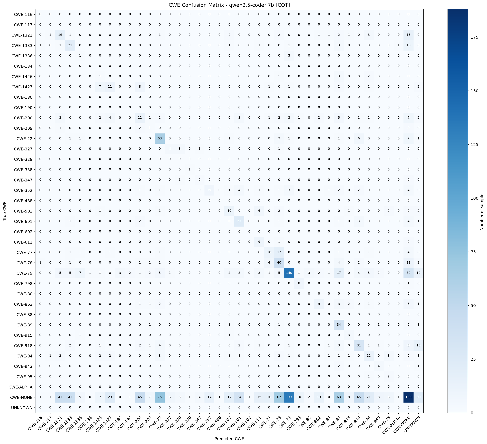

# CodeDEE Individual Evaluation Report: qwen2.5-coder:7b (COT)

- **Prompting Mode:** `cot` (Chain-of-Thought Prompting (4-Step Audit + RAG))
- **Exact CWE Accuracy:** 34.75% (664/1911) | **Macro-F1:** 33.28%
- **Binary Vulnerability Detection:** Precision: 51.60% | Recall: 83.35% | Binary F1: **63.74%** | FPR: 80.08%
- **Speed & Token Metrics:** Avg Latency: 4.92s (P95: 5.99s) | Gen Speed: **108.4 tok/s** | Prompt Eval Speed: 6880.87 tok/s | Avg Tokens (In/Out): 2345.0 / 259.3
- **Reliability:** Strict JSON Rate: 98.85% | Parse Fallback Rate: 1.15% | CWE-NONE Predictions: 308/1911 (16.12%)
- **Most frequent misclassifications:** CWE-NONE -> CWE-79 (133); CWE-NONE -> CWE-22 (75); CWE-NONE -> CWE-78 (67); CWE-NONE -> CWE-89 (63); CWE-NONE -> CWE-918 (45).

## Summary Metrics Table

| Metric | Value |
| :--- | :---: |
| **Model** | qwen2.5-coder:7b |
| **Prompting Mode** | cot |
| **Total Samples Evaluated** | 1911 |
| **Exact CWE Accuracy** | 34.75% |
| **Macro-F1 (28 CWEs)** | 33.28% |
| **Python CWE Accuracy** | 35.07% |
| **JavaScript CWE Accuracy** | 35.05% |
| **TypeScript CWE Accuracy** | 33.42% |
| **Binary Precision (Vuln vs Safe)** | 51.60% |
| **Binary Recall / TPR** | 83.35% |
| **Binary F1-Score** | 63.74% |
| **Specificity / TNR** | 19.92% |
| **False Positive Rate (FPR)** | 80.08% |
| **Avg Inference Latency (s)** | 4.92s |
| **P95 Inference Latency (s)** | 5.99s |
| **Output Generation Speed (tok/s)** | 108.4 tok/s |
| **Prompt Evaluation Speed (tok/s)** | 6880.87 tok/s |
| **Avg Input Prompt Tokens** | 2345.0 |
| **Avg Output Generated Tokens** | 259.3 |
| **Strict JSON Compliance Rate** | 98.85% |
| **JSON Parse Fallback Rate** | 1.15% |

## Confusion Matrix

