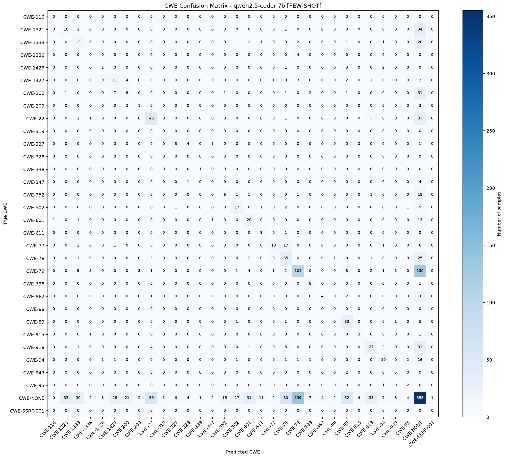

# CodeDEE Individual Evaluation Report: qwen2.5-coder:7b (FEW-SHOT)

- **Prompting Mode:** `few-shot` (Few-Shot Prompting (3 Task Demos + RAG))
- **Exact CWE Accuracy:** 38.78% (741/1911) | **Macro-F1:** 33.89%
- **Binary Vulnerability Detection:** Precision: 49.05% | Recall: 58.63% | Binary F1: **53.41%** | FPR: 62.39%
- **Speed & Token Metrics:** Avg Latency: 3.31s (P95: 3.67s) | Gen Speed: **108.42 tok/s** | Prompt Eval Speed: 6588.96 tok/s | Avg Tokens (In/Out): 2453.5 / 79.8
- **Reliability:** Strict JSON Rate: 99.63% | Parse Fallback Rate: 0.37% | CWE-NONE Predictions: 755/1911 (39.51%)
- **Most frequent misclassifications:** CWE-NONE -> CWE-79 (139); CWE-79 -> CWE-NONE (130); CWE-NONE -> CWE-78 (60); CWE-NONE -> CWE-22 (59); CWE-NONE -> CWE-89 (52).

## Summary Metrics Table

| Metric | Value |
| :--- | :---: |
| **Model** | qwen2.5-coder:7b |
| **Prompting Mode** | few-shot |
| **Total Samples Evaluated** | 1911 |
| **Exact CWE Accuracy** | 38.78% |
| **Macro-F1 (28 CWEs)** | 33.89% |
| **Python CWE Accuracy** | 40.28% |
| **JavaScript CWE Accuracy** | 35.41% |
| **TypeScript CWE Accuracy** | 43.56% |
| **Binary Precision (Vuln vs Safe)** | 49.05% |
| **Binary Recall / TPR** | 58.63% |
| **Binary F1-Score** | 53.41% |
| **Specificity / TNR** | 37.61% |
| **False Positive Rate (FPR)** | 62.39% |
| **Avg Inference Latency (s)** | 3.31s |
| **P95 Inference Latency (s)** | 3.67s |
| **Output Generation Speed (tok/s)** | 108.42 tok/s |
| **Prompt Evaluation Speed (tok/s)** | 6588.96 tok/s |
| **Avg Input Prompt Tokens** | 2453.5 |
| **Avg Output Generated Tokens** | 79.8 |
| **Strict JSON Compliance Rate** | 99.63% |
| **JSON Parse Fallback Rate** | 0.37% |

## Confusion Matrix

