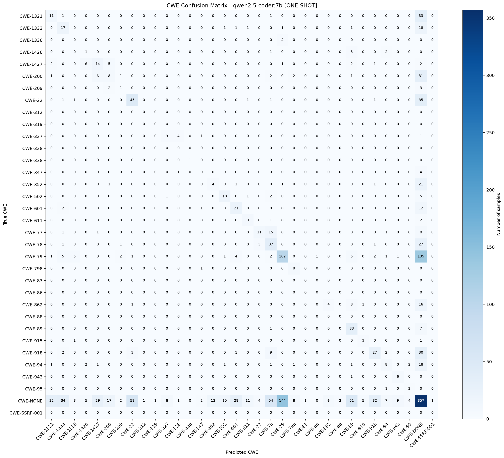

# CodeDEE Individual Evaluation Report: qwen2.5-coder:7b (ONE-SHOT)

- **Prompting Mode:** `one-shot` (One-Shot Prompting (1 Task Demo + RAG))
- **Exact CWE Accuracy:** 39.30% (751/1911) | **Macro-F1:** 35.77%
- **Binary Vulnerability Detection:** Precision: 48.73% | Recall: 57.70% | Binary F1: **52.84%** | FPR: 62.18%
- **Speed & Token Metrics:** Avg Latency: 3.28s (P95: 3.67s) | Gen Speed: **109.37 tok/s** | Prompt Eval Speed: 6792.11 tok/s | Avg Tokens (In/Out): 2139.4 / 86.3
- **Reliability:** Strict JSON Rate: 99.74% | Parse Fallback Rate: 0.26% | CWE-NONE Predictions: 766/1911 (40.08%)
- **Most frequent misclassifications:** CWE-NONE -> CWE-79 (144); CWE-79 -> CWE-NONE (135); CWE-NONE -> CWE-22 (58); CWE-NONE -> CWE-78 (54); CWE-NONE -> CWE-89 (51).

## Summary Metrics Table

| Metric | Value |
| :--- | :---: |
| **Model** | qwen2.5-coder:7b |
| **Prompting Mode** | one-shot |
| **Total Samples Evaluated** | 1911 |
| **Exact CWE Accuracy** | 39.30% |
| **Macro-F1 (28 CWEs)** | 35.77% |
| **Python CWE Accuracy** | 41.69% |
| **JavaScript CWE Accuracy** | 35.29% |
| **TypeScript CWE Accuracy** | 43.84% |
| **Binary Precision (Vuln vs Safe)** | 48.73% |
| **Binary Recall / TPR** | 57.70% |
| **Binary F1-Score** | 52.84% |
| **Specificity / TNR** | 37.82% |
| **False Positive Rate (FPR)** | 62.18% |
| **Avg Inference Latency (s)** | 3.28s |
| **P95 Inference Latency (s)** | 3.67s |
| **Output Generation Speed (tok/s)** | 109.37 tok/s |
| **Prompt Evaluation Speed (tok/s)** | 6792.11 tok/s |
| **Avg Input Prompt Tokens** | 2139.4 |
| **Avg Output Generated Tokens** | 86.3 |
| **Strict JSON Compliance Rate** | 99.74% |
| **JSON Parse Fallback Rate** | 0.26% |

## Confusion Matrix

