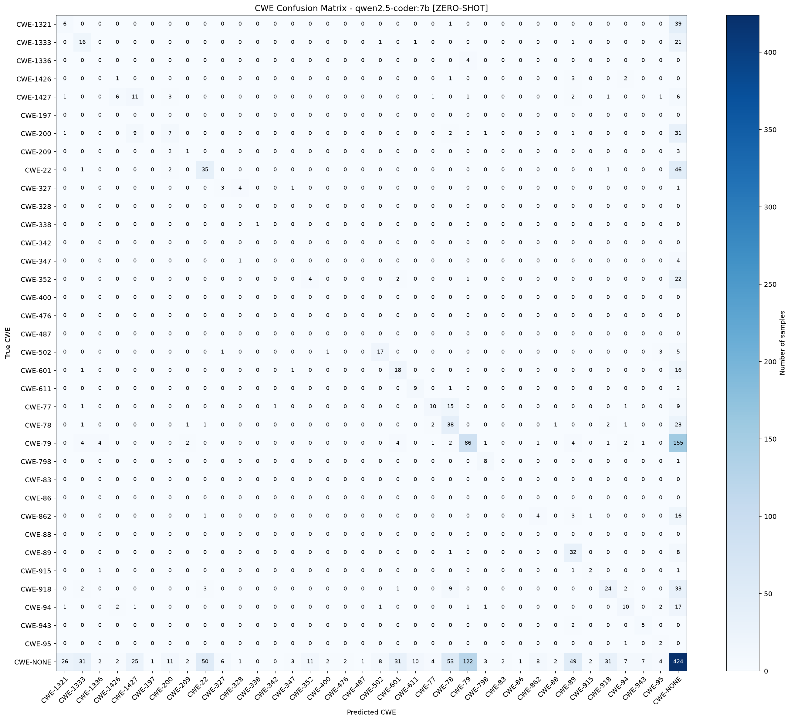

# CodeDEE Individual Evaluation Report: qwen2.5-coder:7b (ZERO-SHOT)

- **Prompting Mode:** `zero-shot` (Zero-Shot Prompting (0 Task Demos + RAG))
- **Exact CWE Accuracy:** 40.50% (774/1911) | **Macro-F1:** 35.14%
- **Binary Vulnerability Detection:** Precision: 49.42% | Recall: 52.53% | Binary F1: **50.93%** | FPR: 55.08%
- **Speed & Token Metrics:** Avg Latency: 3.25s (P95: 3.67s) | Gen Speed: **110.36 tok/s** | Prompt Eval Speed: 6932.52 tok/s | Avg Tokens (In/Out): 1936.8 / 88.0
- **Reliability:** Strict JSON Rate: 99.79% | Parse Fallback Rate: 0.21% | CWE-NONE Predictions: 883/1911 (46.21%)
- **Most frequent misclassifications:** CWE-79 -> CWE-NONE (155); CWE-NONE -> CWE-79 (122); CWE-NONE -> CWE-78 (53); CWE-NONE -> CWE-22 (50); CWE-NONE -> CWE-89 (49).

## Summary Metrics Table

| Metric | Value |
| :--- | :---: |
| **Model** | qwen2.5-coder:7b |
| **Prompting Mode** | zero-shot |
| **Total Samples Evaluated** | 1911 |
| **Exact CWE Accuracy** | 40.50% |
| **Macro-F1 (28 CWEs)** | 35.14% |
| **Python CWE Accuracy** | 41.83% |
| **JavaScript CWE Accuracy** | 36.96% |
| **TypeScript CWE Accuracy** | 46.03% |
| **Binary Precision (Vuln vs Safe)** | 49.42% |
| **Binary Recall / TPR** | 52.53% |
| **Binary F1-Score** | 50.93% |
| **Specificity / TNR** | 44.92% |
| **False Positive Rate (FPR)** | 55.08% |
| **Avg Inference Latency (s)** | 3.25s |
| **P95 Inference Latency (s)** | 3.67s |
| **Output Generation Speed (tok/s)** | 110.36 tok/s |
| **Prompt Evaluation Speed (tok/s)** | 6932.52 tok/s |
| **Avg Input Prompt Tokens** | 1936.8 |
| **Avg Output Generated Tokens** | 88.0 |
| **Strict JSON Compliance Rate** | 99.79% |
| **JSON Parse Fallback Rate** | 0.21% |

## Confusion Matrix

