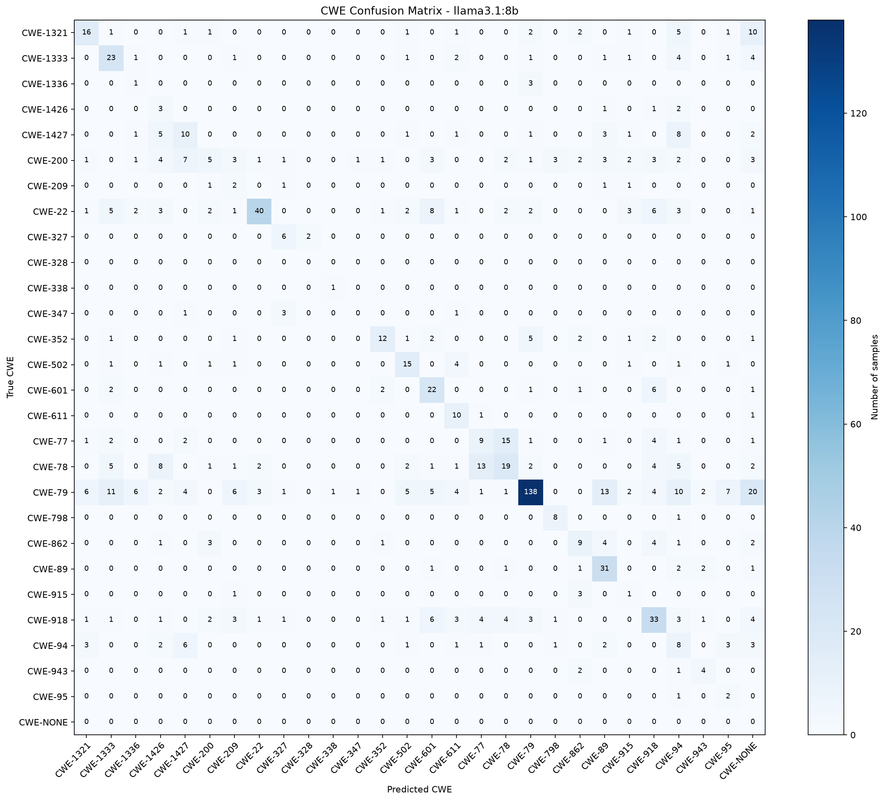
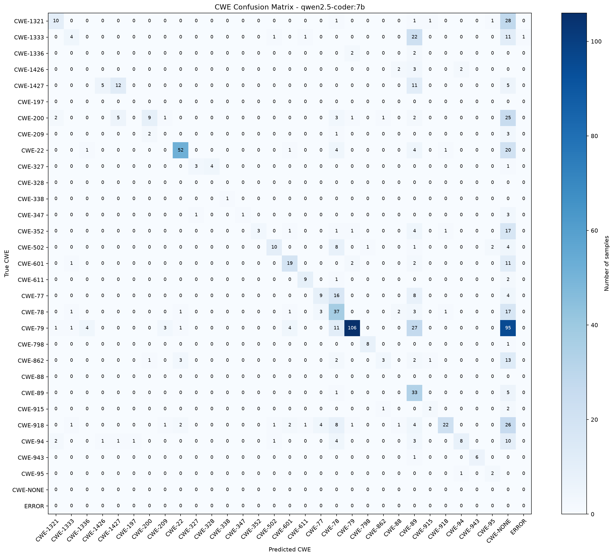
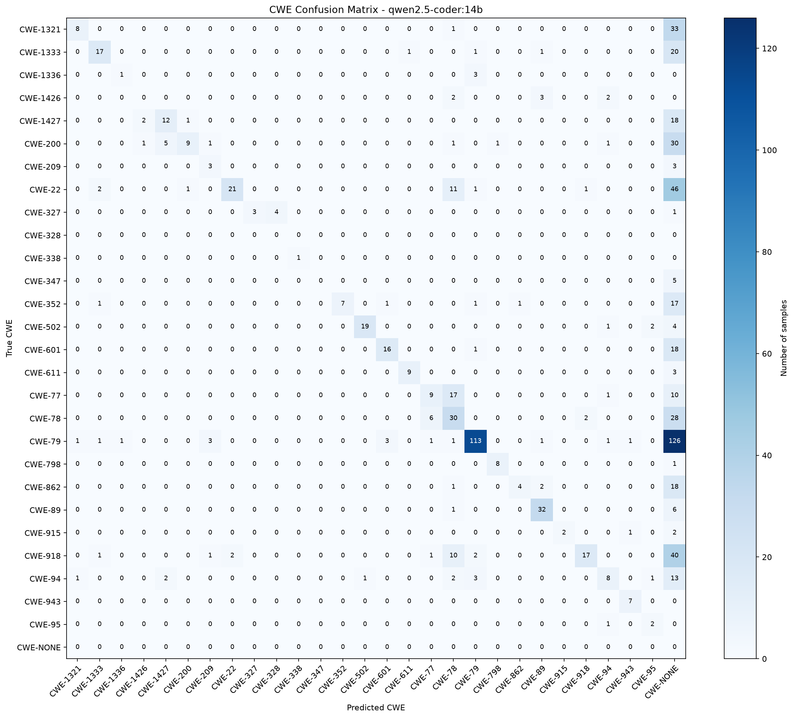
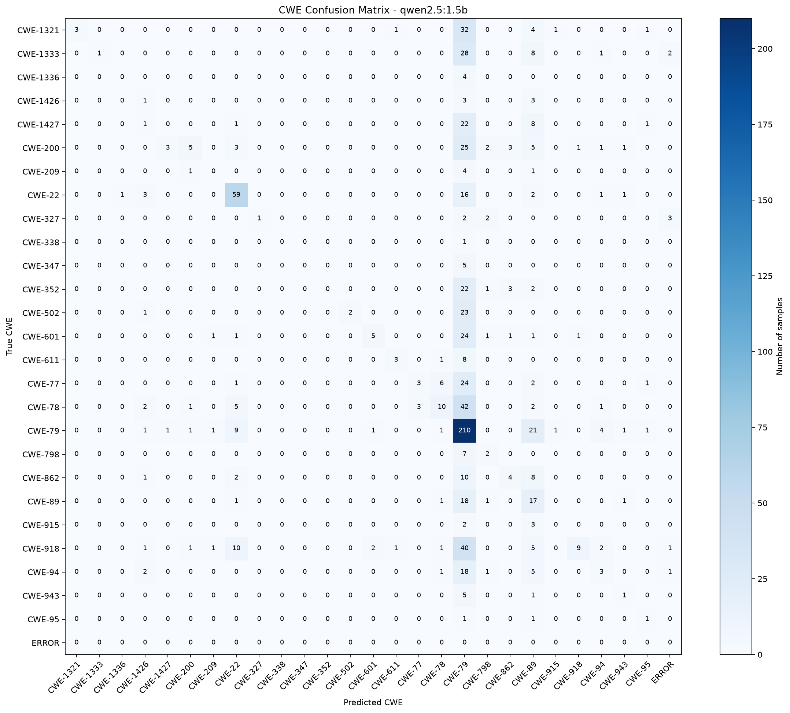
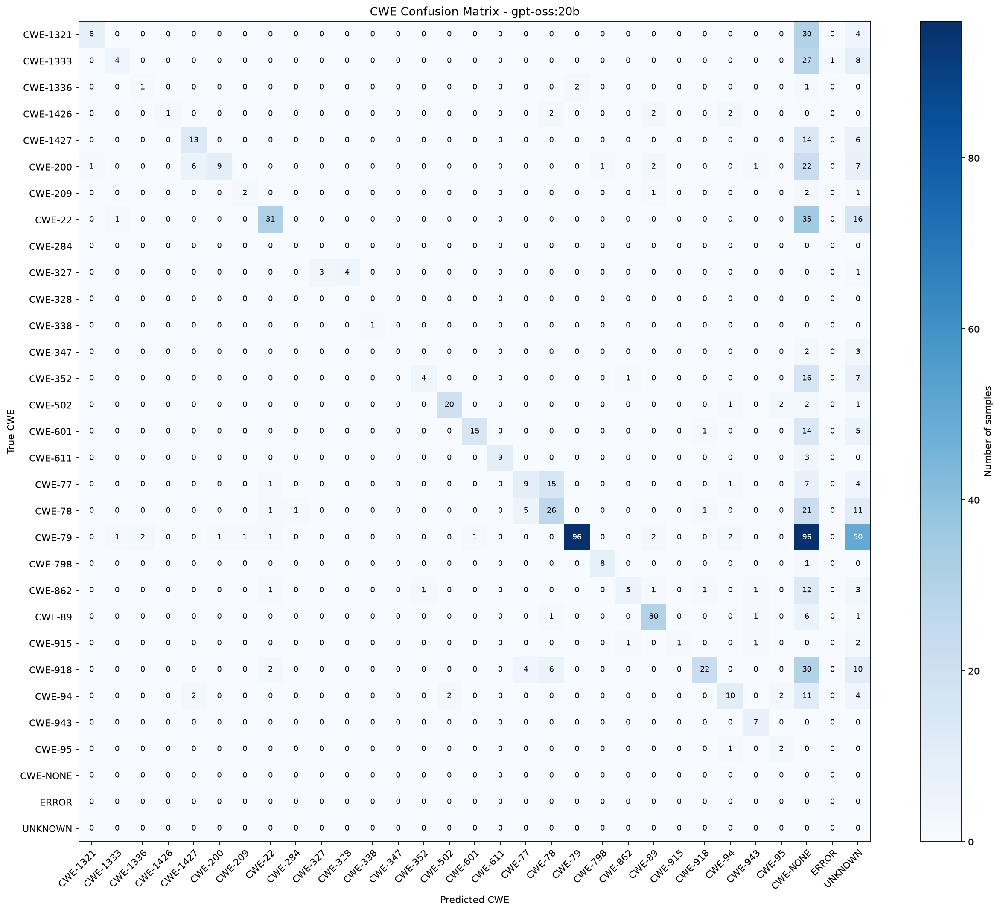
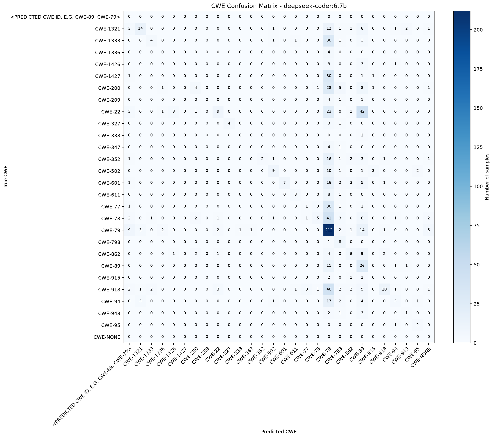
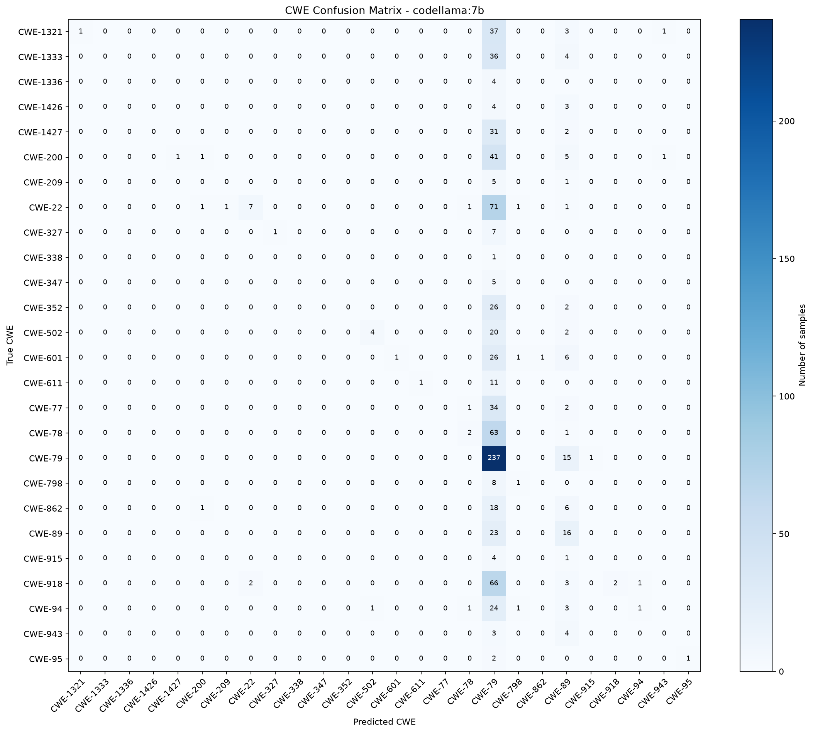
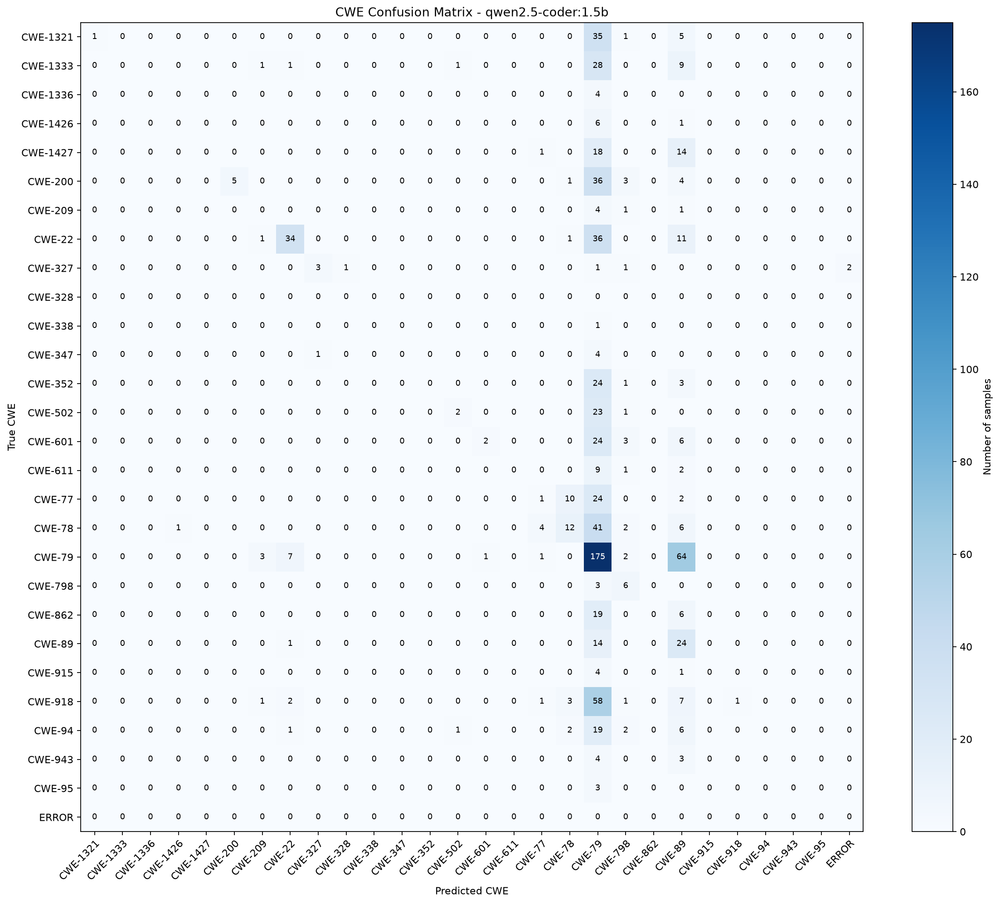

# CodeDEE: Full-Scale Vulnerability Detection Benchmark

- **Dataset Scale:** Cleaned & Normalized Dataset (928 Samples)
- **RAG Engine:** ChromaDB Vector Store with Few-Shot Code Pairs
- **Hardware Environment:** Intel Core Ultra 9 275HX, NVIDIA RTX 5080 Laptop GPU (16 GB VRAM)
- **Inference Platform:** Ollama (Windows 11 Enterprise x64)

## 🏆 Overall Performance Leaderboard

| Model Name | Overall Accuracy | Python Acc | JavaScript Acc | TypeScript Acc | Avg Latency (s) | Speed (tok/s) |
| :--- | :---: | :---: | :---: | :---: | :---: | :---: |
| **qwen2.5-coder:32b** | **47.09%** | 51.59% | 44.67% | 43.82% | 17.42s | 6.82 |
| **llama3.1:8b** | **46.12%** | 48.41% | 48.39% | 36.52% | 3.54s | 34.39 |
| **qwen2.5-coder:7b** | **39.76%** | 44.96% | 35.98% | 38.20% | 3.37s | 34.01 |
| **qwen2.5-coder:14b** | **38.58%** | 42.36% | 37.47% | 33.71% | 4.8s | 26.78 |
| **qwen2.5:1.5b** | **36.64%** | 32.28% | 43.67% | 29.21% | 2.69s | 45.99 |
| **gpt-oss:20b** | **36.31%** | 44.09% | 31.27% | 32.58% | 7.46s | 88.85 |
| **deepseek-coder:6.7b** | **35.56%** | 30.55% | 42.43% | 29.78% | 3.83s | 31.21 |
| **codellama:7b** | **29.74%** | 20.75% | 41.94% | 19.66% | 3.92s | 36.44 |
| **qwen2.5-coder:1.5b** | **28.66%** | 26.22% | 34.74% | 19.66% | 2.72s | 49.56 |

## Confusion Matrices and Findings

The classifier may answer `CWE-NONE` when source-to-sink analysis finds no exploitable vulnerability. It is not a fallback for uncertainty. Since this benchmark contains vulnerability-labeled records, a `CWE-NONE` prediction is counted as incorrect unless a verified safe record is present.

### qwen2.5-coder:32b

- **Accuracy:** 47.09% (437/928).
- **CWE-NONE predictions:** 348/928 (37.50%). Because the benchmark labels are vulnerability records, these count as incorrect unless the dataset contains a verified safe sample.
- **Most frequent misclassifications:** CWE-79 -> CWE-NONE (96); CWE-918 -> CWE-NONE (31); CWE-1321 -> CWE-NONE (31); CWE-22 -> CWE-NONE (29); CWE-1333 -> CWE-NONE (28).

### llama3.1:8b

- **Accuracy:** 46.12% (428/928).
- **CWE-NONE predictions:** 56/928 (6.03%). Because the benchmark labels are vulnerability records, these count as incorrect unless the dataset contains a verified safe sample.
- **Most frequent misclassifications:** CWE-79 -> CWE-NONE (20); CWE-77 -> CWE-78 (15); CWE-78 -> CWE-77 (13); CWE-79 -> CWE-89 (13); CWE-79 -> CWE-1333 (11).

### qwen2.5-coder:7b

- **Accuracy:** 39.76% (369/928).
- **CWE-NONE predictions:** 303/928 (32.65%). Because the benchmark labels are vulnerability records, these count as incorrect unless the dataset contains a verified safe sample.
- **Most frequent misclassifications:** CWE-79 -> CWE-NONE (95); CWE-1321 -> CWE-NONE (28); CWE-79 -> CWE-89 (27); CWE-918 -> CWE-NONE (26); CWE-200 -> CWE-NONE (25).

### qwen2.5-coder:14b

- **Accuracy:** 38.58% (358/928).
- **CWE-NONE predictions:** 442/928 (47.63%). Because the benchmark labels are vulnerability records, these count as incorrect unless the dataset contains a verified safe sample.
- **Most frequent misclassifications:** CWE-79 -> CWE-NONE (126); CWE-22 -> CWE-NONE (46); CWE-918 -> CWE-NONE (40); CWE-1321 -> CWE-NONE (33); CWE-200 -> CWE-NONE (30).

### qwen2.5:1.5b

- **Accuracy:** 36.64% (340/928).
- **CWE-NONE predictions:** 0/928 (0.00%). Because the benchmark labels are vulnerability records, these count as incorrect unless the dataset contains a verified safe sample.
- **Most frequent misclassifications:** CWE-78 -> CWE-79 (42); CWE-918 -> CWE-79 (40); CWE-1321 -> CWE-79 (32); CWE-1333 -> CWE-79 (28); CWE-200 -> CWE-79 (25).

### gpt-oss:20b

- **Accuracy:** 36.31% (337/928).
- **CWE-NONE predictions:** 352/928 (37.93%). Because the benchmark labels are vulnerability records, these count as incorrect unless the dataset contains a verified safe sample.
- **Most frequent misclassifications:** CWE-79 -> CWE-NONE (96); CWE-79 -> UNKNOWN (50); CWE-22 -> CWE-NONE (35); CWE-918 -> CWE-NONE (30); CWE-1321 -> CWE-NONE (30).

### deepseek-coder:6.7b

- **Accuracy:** 35.56% (330/928).
- **CWE-NONE predictions:** 11/928 (1.19%). Because the benchmark labels are vulnerability records, these count as incorrect unless the dataset contains a verified safe sample.
- **Most frequent misclassifications:** CWE-22 -> CWE-89 (42); CWE-78 -> CWE-79 (41); CWE-918 -> CWE-79 (40); CWE-77 -> CWE-79 (30); CWE-1427 -> CWE-79 (30).

### codellama:7b

- **Accuracy:** 29.74% (276/928).
- **CWE-NONE predictions:** 0/928 (0.00%). Because the benchmark labels are vulnerability records, these count as incorrect unless the dataset contains a verified safe sample.
- **Most frequent misclassifications:** CWE-22 -> CWE-79 (71); CWE-918 -> CWE-79 (66); CWE-78 -> CWE-79 (63); CWE-200 -> CWE-79 (41); CWE-1321 -> CWE-79 (37).

### qwen2.5-coder:1.5b

- **Accuracy:** 28.66% (266/928).
- **CWE-NONE predictions:** 0/928 (0.00%). Because the benchmark labels are vulnerability records, these count as incorrect unless the dataset contains a verified safe sample.
- **Most frequent misclassifications:** CWE-79 -> CWE-89 (64); CWE-918 -> CWE-79 (58); CWE-78 -> CWE-79 (41); CWE-22 -> CWE-79 (36); CWE-200 -> CWE-79 (36).

