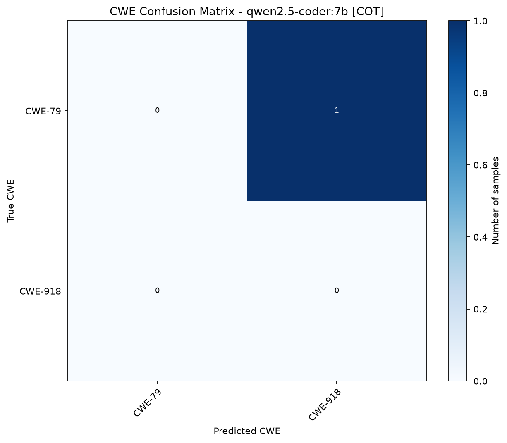
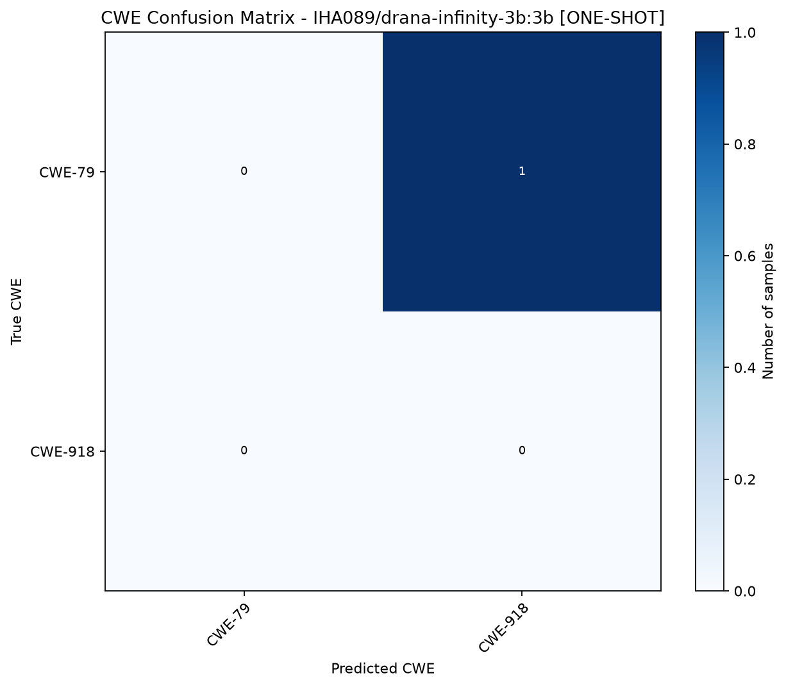
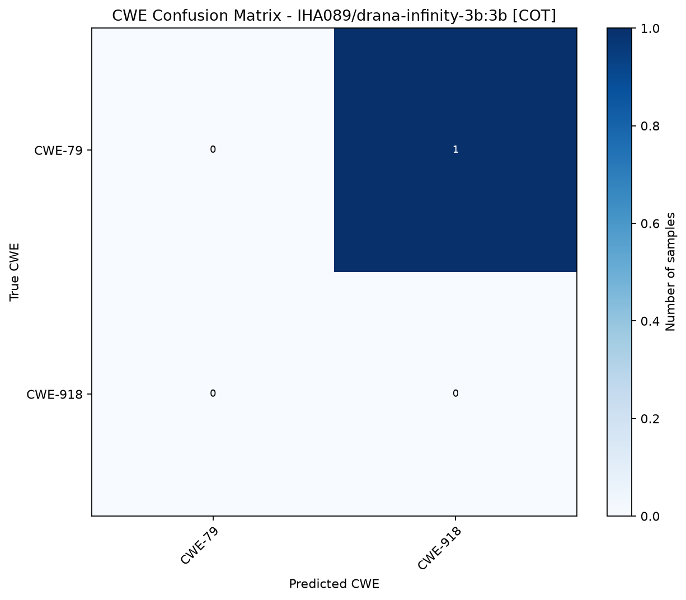

# CodeDEE: Full-Scale Multi-Prompt & Multi-Model Evaluation Report

- **Dataset Evaluated:** `v4` (1 Samples per run)
- **RAG Retrieval:** ChromaDB Vector Store (`top_k=5`, 500-char KB snippets, separated from prompt demonstrations)
- **Prompting Modes Evaluated:** `zero-shot`, `one-shot`, `few-shot`, `cot`
- **Models Evaluated:** 2 Models (8 total Model × Prompt runs)
- **Hardware Environment:** Intel Core Ultra 9 275HX, NVIDIA GeForce RTX 5080 Laptop GPU (16 GB VRAM)
- **Inference Platform:** Ollama (`num_ctx=8192`, `temperature=0.1`, `top_p=0.9`)

## 1. Prompting Paradigm Comparison Matrix (Model × Prompt Mode)

Comparison of **Exact CWE Accuracy (Macro-F1)** and **Generation Speed (tok/s)** across prompting strategies:

| Model | ZERO-SHOT Acc (Macro-F1) | ONE-SHOT Acc (Macro-F1) | FEW-SHOT Acc (Macro-F1) | COT Acc (Macro-F1) | Best Mode | Avg Speed (tok/s) |
| :--- | :---: | :---: | :---: | :---: | :---: | :---: |
| **IHA089/drana-infinity-3b:3b** | 0.00% (0.00%) | 0.00% (0.00%) | 0.00% (0.00%) | 0.00% (0.00%) | `zero-shot` (0.00%) | 181.93 |
| **qwen2.5-coder:7b** | 0.00% (0.00%) | 0.00% (0.00%) | 0.00% (0.00%) | 0.00% (0.00%) | `zero-shot` (0.00%) | 99.28 |

## 2. Master Performance Leaderboard (All Model × Prompt Combinations)

| Rank | Model | Prompt Mode | Exact CWE Acc | Macro-F1 | Binary F1 | Binary Prec / Rec | FPR | Py / JS / TS Acc | Avg Lat (P95) | Gen Speed (tok/s) | Prompt Speed (tok/s) | Avg Tokens (In/Out) | Fallback Rate |
| :---: | :--- | :---: | :---: | :---: | :---: | :---: | :---: | :---: | :---: | :---: | :---: | :---: | :---: |
| 1 | **qwen2.5-coder:7b** | `zero-shot` | **0.00%** | 0.00% | 100.00% | 100.00% / 100.00% | N/A (Vuln-Only) | 0.00% / 0.00% / 0.00% | 9.47s (9.47s) | **97.6** | 3788.14 | 2682.0 / 85.0 | 0.00% |
| 2 | **qwen2.5-coder:7b** | `one-shot` | **0.00%** | 0.00% | 100.00% | 100.00% / 100.00% | N/A (Vuln-Only) | 0.00% / 0.00% / 0.00% | 3.26s (3.26s) | **99.83** | 7590.11 | 2885.0 / 71.0 | 0.00% |
| 3 | **qwen2.5-coder:7b** | `few-shot` | **0.00%** | 0.00% | 100.00% | 100.00% / 100.00% | N/A (Vuln-Only) | 0.00% / 0.00% / 0.00% | 3.3s (3.3s) | **99.45** | 7197.12 | 3202.0 / 67.0 | 0.00% |
| 4 | **qwen2.5-coder:7b** | `cot` | **0.00%** | 0.00% | 100.00% | 100.00% / 100.00% | N/A (Vuln-Only) | 0.00% / 0.00% / 0.00% | 4.81s (4.81s) | **100.22** | 5012.16 | 3091.0 / 196.0 | 0.00% |
| 5 | **IHA089/drana-infinity-3b:3b** | `zero-shot` | **0.00%** | 0.00% | 100.00% | 100.00% / 100.00% | N/A (Vuln-Only) | 0.00% / 0.00% / 0.00% | 5.6s (5.6s) | **160.68** | 7028.3 | 2682.0 / 64.0 | 0.00% |
| 6 | **IHA089/drana-infinity-3b:3b** | `one-shot` | **0.00%** | 0.00% | 100.00% | 100.00% / 100.00% | N/A (Vuln-Only) | 0.00% / 0.00% / 0.00% | 2.65s (2.65s) | **198.16** | 14940.45 | 2885.0 / 69.0 | 0.00% |
| 7 | **IHA089/drana-infinity-3b:3b** | `few-shot` | **0.00%** | 0.00% | 100.00% | 100.00% / 100.00% | N/A (Vuln-Only) | 0.00% / 0.00% / 0.00% | 2.73s (2.73s) | **188.52** | 12869.77 | 3202.0 / 65.0 | 0.00% |
| 8 | **IHA089/drana-infinity-3b:3b** | `cot` | **0.00%** | 0.00% | 100.00% | 100.00% / 100.00% | N/A (Vuln-Only) | 0.00% / 0.00% / 0.00% | 3.71s (3.71s) | **180.35** | 9540.12 | 3091.0 / 225.0 | 0.00% |

## 3. Sub-Leaderboards by Prompting Paradigm

### 3.1 `ZERO-SHOT` — Zero-Shot Prompting (0 Task Demos + RAG)

| Model | Exact CWE Acc | Macro-F1 | Binary F1 | Python Acc | JS Acc | TS Acc | Avg Latency (P95) | Gen Speed (tok/s) | Fallback Rate |
| :--- | :---: | :---: | :---: | :---: | :---: | :---: | :---: | :---: | :---: |
| **qwen2.5-coder:7b** | **0.00%** | 0.00% | 100.00% | 0.00% | 0.00% | 0.00% | 9.47s (9.47s) | **97.6** | 0.00% |
| **IHA089/drana-infinity-3b:3b** | **0.00%** | 0.00% | 100.00% | 0.00% | 0.00% | 0.00% | 5.6s (5.6s) | **160.68** | 0.00% |

### 3.2 `ONE-SHOT` — One-Shot Prompting (1 Task Demo + RAG)

| Model | Exact CWE Acc | Macro-F1 | Binary F1 | Python Acc | JS Acc | TS Acc | Avg Latency (P95) | Gen Speed (tok/s) | Fallback Rate |
| :--- | :---: | :---: | :---: | :---: | :---: | :---: | :---: | :---: | :---: |
| **qwen2.5-coder:7b** | **0.00%** | 0.00% | 100.00% | 0.00% | 0.00% | 0.00% | 3.26s (3.26s) | **99.83** | 0.00% |
| **IHA089/drana-infinity-3b:3b** | **0.00%** | 0.00% | 100.00% | 0.00% | 0.00% | 0.00% | 2.65s (2.65s) | **198.16** | 0.00% |

### 3.3 `FEW-SHOT` — Few-Shot Prompting (3 Task Demos + RAG)

| Model | Exact CWE Acc | Macro-F1 | Binary F1 | Python Acc | JS Acc | TS Acc | Avg Latency (P95) | Gen Speed (tok/s) | Fallback Rate |
| :--- | :---: | :---: | :---: | :---: | :---: | :---: | :---: | :---: | :---: |
| **qwen2.5-coder:7b** | **0.00%** | 0.00% | 100.00% | 0.00% | 0.00% | 0.00% | 3.3s (3.3s) | **99.45** | 0.00% |
| **IHA089/drana-infinity-3b:3b** | **0.00%** | 0.00% | 100.00% | 0.00% | 0.00% | 0.00% | 2.73s (2.73s) | **188.52** | 0.00% |

### 3.4 `COT` — Chain-of-Thought Prompting (4-Step Audit + RAG)

| Model | Exact CWE Acc | Macro-F1 | Binary F1 | Python Acc | JS Acc | TS Acc | Avg Latency (P95) | Gen Speed (tok/s) | Fallback Rate |
| :--- | :---: | :---: | :---: | :---: | :---: | :---: | :---: | :---: | :---: |
| **qwen2.5-coder:7b** | **0.00%** | 0.00% | 100.00% | 0.00% | 0.00% | 0.00% | 4.81s (4.81s) | **100.22** | 0.00% |
| **IHA089/drana-infinity-3b:3b** | **0.00%** | 0.00% | 100.00% | 0.00% | 0.00% | 0.00% | 3.71s (3.71s) | **180.35** | 0.00% |

## 4. Per-(Model, Prompt) Confusion Matrices & Diagnostic Findings

### qwen2.5-coder:7b — `ZERO-SHOT`

- **Prompting Mode:** `zero-shot` (Zero-Shot Prompting (0 Task Demos + RAG))
- **Exact CWE Accuracy:** 0.00% (0/1) | **Macro-F1:** 0.00%
- **Binary Vulnerability Detection:** Precision: 100.00% | Recall: 100.00% | Binary F1: **100.00%** | FPR: N/A (Vuln-Only)
- **Speed & Token Metrics:** Avg Latency: 9.47s (P95: 9.47s) | Gen Speed: **97.6 tok/s** | Prompt Eval Speed: 3788.14 tok/s | Avg Tokens (In/Out): 2682.0 / 85.0
- **Reliability:** Strict JSON Rate: 100.00% | Parse Fallback Rate: 0.00% | CWE-NONE Predictions: 0/1 (0.00%)
- **Most frequent misclassifications:** CWE-79 -> CWE-918 (1).

### qwen2.5-coder:7b — `ONE-SHOT`

- **Prompting Mode:** `one-shot` (One-Shot Prompting (1 Task Demo + RAG))
- **Exact CWE Accuracy:** 0.00% (0/1) | **Macro-F1:** 0.00%
- **Binary Vulnerability Detection:** Precision: 100.00% | Recall: 100.00% | Binary F1: **100.00%** | FPR: N/A (Vuln-Only)
- **Speed & Token Metrics:** Avg Latency: 3.26s (P95: 3.26s) | Gen Speed: **99.83 tok/s** | Prompt Eval Speed: 7590.11 tok/s | Avg Tokens (In/Out): 2885.0 / 71.0
- **Reliability:** Strict JSON Rate: 100.00% | Parse Fallback Rate: 0.00% | CWE-NONE Predictions: 0/1 (0.00%)
- **Most frequent misclassifications:** CWE-79 -> CWE-918 (1).

### qwen2.5-coder:7b — `FEW-SHOT`

- **Prompting Mode:** `few-shot` (Few-Shot Prompting (3 Task Demos + RAG))
- **Exact CWE Accuracy:** 0.00% (0/1) | **Macro-F1:** 0.00%
- **Binary Vulnerability Detection:** Precision: 100.00% | Recall: 100.00% | Binary F1: **100.00%** | FPR: N/A (Vuln-Only)
- **Speed & Token Metrics:** Avg Latency: 3.3s (P95: 3.3s) | Gen Speed: **99.45 tok/s** | Prompt Eval Speed: 7197.12 tok/s | Avg Tokens (In/Out): 3202.0 / 67.0
- **Reliability:** Strict JSON Rate: 100.00% | Parse Fallback Rate: 0.00% | CWE-NONE Predictions: 0/1 (0.00%)
- **Most frequent misclassifications:** CWE-79 -> CWE-918 (1).

### qwen2.5-coder:7b — `COT`

- **Prompting Mode:** `cot` (Chain-of-Thought Prompting (4-Step Audit + RAG))
- **Exact CWE Accuracy:** 0.00% (0/1) | **Macro-F1:** 0.00%
- **Binary Vulnerability Detection:** Precision: 100.00% | Recall: 100.00% | Binary F1: **100.00%** | FPR: N/A (Vuln-Only)
- **Speed & Token Metrics:** Avg Latency: 4.81s (P95: 4.81s) | Gen Speed: **100.22 tok/s** | Prompt Eval Speed: 5012.16 tok/s | Avg Tokens (In/Out): 3091.0 / 196.0
- **Reliability:** Strict JSON Rate: 100.00% | Parse Fallback Rate: 0.00% | CWE-NONE Predictions: 0/1 (0.00%)
- **Most frequent misclassifications:** CWE-79 -> CWE-918 (1).

### IHA089/drana-infinity-3b:3b — `ZERO-SHOT`

- **Prompting Mode:** `zero-shot` (Zero-Shot Prompting (0 Task Demos + RAG))
- **Exact CWE Accuracy:** 0.00% (0/1) | **Macro-F1:** 0.00%
- **Binary Vulnerability Detection:** Precision: 100.00% | Recall: 100.00% | Binary F1: **100.00%** | FPR: N/A (Vuln-Only)
- **Speed & Token Metrics:** Avg Latency: 5.6s (P95: 5.6s) | Gen Speed: **160.68 tok/s** | Prompt Eval Speed: 7028.3 tok/s | Avg Tokens (In/Out): 2682.0 / 64.0
- **Reliability:** Strict JSON Rate: 100.00% | Parse Fallback Rate: 0.00% | CWE-NONE Predictions: 0/1 (0.00%)
- **Most frequent misclassifications:** CWE-79 -> CWE-918 (1).

### IHA089/drana-infinity-3b:3b — `ONE-SHOT`

- **Prompting Mode:** `one-shot` (One-Shot Prompting (1 Task Demo + RAG))
- **Exact CWE Accuracy:** 0.00% (0/1) | **Macro-F1:** 0.00%
- **Binary Vulnerability Detection:** Precision: 100.00% | Recall: 100.00% | Binary F1: **100.00%** | FPR: N/A (Vuln-Only)
- **Speed & Token Metrics:** Avg Latency: 2.65s (P95: 2.65s) | Gen Speed: **198.16 tok/s** | Prompt Eval Speed: 14940.45 tok/s | Avg Tokens (In/Out): 2885.0 / 69.0
- **Reliability:** Strict JSON Rate: 100.00% | Parse Fallback Rate: 0.00% | CWE-NONE Predictions: 0/1 (0.00%)
- **Most frequent misclassifications:** CWE-79 -> CWE-918 (1).

### IHA089/drana-infinity-3b:3b — `FEW-SHOT`

- **Prompting Mode:** `few-shot` (Few-Shot Prompting (3 Task Demos + RAG))
- **Exact CWE Accuracy:** 0.00% (0/1) | **Macro-F1:** 0.00%
- **Binary Vulnerability Detection:** Precision: 100.00% | Recall: 100.00% | Binary F1: **100.00%** | FPR: N/A (Vuln-Only)
- **Speed & Token Metrics:** Avg Latency: 2.73s (P95: 2.73s) | Gen Speed: **188.52 tok/s** | Prompt Eval Speed: 12869.77 tok/s | Avg Tokens (In/Out): 3202.0 / 65.0
- **Reliability:** Strict JSON Rate: 100.00% | Parse Fallback Rate: 0.00% | CWE-NONE Predictions: 0/1 (0.00%)
- **Most frequent misclassifications:** CWE-79 -> CWE-918 (1).

### IHA089/drana-infinity-3b:3b — `COT`

- **Prompting Mode:** `cot` (Chain-of-Thought Prompting (4-Step Audit + RAG))
- **Exact CWE Accuracy:** 0.00% (0/1) | **Macro-F1:** 0.00%
- **Binary Vulnerability Detection:** Precision: 100.00% | Recall: 100.00% | Binary F1: **100.00%** | FPR: N/A (Vuln-Only)
- **Speed & Token Metrics:** Avg Latency: 3.71s (P95: 3.71s) | Gen Speed: **180.35 tok/s** | Prompt Eval Speed: 9540.12 tok/s | Avg Tokens (In/Out): 3091.0 / 225.0
- **Reliability:** Strict JSON Rate: 100.00% | Parse Fallback Rate: 0.00% | CWE-NONE Predictions: 0/1 (0.00%)
- **Most frequent misclassifications:** CWE-79 -> CWE-918 (1).

