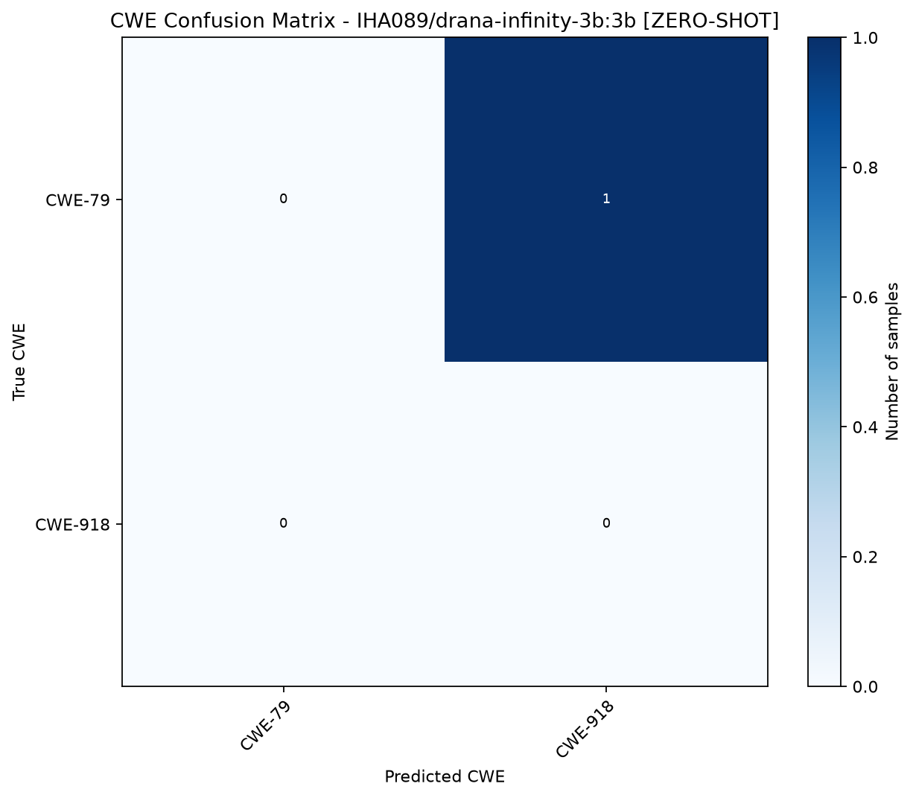

# CodeDEE Individual Evaluation Report: IHA089/drana-infinity-3b:3b (ZERO-SHOT)

- **Prompting Mode:** `zero-shot` (Zero-Shot Prompting (0 Task Demos + RAG))
- **Exact CWE Accuracy:** 0.00% (0/1) | **Macro-F1:** 0.00%
- **Binary Vulnerability Detection:** Precision: 100.00% | Recall: 100.00% | Binary F1: **100.00%** | FPR: N/A (Vuln-Only)
- **Speed & Token Metrics:** Avg Latency: 5.6s (P95: 5.6s) | Gen Speed: **160.68 tok/s** | Prompt Eval Speed: 7028.3 tok/s | Avg Tokens (In/Out): 2682.0 / 64.0
- **Reliability:** Strict JSON Rate: 100.00% | Parse Fallback Rate: 0.00% | CWE-NONE Predictions: 0/1 (0.00%)
- **Most frequent misclassifications:** CWE-79 -> CWE-918 (1).

## Summary Metrics Table

| Metric | Value |
| :--- | :---: |
| **Model** | IHA089/drana-infinity-3b:3b |
| **Prompting Mode** | zero-shot |
| **Total Samples Evaluated** | 1 |
| **Exact CWE Accuracy** | 0.00% |
| **Macro-F1 (28 CWEs)** | 0.00% |
| **Python CWE Accuracy** | 0.00% |
| **JavaScript CWE Accuracy** | 0.00% |
| **TypeScript CWE Accuracy** | 0.00% |
| **Binary Precision (Vuln vs Safe)** | 100.00% |
| **Binary Recall / TPR** | 100.00% |
| **Binary F1-Score** | 100.00% |
| **Specificity / TNR** | N/A (Vuln-Only) |
| **False Positive Rate (FPR)** | N/A (Vuln-Only) |
| **Avg Inference Latency (s)** | 5.6s |
| **P95 Inference Latency (s)** | 5.6s |
| **Output Generation Speed (tok/s)** | 160.68 tok/s |
| **Prompt Evaluation Speed (tok/s)** | 7028.3 tok/s |
| **Avg Input Prompt Tokens** | 2682.0 |
| **Avg Output Generated Tokens** | 64.0 |
| **Strict JSON Compliance Rate** | 100.00% |
| **JSON Parse Fallback Rate** | 0.00% |

## Confusion Matrix

