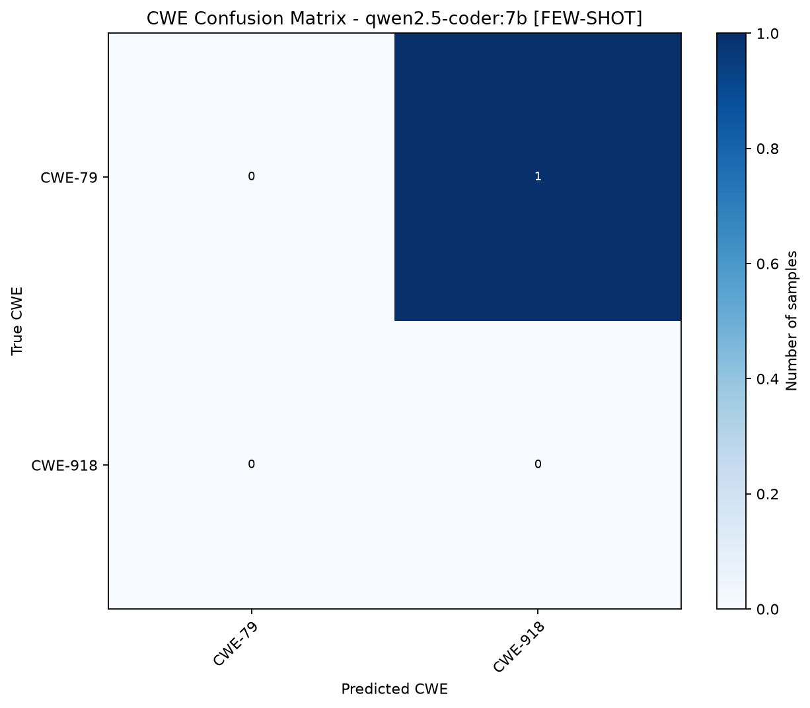

# CodeDEE Individual Evaluation Report: qwen2.5-coder:7b (FEW-SHOT)

- **Prompting Mode:** `few-shot` (Few-Shot Prompting (3 Task Demos + RAG))
- **Exact CWE Accuracy:** 0.00% (0/1) | **Macro-F1:** 0.00%
- **Binary Vulnerability Detection:** Precision: 100.00% | Recall: 100.00% | Binary F1: **100.00%** | FPR: N/A (Vuln-Only)
- **Speed & Token Metrics:** Avg Latency: 3.3s (P95: 3.3s) | Gen Speed: **99.45 tok/s** | Prompt Eval Speed: 7197.12 tok/s | Avg Tokens (In/Out): 3202.0 / 67.0
- **Reliability:** Strict JSON Rate: 100.00% | Parse Fallback Rate: 0.00% | CWE-NONE Predictions: 0/1 (0.00%)
- **Most frequent misclassifications:** CWE-79 -> CWE-918 (1).

## Summary Metrics Table

| Metric | Value |
| :--- | :---: |
| **Model** | qwen2.5-coder:7b |
| **Prompting Mode** | few-shot |
| **Total Samples Evaluated** | 1 |
| **Exact CWE Accuracy** | 0.00% |
| **Macro-F1 (28 CWEs)** | 0.00% |
| **Python CWE Accuracy** | 0.00% |
| **JavaScript CWE Accuracy** | 0.00% |
| **TypeScript CWE Accuracy** | 0.00% |
| **Binary Precision (Vuln vs Safe)** | 100.00% |
| **Binary Recall / TPR** | 100.00% |
| **Binary F1-Score** | 100.00% |
| **Specificity / TNR** | N/A (Vuln-Only) |
| **False Positive Rate (FPR)** | N/A (Vuln-Only) |
| **Avg Inference Latency (s)** | 3.3s |
| **P95 Inference Latency (s)** | 3.3s |
| **Output Generation Speed (tok/s)** | 99.45 tok/s |
| **Prompt Evaluation Speed (tok/s)** | 7197.12 tok/s |
| **Avg Input Prompt Tokens** | 3202.0 |
| **Avg Output Generated Tokens** | 67.0 |
| **Strict JSON Compliance Rate** | 100.00% |
| **JSON Parse Fallback Rate** | 0.00% |

## Confusion Matrix

