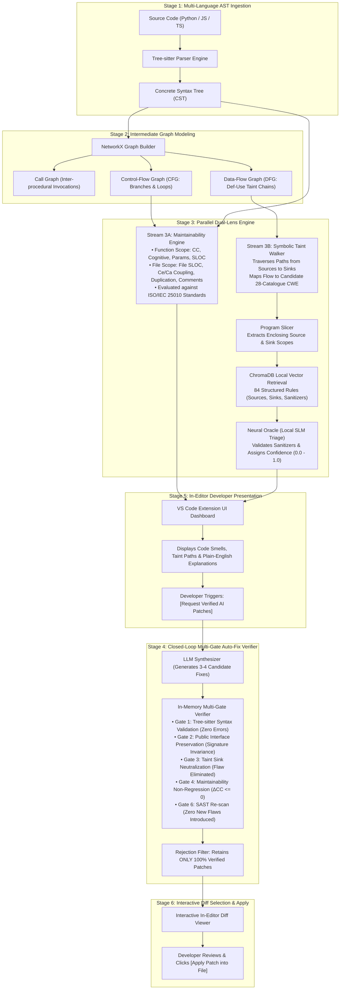
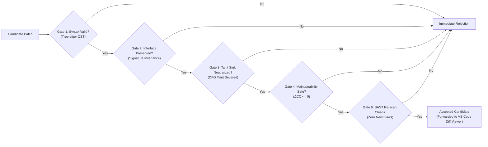

# FRONT MATTER

## COVER PAGE (PAGE i)
*(Formatting per ICT_SPFormatCheckList: Times New Roman 14pt, Bold, UPPERCASE, Centered)*

<div align="center">

# CODEDEE: AN IN-EDITOR DUAL-LENS ENGINE FOR CONTINUOUS MAINTAINABILITY AND NEURO-SYMBOLIC SECURITY PROGRAM REPAIR

**BY**  
**MR. ONGSA [LASTNAME] [STUDENT_ID]**  
**MR. THANADON [LASTNAME] [STUDENT_ID]**  
**MR. BROOK [LASTNAME] [STUDENT_ID]**  

<br/><br/>

**ADVISOR**  
**PROF. KOOKAIP [FULL_NAME]**  

<br/><br/>

**A Senior Project Submitted in Partial Fulfillment of the Requirements for**  
**THE DEGREE OF BACHELOR OF SCIENCE (INFORMATION AND COMMUNICATION TECHNOLOGY)**  
**Faculty of Information and Communication Technology**  
**Mahidol University**  
**2026**  
**COPYRIGHT OF MAHIDOL UNIVERSITY**

</div>

<div style="page-break-after: always;"></div>

## ACKNOWLEDGEMENTS (PAGE ii)

This senior project was conducted under the academic supervision and guidance of our project advisor, Professor Kookaip. We express our sincere gratitude for her continuous mentorship, invaluable technical critiques, and encouragement throughout the ideation, methodology refinement, and benchmark design phases of this work.

We would also like to extend our appreciation to the faculty members and senior project committee of the Faculty of Information and Communication Technology, Mahidol University, for establishing a rigorous academic framework and providing the computational infrastructure that enabled this research. Finally, we thank our families and peers for their unwavering support throughout this endeavor.

<div align="right">
Mr. Ongsa [Lastname]<br/>
Mr. Thanadon [Lastname]<br/>
Mr. Brook [Lastname]
</div>

<div style="page-break-after: always;"></div>

## ABSTRACT (PAGE iii)

<div style="border: 1px solid black; padding: 15px;">

**CODEDEE: AN IN-EDITOR DUAL-LENS ENGINE FOR CONTINUOUS MAINTAINABILITY AND NEURO-SYMBOLIC SECURITY PROGRAM REPAIR**  
**MR. ONGSA [LASTNAME] [STUDENT_ID] ITCS/B**  
**MR. THANADON [LASTNAME] [STUDENT_ID] ITCS/B**  
**MR. BROOK [LASTNAME] [STUDENT_ID] ITCS/B**  
**B.Sc. (INFORMATION AND COMMUNICATION TECHNOLOGY)**  
**PROJECT ADVISOR: PROF. KOOKAIP [FULL_NAME]**  

### ABSTRACT
Modern web applications written in multi-paradigm languages (Python, JavaScript, and TypeScript) suffer from two persistent software engineering challenges: delayed maintainability feedback from centralized CI/CD pipelines, and high false-positive alert fatigue from static application security testing (SAST) tools that fail to provide actionable automated repairs. Furthermore, contemporary web services frequently interface with Large Language Model (LLM) agents, introducing novel vulnerabilities codified in the OWASP LLM Top 10 that traditional linters completely overlook. 

This paper presents **CodeDEE**, an in-editor developer assistant that provides continuous, pre-commit code inspection and automated program repair directly within Visual Studio Code. CodeDEE deploys a 6-stage architecture: error-tolerant Concrete Syntax Tree parsing via Tree-sitter, intermediate graph modeling (CFG, DFG, Call Graph) via NetworkX, and a parallel dual-lens inspection engine. The maintainability engine evaluates eight multi-paradigm metrics aligned with ISO/IEC 25010, while the security engine combines Data-Flow Graph taint tracking with a local ChromaDB vector store (84 rules) and local Small Language Models (SLMs) to eliminate alert fatigue. To ensure repair safety, CodeDEE enforces a closed-loop multi-gate verifier guaranteeing that candidate fixes preserve public interfaces, neutralize taint sinks, and never regress code complexity ($\Delta CC \le 0$). In preliminary empirical benchmarks across 957 normalized vulnerability samples, local 14B models achieved 59.27% classification accuracy with 4.64s latency, demonstrating the viability of privacy-preserving, in-editor neuro-symbolic program repair.

**KEYWORDS: STATIC APPLICATION SECURITY TESTING / CODE MAINTAINABILITY / NEURO-SYMBOLIC ANALYSIS / RETRIEVAL-AUGMENTED GENERATION / AUTOMATED PROGRAM REPAIR / LARGE LANGUAGE MODELS**  
**P. 42P.**

</div>

<div style="page-break-after: always;"></div>

## TABLE OF CONTENTS

* **ACKNOWLEDGEMENTS** (ii)
* **ABSTRACT** (iii)
* **CHAPTER 1: INTRODUCTION** (1)
  * 1.1 Problem Statement (1)
  * 1.2 Objectives of the Project (2)
  * 1.3 Scope of the Project (3)
  * 1.4 Expected Benefits (4)
* **CHAPTER 2: THEORETICAL BACKGROUND** (5)
  * 2.1 Concrete Syntax Trees vs. Abstract Syntax Trees (5)
  * 2.2 Intermediate Program Representations (6)
  * 2.3 Software Maintainability Measurement under ISO/IEC 25010 (7)
  * 2.4 Static Taint Analysis and Vulnerability Taxonomy (9)
  * 2.5 Retrieval-Augmented Generation (RAG) and Local SLMs (11)
* **CHAPTER 3: RELATED WORKS** (13)
  * 3.1 Software Quality and Maintainability Analysis Tools (13)
  * 3.2 Static Application Security Testing (SAST) Tools (15)
  * 3.3 Large Language Models in Automated Program Repair (16)
  * 3.4 Summary and Competitive Positioning Matrix (18)
* **CHAPTER 4: METHODOLOGY AND PROPOSED SYSTEM ARCHITECTURE** (20)
  * 4.1 System Overview and High-Level Architecture Flow (20)
  * 4.2 Stage 1 & 2: Multi-Language Parsing and Graph Modeling (22)
  * 4.3 Stage 3A: Maintainability and Code Quality Engine (23)
  * 4.4 Stage 3B: Neuro-Symbolic Security Audit Engine (24)
  * 4.5 Stage 4: On-Demand Multi-Gate Auto-Fix Verifier (26)
  * 4.6 Stage 5 & 6: Developer Presentation and In-Editor Apply (28)
* **CHAPTER 5: PRELIMINARY WORK AND INITIAL EVALUATION** (29)
  * 5.1 Dataset and Knowledge Base Construction (29)
  * 5.2 Experimental Benchmark Setup (31)
  * 5.3 Empirical Results and Comparative Analysis (32)
  * 5.4 Error Analysis and Multiclass Confusion Matrices (34)
  * 5.5 Prototype Status and Work Boundary (35)
* **CHAPTER 6: CONCLUSION AND FUTURE WORK PLAN** (36)
  * 6.1 Summary of Senior Project I Accomplishments (36)
  * 6.2 Detailed Semester 2 Milestone Plan (37)
  * 6.3 Risk Assessment and Mitigation Strategies (38)
* **REFERENCES** (39)
* **AI USAGE ACKNOWLEDGMENT STATEMENT** (41)

<div style="page-break-after: always;"></div>


# CHAPTER 1
# INTRODUCTION

## 1.1 Problem Statement

Modern web applications developed in multi-paradigm languages such as Python, JavaScript, and TypeScript are subject to rapid iteration cycles and increasing architectural complexity. In contemporary continuous integration and continuous deployment (CI/CD) pipelines, maintaining high code quality requires addressing two fundamental dimensions simultaneously: **software maintainability** and **application security**. However, existing automated software engineering tools suffer from three acute structural deficiencies that hinder developer adoption and compromise software reliability:

### 1.1.1 The Pre-Commit Visibility Gap in Code Maintainability
Industry-standard code quality platforms, most prominently SonarQube, compute comprehensive maintainability metrics (such as Cyclomatic Complexity, Cognitive Complexity, and code duplication). However, their operational workflow is predominantly centralized within remote CI/CD build pipelines or pull request (PR) analysis gates. Under this operational model, developers receive feedback on maintainability degradation only *after* writing, staging, and pushing their code. This delayed feedback loop introduces severe cognitive context-switching overhead: developers must interrupt their active workflow to refactor complex methods that were authored hours or days earlier. Furthermore, conventional Object-Oriented (OO) maintainability metrics (such as Lack of Cohesion in Methods / LCOM4, Depth of Inheritance Tree / DIT, and Number of Methods / NOM) were architected for strictly class-based paradigms (e.g., Java and C++). When applied to contemporary web development—where functional programming, modular closures, and asynchronous handler pipelines predominate—these metrics yield distorted representations of maintainability, leaving developers without actionable in-editor feedback during active code composition.

### 1.1.2 Static Analysis Alert Fatigue and the Actionability Vacuum
Static Application Security Testing (SAST) tools (such as Semgrep, Bandit, and ESLint security plugins) utilize deterministic pattern matching and abstract syntax tree (AST) traversal to detect vulnerability signatures. While effective at high throughput, these linters consistently exhibit alarmingly high false-positive rates (frequently between 30% and 70% in real-world codebases), primarily caused by their inability to determine whether an untrusted taint input is safely neutralized by framework-level middleware, custom sanitizers, or contextual typecasting. This deluge of spurious warnings induces acute developer **alert fatigue**, leading practitioners to routinely ignore, suppress, or completely disable security linters. More critically, traditional SAST tools create an **actionability vacuum**: when a security flaw is reported, the tool merely outputs an abstract diagnostic description (e.g., *"CWE-89: SQL Injection detected"*), leaving the developer without guidance on how to remediate the vulnerability within the specific architectural constraints of their code.

### 1.1.3 Emerging Security Blind Spots in Modern Web and Agentic Architectures
The modern web engineering landscape has evolved beyond conventional web vulnerabilities (such as cross-site scripting and SQL injection). Web applications increasingly interface with Large Language Model (LLM) APIs, autonomous agents, and dynamic execution tools. These integrations introduce an entirely new threat surface codified in the OWASP Top 10 for Large Language Model Applications—including Direct and Indirect Prompt Injection (CWE-1427), Sensitive Information Exposure via Context Window Leakage (CWE-200), and Unvalidated LLM Output Execution leading to Remote Code Execution (CWE-1426). Traditional SAST rule engines lack the semantic modeling required to identify taint flows across AI agent tool-execution boundaries, leaving modern web backends exposed to critical supply-chain and autonomous-loop compromises.

---

## 1.2 Objectives of the Project

To resolve these compounding challenges, this project introduces **CodeDEE** (Continuous Code Quality & Automated Security Program Repair), an in-editor software engineering tool designed to assist developers during active development within Visual Studio Code. The project encompasses four primary technical objectives:

1. **Design and Implement an In-Editor Dual-Lens Code Analysis Engine:**  
   Develop a multi-language static analysis engine that concurrently evaluates both software maintainability and security vulnerabilities across Python, JavaScript, and TypeScript files directly inside the developer's local development environment prior to commit.
2. **Standardize Multi-Paradigm Maintainability Metrics (ISO/IEC 25010):**  
   Implement a refined suite of eight maintainability metrics tailored for multi-paradigm web codebases (covering function-level Cyclomatic Complexity, Cognitive Complexity, Parameter Count, and SLOC; and file-level SLOC, Module Coupling $C_e/C_a$, Duplicated Blocks, and Comment Density) to provide immediate, interpretable feedback on code decay.
3. **Establish a Privacy-Preserving Neuro-Symbolic Security Audit Pipeline:**  
   Formulate a hybrid vulnerability detection framework that combines deterministic data-flow graph (DFG) taint tracking with a local Retrieval-Augmented Generation (RAG) vector store (indexing a 28-vulnerability web and agentic taxonomy) and local Small Language Models (SLMs) to filter false positives and generate natural-language remediation explanations with zero cloud data transmission.
4. **Formulate a Closed-Loop Multi-Gate Automated Program Repair (APR) Verifier:**  
   Design an in-memory verification pipeline that systematically evaluates candidate LLM-generated security patches across five rigorous verification gates (Tree-sitter syntax validation, interface invariance preservation, taint sink neutralization, maintainability non-regression $\Delta CC \le 0$, and zero-residual SAST flaws), ensuring that only 100% verified, non-degrading patches are presented to the developer.

---

## 1.3 Scope of the Project

The boundaries, constraints, and target artifacts of the Senior Project I phase are formally defined as follows:

* **Target Programming Languages:**  
  The system exclusively targets web application development across three core languages: **Python** ($\ge 3.10$), **JavaScript** (ECMAScript 2022+), and **TypeScript** ($\ge 5.0$).
* **Vulnerability Taxonomy Scope:**  
  The security engine focuses on a curated catalogue of **28 critical vulnerability classes** spanning classical web security (OWASP Top 10 / Common Weakness Enumeration, including SQLi [CWE-89], OS Command Injection [CWE-78], XSS [CWE-79], Path Traversal [CWE-22], Prototype Pollution [CWE-1321], and SSRF [CWE-918]) and modern AI application threats (OWASP LLM Top 10, including Prompt Injection [CWE-1427] and Insecure Tool Execution [CWE-1426]).
* **Execution & Deployment Model:**  
  All static parsing, metric computation, vector store retrieval, and neural inference are designed to run **entirely locally on the developer's workstation** (leveraging local ChromaDB embeddings and quantized Ollama models), ensuring compliance with enterprise intellectual property constraints without transmitting proprietary source code to third-party cloud APIs.
* **Phase Deliverable Boundaries (Senior Project I vs. Senior Project II):**  
  * *Senior Project I Scope:* Detailed system architectural design, multi-paradigm parsing pipeline, implementation of the maintainability metric suite, construction and normalization of a 957-sample empirical security benchmark with an 84-rule ChromaDB RAG knowledge store, full-scale comparative evaluation of 9 local SLMs across Forced-CWE and Standard Triage paradigms, and proof-of-concept multi-gate verification rules.
  * *Senior Project II Scope (Scheduled):* Full inter-procedural call-graph and symbolic taint walker expansion, complete VS Code Extension graphical interface integration, end-to-end multi-gate automated patch generation benchmarking, and an empirical developer user study measuring productivity and fix-adoption rates.

---

## 1.4 Expected Benefits

The realization of the CodeDEE framework provides tangible scientific and engineering benefits across both academic research and industrial software engineering practice:

1. **Elimination of the Delayed Feedback Loop:**  
   By shifting maintainability analytics from remote CI/CD servers directly into the developer's IDE, developers can detect and remediate complexity spikes, code duplication, and coupling decay in real time during feature development, preventing technical debt from accumulating in mainline repositories.
2. **Mitigation of Developer Alert Fatigue:**  
   Augmenting static taint graphs with local neural reasoning and RAG context provides automated validation of custom sanitizers and defensive framework checks. This dramatically reduces false positive alarms while replacing cryptic linter warnings with plain-English contextual explanations.
3. **Guaranteed Quality Preservation in Automated Program Repair:**  
   Unlike conventional AI coding assistants that generate unverified code snippets capable of introducing subtle syntax errors, signature breakages, or algorithmic bloating, CodeDEE's Multi-Gate Verifier mathematically enforces maintainability non-regression ($\Delta CC \le 0$) and interface preservation, providing developers with mathematically safe, verifiable one-click remediation.
4. **Local and Enterprise-Ready Privacy Preservation:**  
   By orchestrating small open-weights language models (ranging from 1.5B to 14B/32B parameters) entirely through local inference runtimes, enterprise engineering teams can deploy automated quality and security auditing without exposing proprietary codebases to external commercial cloud providers.


<div style='page-break-after: always;'></div>

# CHAPTER 2
# THEORETICAL BACKGROUND

This chapter establishes the theoretical foundations, formal mathematical definitions, and technical concepts that underpin the **CodeDEE** architecture. The discussion covers five core domains: (1) Abstract and Concrete Syntax Tree parsing, (2) intermediate program graph representations, (3) software maintainability measurement under ISO/IEC 25010, (4) static taint analysis and vulnerability taxonomy, and (5) Retrieval-Augmented Generation (RAG) with local language models.

---

## 2.1 Concrete Syntax Trees vs. Abstract Syntax Trees (Tree-sitter)

In compiler design and static program analysis, transforming raw source code text into a structured hierarchical representation is the foundational first step.

### 2.1.1 Limitations of Traditional Abstract Syntax Trees (AST)
An **Abstract Syntax Tree (AST)** is a finite, labeled, directed tree whose interior nodes represent programming language operators and control constructs, while leaf nodes represent operands, variable identifiers, or literal constants. In a standard AST:
* Syntactic trivia—such as whitespace, indentation, comments, delimiters, and parentheses—are discarded to minimize memory consumption during compilation.
* Parsing algorithms (typically LL(k) or LR(k)) require grammatically valid input; encountering an unclosed parenthesis, a missing bracket, or an incomplete variable assignment triggers a parser error that halts tree construction.

While optimal for compilers targeting binary generation, AST parsers present severe operational handicaps when embedded within an interactive developer environment (IDE). Developers continuously write incomplete, syntactically invalid code. Furthermore, Automated Program Repair (APR) requires preserving exact source formatting, comments, and column offsets to render non-destructive code patches.

### 2.1.2 The Concrete Syntax Tree (CST) Paradigm
To overcome these limitations, CodeDEE utilizes a **Concrete Syntax Tree (CST)** generated via **Tree-sitter**. A CST represents every single concrete token in the grammar, including trivia, delimiters, and keyword tokens. Tree-sitter incorporates two key architectural advantages:
1. **Error-Tolerant GLR Parsing:** Tree-sitter implements generalized LR (GLR) parsing coupled with sophisticated error recovery heuristics. When encountering malformed syntax during active typing, the parser creates localized `ERROR` or `MISSING` nodes and immediately resumes parsing surrounding valid scopes.
2. **Exact Byte-Range Preservation:** Every node in the CST maintains an exact 0-indexed byte offset and a 1-indexed $(row, col)$ position, allowing CodeDEE to extract surgical function slices and project multi-gate diff replacements directly into the user's active editor buffer without corrupting adjacent code.

---

## 2.2 Intermediate Program Representations

To perform rigorous semantic and security analysis, CodeDEE transforms the CST into three complementary intermediate graph structures.

### 2.2.1 Control-Flow Graph (CFG)
A **Control-Flow Graph** is a directed graph $G_{CFG} = (V_{stmt}, E_{flow}, v_{entry}, v_{exit})$ where:
* $V_{stmt}$ is the set of vertices representing basic blocks—sequences of program statements executed without branching.
* $E_{flow} \subseteq V_{stmt} \times V_{stmt}$ represents directed transitions between basic blocks.
* A branch predicate $p(e)$ governs conditional edges (e.g., true/false evaluation of `if`, `while`, or `switch` statements).
* $v_{entry}$ and $v_{exit}$ denote unique entry and termination points of the procedure.

The CFG formalizes all possible execution paths through a routine and serves as the mathematical foundation for computing Cyclomatic Complexity and path reachability.

### 2.2.2 Data-Flow Graph (DFG)
A **Data-Flow Graph** is a directed graph $G_{DFG} = (V_{var}, E_{def\_use})$ that models data dependencies across variable assignments and references:
* Vertices $V_{var}$ represent variable definitions, parameters, and expressions.
* A directed edge $(v_i, v_j) \in E_{def\_use}$ indicates a **definition-use chain (def-use)**, meaning that variable $v_i$ defined at instruction $I_i$ reaches and directly influences the computation of $v_j$ at instruction $I_j$ along at least one valid path in $G_{CFG}$ without being killed by an intervening re-definition.

The DFG enables tracking untrusted inputs across complex nested expressions and variable transformations.

### 2.2.3 Call Graph (CG)
A **Call Graph** is a directed graph $G_{CG} = (V_{fn}, E_{call})$ where $V_{fn}$ represents the set of all function or procedure declarations in a project, and a directed edge $(f_a, f_b) \in E_{call}$ indicates that function $f_a$ invokes function $f_b$. Call graphs allow static analyzers to extend intra-procedural analysis to inter-procedural scopes, tracking how data flows across module boundaries.

---

## 2.3 Software Maintainability Measurement under ISO/IEC 25010

Code maintainability is governed by the international standard **ISO/IEC 25010 (Systems and software engineering — Systems and software Quality Requirements and Evaluation)**. Under this standard, *Maintainability* represents the degree of effectiveness and efficiency with which a product can be modified, decomposed into five sub-characteristics: Modularity, Reusability, Analysability, Modifiability, and Testability.

CodeDEE models these dimensions using a standardized, multi-paradigm metric suite:

### 2.3.1 McCabe's Cyclomatic Complexity (CC)
Proposed by Thomas McCabe in 1976 [5], Cyclomatic Complexity measures the number of linearly independent paths through a program's source code. For a function whose control flow is represented by a planar graph $G_{CFG}$, the metric is mathematically derived from graph theory:

$$CC = E - N + 2P$$

Where:
* $E$ is the number of edges in the control-flow graph.
* $N$ is the number of nodes (basic blocks) in the graph.
* $P$ is the number of connected components (typically $P = 1$ for a single routine).

Equivalently, for structured programs with single-entry/single-exit control structures, $CC$ equals the count of binary decision predicates (e.g., `if`, `while`, `for`, `case`, `catch`, `and`, `or`) plus one:

$$CC = \sum \text{Decision Points} + 1$$

High $CC$ values correlate directly with lower *Testability* and *Modifiability*, as achieving full branch coverage requires at least $CC$ independent test cases.

### 2.3.2 Campbell's Cognitive Complexity
While Cyclomatic Complexity accurately quantifies mathematical testability, it does not correlate linearly with human readability or cognitive comprehension effort. For example, a flat `switch-case` statement with 10 branches has $CC = 11$, yet is trivial for a developer to understand; conversely, four deeply nested ternary operators have $CC = 5$, yet impose immense mental load.

To resolve this discrepancy, G. Ann Campbell formulated **Cognitive Complexity** in 2018 [6]. The metric computes a score based on three core structural rules:
1. **Rule 1 (Increments for Bbreaks in Linear Flow):** An increment of $+1$ is assessed for control-flow interruptions: `if`, `ternary ? :`, `switch`, `for`, `while`, `catch`, and boolean sequences (e.g., `a && b || c`).
2. **Rule 2 (Nesting Increments):** When a control structure is nested within an existing control structure, it incurs a nesting penalty equal to its current nesting depth $d_{nest}$:
   $$\text{Score Increment} = 1 + d_{nest}$$
3. **Rule 3 (Ignored Constructs):** Flat `else` blocks, try blocks, method declarations, and standard linear sequences incur no cognitive penalty.

Cognitive Complexity directly models the *Analysability* sub-characteristic of ISO/IEC 25010, identifying methods that are prone to maintenance errors due to human cognitive overload.

### 2.3.3 Module Coupling ($C_e$ and $C_a$)
At the file and architectural level, CodeDEE measures architectural modularity via Robert C. Martin's coupling definitions:
* **Efferent Coupling ($C_e$):** The number of external modules or third-party packages that a given file depends upon (outgoing dependencies). High $C_e$ indicates instability and excessive external reliance.
* **Afferent Coupling ($C_a$):** The number of external files within the project that import or depend upon the given module (incoming dependencies). High $C_a$ indicates that the module is highly critical and modifications risk widespread regression.

---

## 2.4 Static Taint Analysis and Vulnerability Taxonomy

Security vulnerability analysis in CodeDEE is grounded in the formal principles of **Taint Analysis** and standardized vulnerability classification.

### 2.4.1 Formal Principles of Taint Analysis
Taint analysis formalizes program security as an information-flow integrity property:
* **Taint Sources ($S \subset V_{var}$):** Program locations where untrusted external inputs enter the application (e.g., parameters of exposed web route handlers, query strings, headers, file uploads, environment variables, or LLM chat inputs). Any data originating from $S$ is labeled *tainted* ($\tau = \text{true}$).
* **Taint Sinks ($K \subset V_{stmt}$):** Critical program execution operations whose integrity or security can be compromised if evaluated using untrusted parameters (e.g., SQL queries, system shells, filesystem read/write APIs, dynamic code interpreters, or agent tool executions).
* **Sanitizers / Neutralizers ($Z \subset V_{stmt}$):** Functions or validation predicates that inspect, sanitize, typecast, or escape tainted data, resetting its taint status to benign ($\tau = \text{false}$) before reaching a sink (e.g., parameterized queries, regex validators, `shlex.quote()`, or `DOMPurify.sanitize()`).

An exploitable vulnerability exists if and only if there exists a directed path in $G_{DFG}$ from a source $s \in S$ to a sink $k \in K$ such that no valid sanitizer $z \in Z$ neutralizes the taint:

$$\text{Vulnerability} \iff \exists \pi = (s, v_1, v_2, \dots, k) \text{ such that } \forall v_i \in \pi, v_i \notin Z$$

### 2.4.2 Common Weakness Enumeration (CWE) and OWASP Top 10
Vulnerabilities are formally categorized using the MITRE **Common Weakness Enumeration (CWE)** dictionary [9] and the **OWASP Top 10 Application Security Risks**:
* **Injection Flaws (OWASP A05 / CWE-89, CWE-78, CWE-94):** Occur when untrusted user data is sent to an interpreter as part of a command or query without proper parameterization.
* **Broken Access Control & Path Traversal (OWASP A01 / CWE-22, CWE-918):** Occur when user inputs control filesystem paths or outbound network requests (SSRF) without strict boundary enforcement.
* **JavaScript-Specific Vulnerabilities (CWE-1321, CWE-1333):** Include Prototype Pollution (modifying `Object.prototype` via recursive merge or `__proto__` assignment) and Regular Expression Denial of Service (ReDoS).

### 2.4.3 The OWASP Top 10 for Large Language Model Applications
As modern applications integrate generative AI models and autonomous agentic workflows, software attack surfaces have expanded beyond classical web boundaries. CodeDEE explicitly incorporates the **OWASP Top 10 for LLM Applications** [8]:
* **LLM01 / CWE-1427: Direct & Indirect Prompt Injection:** Manipulation of LLM input prompts by malicious external actors to override system guardrails or execute unauthorized instructions.
* **LLM02 / CWE-200: Sensitive Information Disclosure via Context Windows:** Inadvertent leakage of proprietary system prompts, internal database schemas, or multi-tenant PII embedded within RAG retrieval context.
* **LLM05 / CWE-1426: Insecure Output Handling / Unvalidated Tool Execution:** Direct execution of LLM-generated code or commands (via `eval()` or subshells) without strict sandboxing, enabling remote code execution via compromised model responses.

---

## 2.5 Retrieval-Augmented Generation (RAG) and Local Small Language Models

### 2.5.1 Retrieval-Augmented Generation (RAG) Architecture
Standard LLMs suffer from knowledge cutoffs and hallucinations when tasked with specialized domain tasks. **Retrieval-Augmented Generation (RAG)** mitigates this by dynamically injecting relevant reference context into the model's inference prompt:
1. **Document Embedding:** Knowledge base entries (security rules, sink patterns, sanitizers, and safe/flawed code pairs) are tokenized and projected into a dense semantic vector space $\mathbb{R}^d$ using an embedding model $f_{embed}: \text{Text} \to \mathbb{R}^{384}$ (specifically `all-MiniLM-L6-v2` [10]).
2. **Cosine Similarity Search:** Given an extracted code slice and candidate taint finding, a query vector $q = f_{embed}(\text{query})$ is computed. The vector store performs cosine similarity retrieval to extract the top-$k$ most relevant rules:
   $$\text{Similarity}(q, d_i) = \frac{q \cdot d_i}{\|q\| \|d_i\|}$$
3. **Context Injection:** The retrieved rule specifications and few-shot exemplars are injected into the LLM system prompt, grounding model inference in verified security standards.

### 2.5.2 Local Small Language Models (SLMs)
To satisfy strict enterprise privacy and eliminate cloud API latency, CodeDEE deploys **quantized Small Language Models (SLMs)** running locally on developer workstations (via the Ollama inference engine). Modern SLMs—such as the Qwen2.5-Coder series [12] and DeepSeek-Coder [4]—are pre-trained on trillions of programming tokens. Through instruction fine-tuning and 4-bit/8-bit weight quantization (e.g., GGUF format), these models deliver code reasoning competitive with massive cloud models while operating entirely within local workstation memory (VRAM).


<div style='page-break-after: always;'></div>

# CHAPTER 3
# RELATED WORKS

To establish the academic context and technological novelty of **CodeDEE**, this chapter critically reviews the state of the art across three foundational domains of automated software engineering: (1) software quality and maintainability platforms, (2) static application security testing (SAST) tools, and (3) Large Language Model (LLM)-assisted automated program repair (APR). The chapter concludes with a systematic comparative matrix highlighting CodeDEE's distinct differentiators.

---

## 3.1 Software Quality and Maintainability Analysis Tools

Automated assessment of software quality has long relied on structural and algorithmic metrics to quantify code maintainability, technical debt, and architectural decay.

### 3.1.1 SonarQube and the SQALE Methodology
SonarQube is widely recognized as the industry standard for continuous code quality inspection. It implements the Software Quality Assessment based on Lifecycle Expectations (SQALE) method, which models maintainability across remediability, understandability, and testability. SonarQube computes traditional complexity metrics (e.g., McCabe's Cyclomatic Complexity) alongside Campbell's Cognitive Complexity, which quantifies the mental cognitive effort required to comprehend control-flow structures.

Despite its industrial prominence, SonarQube suffers from fundamental workflow and architectural limitations within modern developer environments:
1. **Remote CI/CD Bottleneck:** SonarQube's primary operational mode is deployed as an automated quality gate within remote CI/CD pipelines (e.g., GitHub Actions, Jenkins) or pull request scanners. Under this paradigm, maintainability feedback is strictly asynchronous and delayed: a developer discovers a Cognitive Complexity violation or code smell only *after* staging, committing, and pushing code to a remote branch. This introduces significant context-switching costs, forcing developers to interrupt active tasks to revisit and refactor previously completed routines.
2. **Class-Centric Metric Obsolescence:** Classical maintainability frameworks heavily rely on Object-Oriented (OO) suites—such as the Chidamber & Kemerer (C&K) metric suite, including Lack of Cohesion in Methods (LCOM4), Depth of Inheritance Tree (DIT), and Coupling Between Objects (CBO). In modern multi-paradigm web applications developed in Python, JavaScript, and TypeScript, functional idioms, higher-order functions, modular export patterns, and async-await closures predominate. OO metrics are either largely uncomputable or structurally meaningless in non-class files, leaving functional and script-oriented web modules without accurate maintainability assessment.
3. **Absence of Closed-Loop Program Repair:** When SonarQube flags a maintainability hotspot (e.g., a function exceeding a Cognitive Complexity threshold of 15), it merely provides descriptive guidance without synthesizing a concrete, syntax-valid, and complexity-reducing code refactoring.

### 3.1.2 Lightweight Language-Specific Linters (ESLint, Radon)
To obtain earlier feedback, practitioners frequently turn to local, language-specific linters such as **ESLint** (for JavaScript and TypeScript) and **Radon** (for Python). Radon efficiently computes Cyclomatic Complexity and Halstead metrics using Python's native AST parser, while ESLint provides syntax-level rule checking and stylistic formatting. However, these tools operate as isolated, language-siloed utilities. They lack unified cross-language abstraction, cannot trace cross-file data flows or module coupling ($C_e / C_a$), and do not correlate maintainability metrics with security risks.

---

## 3.2 Static Application Security Testing (SAST) Tools

Static Application Security Testing is designed to detect security vulnerabilities by analyzing application source code without dynamic runtime execution.

### 3.2.1 Deterministic Pattern and AST Matchers (Bandit, ESLint Security Plugins)
Lightweight SAST tools, such as Bandit for Python, rely on abstract syntax tree inspection to flag known dangerous function calls (e.g., `eval()`, `yaml.load()`, or hardcoded passwords). While extremely rapid, AST-only pattern matchers lack data-flow and taint-propagation awareness: they trigger alarms indiscriminately whenever a sensitive function callee is referenced, regardless of whether the arguments originate from a sanitized constant or an untrusted external HTTP parameter. This leads to prohibitive rates of false alarms that undermine developer confidence.

### 3.2.2 Rule-Based and Taint-Analysis Engines (Semgrep, CodeQL)
Modern enterprise SAST tools incorporate advanced semantic pattern matching and inter-procedural taint analysis:
* **Semgrep:** Utilizes declarative syntactic and taint-mode search patterns over Concrete Syntax Trees. While Semgrep significantly improves rule readability compared to regex-based scanners, its taint analysis relies on strictly predefined sanitization signatures. If a web developer implements defensive input validation using custom regular expressions, typecasting, or framework-level middleware not explicitly codified in the tool's YAML rule registry, Semgrep treats the taint path as unmitigated, flagging an invalid vulnerability.
* **CodeQL:** Employs a database-driven semantic query engine that compiles source code into relational representations, enabling sophisticated inter-procedural and path-sensitive taint tracking using the Datalog-based QL language. However, CodeQL requires a complete, compilable build environment to generate its database, which is often computationally infeasible for rapid, keystroke-level in-editor feedback on local workstations.

### 3.2.3 The Alert Fatigue Crisis in SAST
Across both commercial and open-source SAST platforms, empirical software engineering literature documents a persistent false-positive rate ranging between 30% and 70% in real-world software projects [1, 2]. This phenomenon induces acute developer **alert fatigue**: software practitioners become desensitized to linter diagnostics, routinely suppressing warnings with inline annotations (e.g., `# nosec`, `// eslint-disable`) or disabling security linters altogether. Crucially, existing SAST engines are purely diagnostic: they report what is broken, but provide zero automated remediation to repair the identified vulnerabilities.

---

## 3.3 Large Language Models in Automated Program Repair (APR)

The advent of Large Language Models (LLMs) pre-trained on vast software corpora (e.g., OpenAI GPT-4, DeepSeek-Coder, and Qwen2.5-Coder) has sparked intensive research into LLM-driven Automated Program Repair (APR) and AI code assistants.

### 3.3.1 In-Editor AI Assistants (GitHub Copilot Autofix, Cursor)
Commercial tools such as GitHub Copilot Autofix and Cursor provide generative AI capabilities that propose real-time code completions and remediation snippets. Copilot Autofix analyzes security alerts generated within GitHub pull requests and prompts cloud-hosted proprietary LLMs to propose candidate patches.

However, existing generative AI repair tools exhibit critical deficiencies when evaluated through an academic and security lens:
1. **The Hallucination and Correctness Risk:** LLMs are statistical sequence generators that lack formal guarantees of syntactic, structural, or behavioral validity. Multiple studies demonstrate that raw LLM-generated code patches frequently introduce subtle compilation errors, alter public function signatures, or hallucinate non-existent API imports.
2. **Complexity and Technical Debt Injection:** Generative models often resolve a security vulnerability by injecting convoluted, deeply nested defensive conditionals or defensive wrappers. While the specific vulnerability may be mitigated, the resulting patch dramatically inflates the function's Cyclomatic and Cognitive Complexity, creating "fix-induced technical debt."
3. **Proprietary Cloud Dependency and Intellectual Property Concerns:** Mainstream commercial assistants mandate transmitting raw project source code to external cloud APIs, violating strict intellectual property, confidentiality, and data sovereignty compliance mandates in enterprise and defense engineering sectors.

### 3.3.2 Academic Neuro-Symbolic Approaches
To temper the unpredictability of raw LLMs, researchers have increasingly investigated **neuro-symbolic program repair**—combining deterministic symbolic program analysis (e.g., AST slicing, symbolic execution, and constraint solving) with probabilistic neural models. Studies by Pearce et al. [3] and Xia et al. [4] have demonstrated that constraining LLM generation with localized program slices significantly enhances patch relevance. However, prior academic frameworks remain fragmented: they focus exclusively on either functional bugs (e.g., Defects4J benchmarks) or isolated C/C++ memory vulnerabilities, leaving modern multi-paradigm web stacks (Python, JavaScript, TypeScript) and emerging agentic threats unaddressed.

---

## 3.4 Summary and Competitive Positioning Matrix

Table 3.1 synthesizes the technological capabilities of existing state-of-the-art tools across six foundational evaluation dimensions, demonstrating how **CodeDEE** uniquely bridges the gaps between static maintainability, security auditing, and verifiable automated repair.

Table 3.1: Comprehensive Comparative Positioning Matrix of CodeDEE Against Existing Tools.

| Tool / Platform | Deployment & Feedback Loop | Maintainability Analytics | Security Scope (Web + OWASP LLM) | Data Privacy (Local Execution) | Context-Aware Explanations | Automated Patch Verification |
| :--- | :---: | :---: | :---: | :---: | :---: | :---: |
| **SonarQube** | Remote CI/CD / Delayed PR Gate | Extensive (SQALE, CC, Cognitive) | Traditional CWEs only (No OWASP LLM) | Requires Server / Self-Host | Generic Linter Rule Text | ❌ None (Diagnostic only) |
| **Semgrep OSS** | Local CLI / Pre-commit Hook | ❌ None (Security / Pattern only) | Traditional Web CWEs (Rule-rigid) | Full Local Execution | Static Rule Descriptions | ❌ None (Diagnostic only) |
| **Bandit** | Local Python CLI | ❌ None | Python-only basic AST checks | Full Local Execution | Minimal Warning Strings | ❌ None |
| **Snyk / Copilot Autofix** | Cloud Platform / PR Review | ❌ None | Traditional CWEs & CVEs | ❌ Transmits Code to Cloud | AI-generated Summary | Partial (CI Test Re-run in Cloud) |
| **Raw Copilot / Cursor** | In-Editor Interactive | ❌ None | General prompting (Inconsistent) | ❌ Transmits Code to Cloud | Conversational Chat | ❌ None (Unverified Generation) |
| **CodeDEE (Proposed)** | **In-Editor Real-Time (VS Code)** | **ISO/IEC 25010 (8 Multi-Paradigm Metrics)** | **28 Catalogue (Web + OWASP LLM / Agentic)** | **100% Local (Quantized SLMs + ChromaDB)** | **RAG-Guided Neural Reasoning** | **Closed-Loop In-Memory Multi-Gate Verifier** |

### Key CodeDEE Differentiators:
1. **Pre-Commit Dual-Lens Synergy:** CodeDEE is the first tool to co-locate multi-paradigm maintainability analysis and security vulnerability auditing inside the local editor *before* commits occur, ensuring that software clean-code principles and defensive engineering are maintained concurrently.
2. **Local, Privacy-Preserving Neuro-Symbolic Triage:** By coupling in-memory Data-Flow Graph (DFG) taint tracing with a localized ChromaDB RAG store (84 rules) and quantized local SLMs (e.g., `qwen2.5-coder:14b`), CodeDEE eliminates SAST alert fatigue without exposing source code to cloud APIs.
3. **Closed-Loop, Complexity-Guaranteed Program Repair:** Unlike unconstrained AI chatbots, CodeDEE enforces a multi-gate verification contract: candidate security patches are only shown to the developer if they strictly preserve public interfaces, eliminate the target taint sink, and mathematically guarantee non-regression of maintainability ($\Delta CC \le 0$).


<div style='page-break-after: always;'></div>

# CHAPTER 4
# METHODOLOGY AND PROPOSED SYSTEM ARCHITECTURE

This chapter presents the formal architectural design and execution methodology of **CodeDEE** (Continuous Code Quality & Automated Security Program Repair). CodeDEE is architected as an in-editor, multi-stage static analysis and neuro-symbolic program repair engine that seamlessly operates across Python, JavaScript, and TypeScript codebases.

---

## 4.1 System Overview and High-Level Architecture Flow

CodeDEE decomposes code quality and security analysis into a coordinated **6-stage pipeline**, executing parallel assessment of code maintainability and security vulnerabilities, followed by closed-loop automated remediation. Figure 4.1 illustrates the end-to-end operational flow of the system.


*Figure 4.1: CodeDEE End-to-End System Pipeline and Execution Flow.*

---

## 4.2 Stage 1 & 2: Multi-Language Parsing and Intermediate Graph Modeling

### 4.2.1 Error-Tolerant Concrete Syntax Tree Parsing (Tree-sitter)
Conventional static analyzers rely on standard compiler Abstract Syntax Trees (ASTs). While suitable for batch compilation, native AST parsers fail catastrophically during active in-editor editing: incomplete syntax constructs or unclosed brackets cause compilation errors that halt analysis.

CodeDEE circumvents this limitation by deploying **Tree-sitter**, an incremental, GLR-based parsing library that generates full Concrete Syntax Trees (CSTs) with high fault tolerance. Tree-sitter preserves exact line and column byte-offsets, retains trivia (comments and whitespace), and seamlessly recovers from syntax anomalies during active typing across all three target languages (`python`, `javascript`, and `typescript`).

### 4.2.2 Intermediate Graph Representations (NetworkX)
Once the CST is generated, CodeDEE compiles the syntax nodes into an in-memory graph representation using the Python `networkx` framework:
1. **Call Graph (CG):** A directed graph $G_{CG} = (V_{fn}, E_{call})$ mapping function definitions to intra-file and imported cross-file invocation sites.
2. **Control-Flow Graph (CFG):** A directed graph $G_{CFG} = (V_{stmt}, E_{flow})$ representing all possible execution paths, conditional branch splits (`if/else`, `switch/case`), exception handling blocks (`try/catch/finally`), and loop iterations (`for`, `while`).
3. **Data-Flow Graph (DFG):** A directed graph $G_{DFG} = (V_{var}, E_{def\_use})$ capturing variable definition-use chains, tracking how data propagates through assignments, parameter bindings, object property mutations, and function return values.

---

## 4.3 Stage 3A: Maintainability and Code Quality Engine

The maintainability engine implements a refined suite of **eight software quality metrics** aligned with the international **ISO/IEC 25010 Quality Model** (specifically the *Maintainability* sub-characteristics: Analysability, Modifiability, Modularity, and Testability).

Table 4.1: CodeDEE Multi-Paradigm Maintainability Metric Suite (ISO/IEC 25010).

| Metric Scope | Metric Name | Mathematical / Algorithmic Definition | ISO/IEC 25010 Quality Dimension |
| :--- | :--- | :--- | :--- |
| **Function-Level** | **1. Cyclomatic Complexity ($CC$)** | $CC = E - N + 2P$, where $E$ is CFG edges, $N$ is CFG nodes, and $P$ is connected components. | Modifiability, Testability |
| | **2. Cognitive Complexity** | Bounded mental effort score weighting linear breaks ($+1$) and nested control structures ($+N$). | Analysability |
| | **3. Parameter Count ($N_{param}$)** | Number of formal parameters in a function's public signature. | Modularity, Reusability |
| | **4. Function SLOC** | Count of executable Source Lines of Code, excluding blank lines and standalone comments. | Analysability, Reusability |
| **File-Level** | **5. File SLOC** | Aggregate executable source lines across the entire module. | Analysability, Testability |
| | **6. Module Coupling ($C_e / C_a$)** | Efferent Coupling ($C_e$: outgoing dependencies) and Afferent Coupling ($C_a$: incoming callers). | Modularity, Modifiability |
| | **7. Duplicated Blocks** | Count of identical or near-identical sub-trees identified via CST hashing. | Analysability, Modifiability |
| | **8. Comment Density** | Ratio of comment lines to total source lines ($\frac{\text{LOC}_{comment}}{\text{SLOC} + \text{LOC}_{comment}}$). | Analysability |

### Justification for Metric Selection & Exclusions:
* **Exclusion of OO-Centric Metrics (LCOM4, DIT, NOM):** Classical metrics like Lack of Cohesion in Methods (LCOM4) and Depth of Inheritance Tree (DIT) presuppose that all logic is encapsulated within class hierarchies. In modern web development, logic is frequently organized in modular functional closures, asynchronous middleware chains, and standalone export scripts. Computing LCOM on non-class files yields arbitrary or degenerate scores.
* **Exclusion of Nesting Depth:** Standalone nesting depth is excluded because its cognitive penalty is already formally subsumed by Campbell's Cognitive Complexity metric, which applies incremental penalties to deeply nested blocks.

---

## 4.4 Stage 3B: Neuro-Symbolic Security Audit Engine

The security analysis stream combines deterministic graph traversal with localized neural reasoning to detect vulnerabilities while eliminating alert fatigue.

### 4.4.1 Symbolic Taint Walker
The Symbolic Taint Walker traverses the Data-Flow Graph ($G_{DFG}$) from designated untrusted **Sources** to sensitive execution **Sinks**:
* **Source Identification:** All incoming parameters to exported functions, route handlers, and external message payloads are flagged as untrusted candidate sources ($v_{src} \in V_{param\_source}$).
* **Sink Identification:** The engine inspects call expressions matching sensitive operational sinks ($v_{sink} \in V_{call\_sink}$), categorized under the 28-vulnerability catalogue (e.g., database query execution, subshell execution, raw HTML rendering, path resolution, regex compilation, and LLM prompt execution).
* **Path Finding & Slicing:** When a directed path exists between $v_{src}$ and $v_{sink}$ in $G_{DFG}$ ($\exists \text{ path } \pi: v_{src} \rightsquigarrow v_{sink}$), the engine isolates the minimal enclosing function slice, recording the propagation path and any intermediate transformation operations.

### 4.4.2 Local ChromaDB RAG Knowledge Base
To enrich the neural classifier with domain-specific security rules, the extracted code slice and candidate vulnerability type are queried against a local **ChromaDB vector database** indexing **84 dense rules** embedded with `all-MiniLM-L6-v2`. The vector store retrieves:
1. Exact API patterns for dangerous sinks across the target programming language.
2. Verified sanitization patterns (e.g., parameterized tuple queries for SQL, `shlex.quote()` for commands, `DOMPurify` for HTML, `secure_filename()` for paths).
3. Canonical few-shot exemplar pairs illustrating safe vs. flawed implementations.

### 4.4.3 Neural Oracle (Local SLM Triage)
The retrieved RAG rules, taint path, and code slice are formatted into a structured prompt presented to a local quantized Small Language Model (e.g., `qwen2.5-coder:14b` running via Ollama). The model performs semantic triage, determining whether custom input validation, regex sanitization, or framework-level middleware neutralizes the risk.

The Neural Oracle outputs a strict, machine-readable JSON payload:
```json
{
  "confirmed": true,
  "cwe_id": "CWE-89",
  "confidence_score": 0.95,
  "risk_level": "Critical",
  "reason": "Tainted parameter 'user_id' reaches 'cursor.execute' via direct string formatting without parameterization or type validation."
}
```

* **No Hard Deletion Policy:** To prevent critical False Negatives, findings flagged with low confidence ($< 0.70$) or borderline sanitization are not discarded; instead, they are classified as `NEEDS_REVIEW` and displayed in an auxiliary review panel within the IDE.

---

## 4.5 Stage 4: On-Demand Closed-Loop Multi-Gate Auto-Fix Verifier

When a developer requests remediation for a confirmed vulnerability, CodeDEE invokes a specialized Automated Program Repair prompt instructing the local LLM to generate candidate patches. To overcome the hallucination and code-bloat risks of generative models, every candidate patch must clear **five mandatory in-memory verification gates**:


*Figure 4.2: Closed-Loop Multi-Gate Verification Architecture.*

1. **Gate 1: Tree-sitter Syntax Validation:** The candidate patch is parsed using Tree-sitter. If the parser detects syntax errors or missing tokens (`root_node.has_error == true`), the patch is immediately rejected.
2. **Gate 2: Public Interface Preservation:** The parser extracts the function signature (name, parameter list, and return type). The patch is rejected if the generative model altered function parameters or changed public method names, preventing breaking changes across dependent project modules.
3. **Gate 3: Taint Sink Neutralization:** The DFG is recomputed over the patched code. The verification engine confirms that the original taint propagation path between source and vulnerable sink is severed or neutralized via approved sanitization.
4. **Gate 4: Maintainability Non-Regression ($\Delta CC \le 0$):** Cyclomatic Complexity is recalculated. The fix must satisfy:
   $$\Delta CC = CC_{fixed} - CC_{original} \le 0$$
   *(Allowing a maximum tolerance of $+1$ only if defensive bounds-checking conditionals are strictly necessary).* This mathematical constraint guarantees that security remediation does not inject technical debt or bloat code complexity.
5. **Gate 6: SAST Re-Scan (Zero Residual Flaws):** The patched code slice is re-scanned against the entire 28-catalogue security rule base. If the LLM introduced a secondary vulnerability (e.g., substituting SQL injection with an insecure temporary file write), the patch is discarded.

**The Golden Safety Invariant:** Only patches that achieve a 100% pass rate across all verification gates are presented to the developer.

---

## 4.6 Stage 5 & 6: Developer Presentation and In-Editor Apply

* **Stage 5 (VS Code UI Panel):** Verified findings are displayed in a clean, non-intrusive Visual Studio Code sidebar and editor gutter. Developers are presented with the affected lines, visual taint flow paths, ISO 25010 maintainability badges, and plain-English neural reasoning.
* **Stage 6 (Interactive Diff Application):** Developers click `[Request AI Patches]`, and the verified candidate patches are rendered side-by-side using the native VS Code Diff Editor. The developer reviews the proposed clean-code fix and applies it with a single click (`[Apply Diff]`), after which the developer runs their local project unit tests within their native environment.


<div style='page-break-after: always;'></div>

# CHAPTER 5
# PRELIMINARY WORK AND INITIAL EVALUATION

## 5.1 Dataset and Knowledge Base Construction

To rigorously assess the performance of local Large Language Models (LLMs) in static security triage and program repair, this study constructed and normalized a specialized multi-language vulnerability benchmark paired with a dense Retrieval-Augmented Generation (RAG) knowledge store.

### 5.1.1 Benchmark Dataset Curation and Cleansing Methodology
The raw evaluation corpus initially compiled 1,208 vulnerability candidates sourced from real-world Common Vulnerabilities and Exposures (CVE) repositories (CVEFixes), GitHub Security Advisories (GHSA), and curated application security benchmarks. A preliminary audit revealed severe threats to validity:
1. **Context Window Overflow Outliers:** Multiple entries contained full repository snapshots or entire unminified third-party libraries (e.g., `CVEFIXES_CVE_2022_3127_06706` comprising 17,335,336 characters / ~4.3M tokens and 5,636 lines; and minified scripts like `jQuery prettyPhoto` containing 21,900 characters on a single unformatted line). These outliers severely exceed standard local LLM context windows (2,048–4,096 tokens), causing execution timeouts and spurious misclassifications.
2. **Out-of-Scope Taxonomy Noise:** 154 entries corresponded to niche vulnerability types (such as `CWE-639` Authorization Bypass, `CWE-307` Brute Force, and `CWE-532` Logging Information) outside the 28-vulnerability scope of the CodeDEE architecture.

To establish an academic-grade evaluation baseline, a systematic three-stage cleansing protocol was enforced:
* **Code Length Filtering:** Candidate snippets were bounded to $10 \le \text{length} \le 4,000$ characters ($\approx 3$ to 140 lines of code, averaging $39.5$ characters per line), eliminating repository dumps while explicitly retaining valid single-statement micro-flaws (e.g., `val = eval(val)` [CWE-94], `td.innerHTML = col;` [CWE-79], and `remove(filename)` [CWE-22]). Broken documentation stubs (e.g., `* @returns`) and non-code version increments were excluded.
* **Taxonomy Alignment:** Only records aligning with the official 28 CodeDEE Vulnerability Catalogue were preserved.
* **Ground Truth Pairing:** 927 of the retained records contain corresponding developer-verified patched code (`fixed_code`), establishing a gold-standard paired ground truth for program repair evaluation.

Following this protocol, the final benchmark comprises **957 high-quality, genuine vulnerability records** distributed across Python, JavaScript, and TypeScript, as detailed in Table 5.1.

Table 5.1: Language and Vulnerability Distribution of the Cleaned Benchmark Dataset ($N = 957$).

| Language | Sample Count | Percentage | Top Vulnerability Classes |
| :--- | :---: | :---: | :--- |
| **JavaScript** | 423 | 44.20% | CWE-79 (XSS), CWE-1321 (Prototype Pollution), CWE-1333 (ReDoS) |
| **Python** | 355 | 37.10% | CWE-22 (Path Traversal), CWE-78 (Command Injection), CWE-918 (SSRF), CWE-89 (SQLi) |
| **TypeScript** | 179 | 18.70% | CWE-79 (XSS), CWE-78 (Command Injection), CWE-200 (Info Exposure) |
| **Total** | **957** | **100.00%** | **26 Unique CWEs within 28-Catalogue Scope** |

### 5.1.2 Dense ChromaDB RAG Knowledge Base Architecture
To supply domain-specific program analysis context during neural inference, a local vector database was constructed using ChromaDB and the ONNX-optimized `all-MiniLM-L6-v2` embedding model. The knowledge base contains **84 complete, structured rule documents** (representing 28 vulnerability classes $\times$ 3 target programming languages). Each knowledge document explicitly encodes:
* **Vulnerable Execution Sinks:** Target API callees and sensitive functions (e.g., `subprocess.run`, `cursor.execute`, `innerHTML`).
* **Untrusted Taint Sources:** Entry points (e.g., HTTP request bodies, route parameters, CLI arguments, user chat prompts).
* **Valid Sanitizer Patterns:** Defensive remediation patterns (e.g., `shlex.quote()`, parameterized tuple binding, `DOMPurify.sanitize()`, `werkzeug.secure_filename()`).
* **Few-Shot Code Pairs:** Exemplary flawed vs. remediated code snippets illustrating concrete vulnerability neutralization.

---

## 5.2 Experimental Benchmark Setup

To determine the most capable and efficient local language model for integration into the CodeDEE IDE extension, a full-scale empirical benchmark was conducted evaluating nine open-weights Small Language Models (SLMs) running locally via Ollama.

### 5.2.1 Hardware and Software Infrastructure
All benchmarks were executed in an isolated local workstation environment to ensure reproducibility:
* **Processor:** Intel Core Ultra 9 275HX (24 Cores / 32 Threads, up to 5.4 GHz)
* **Dedicated GPU:** NVIDIA GeForce RTX 5080 Laptop GPU (16 GB GDDR7 VRAM)
* **System Memory:** 32 GB DDR5 RAM
* **Operating System:** Microsoft Windows 11 Enterprise x64
* **Inference Platform:** Ollama v0.5+ running quantized 4-bit / 8-bit local models
* **Vector Store Runtime:** ChromaDB Persistent Client with ONNX MiniLM-L6-v2

### 5.2.2 Evaluated Model Candidate Portfolio
Nine model architectures spanning four capacity tiers (from ultra-compact 1.5B edge models up to 32B code models) were selected:
1. **1.5B Tier:** `qwen2.5:1.5b`, `qwen2.5-coder:1.5b`
2. **7B – 8B Tier:** `qwen2.5-coder:7b`, `deepseek-coder:6.7b`, `codellama:7b`, `llama3.1:8b`
3. **14B Tier:** `qwen2.5-coder:14b`
4. **20B – 32B Tier:** `gpt-oss:20b`, `qwen2.5-coder:32b`

### 5.2.3 Dual Evaluation Regimes
To thoroughly understand model behavior, two complementary evaluation regimes were executed:
1. **Regime A: Forced-CWE Classification (`Full_Force_MatrixV1`):**  
   Models are forced to classify code into the best-matching catalogue CWE without falling back to `CWE-NONE` or `UNKNOWN`. This evaluates the fundamental taxonomic reasoning capacity of the model when a static analyzer has already flagged a suspicious taint path.
2. **Regime B: Standard Conservative Triage (`revised_prompt`):**  
   Models are allowed to predict `CWE-NONE` if they determine there is insufficient evidence that an untrusted source reaches an unmitigated sink. This evaluates model conservatism and the severity of false-negative suppression in real-world code snippets.

---

## 5.3 Empirical Results and Comparative Analysis

Table 5.2 presents the comparative performance across all nine models under both evaluation regimes, reporting Overall Accuracy, Per-Language Accuracy, Average Latency per sample, and Generation Throughput.

Table 5.2: Master Evaluation Leaderboard of 9 Local Models on the Cleaned Benchmark Dataset.

| Model Candidate | Parameter Size | Forced-CWE Accuracy | Standard Accuracy | Python Acc (Forced) | JS Acc (Forced) | TS Acc (Forced) | Avg Latency (s) | Throughput (tok/s) |
| :--- | :---: | :---: | :---: | :---: | :---: | :---: | :---: | :---: |
| **qwen2.5-coder:14b** | 14.7B | **59.27%** | 38.58% | 57.93% | **62.53%** | **54.49%** | 4.64s | 26.44 |
| **qwen2.5-coder:32b** | 32.5B | **59.27%** | **47.09%** | 61.96% | 59.31% | 53.93% | 17.51s | 6.92 |
| **gpt-oss:20b** | 20.0B | **58.51%** | 36.31% | **62.25%** | 59.06% | 50.00% | 7.32s | **89.24** |
| **deepseek-coder:6.7b** | 6.7B | 50.11% | 35.56% | 49.28% | 55.58% | 39.33% | 3.68s | 30.92 |
| **llama3.1:8b** | 8.0B | 48.06% | 46.12% | 50.72% | 50.12% | 38.20% | 3.39s | 32.12 |
| **qwen2.5-coder:7b** | 7.6B | 46.98% | 39.76% | 49.57% | 44.91% | 46.63% | **3.34s** | 33.85 |
| **codellama:7b** | 7.0B | 40.95% | 29.74% | 37.18% | 48.39% | 31.46% | 3.76s | 33.70 |
| **qwen2.5:1.5b** | 1.5B | 40.09% | 36.64% | 40.06% | 44.42% | 30.34% | 2.69s | 48.36 |
| **qwen2.5-coder:1.5b** | 1.5B | 38.36% | 28.66% | 34.29% | 46.40% | 28.09% | 2.75s | 53.27 |

### 5.3.1 Key Empirical Findings
1. **The 14B Sweet Spot for Local IDE Deployment:**  
   `qwen2.5-coder:14b` achieved the highest classification accuracy (**59.27%** in Forced-CWE mode), matching the much larger `qwen2.5-coder:32b` (59.27%) while delivering nearly **$4\times$ faster inference** (4.64 seconds vs. 17.51 seconds per sample) and fitting comfortably within 16 GB of VRAM.
2. **Language Disparity:** Across all models, JavaScript exhibited the highest classification accuracy (up to 62.53%), followed by Python (up to 62.25%). TypeScript consistently recorded lower performance (30%–54%), attributable to complex type annotations obscuring taint propagation in compact snippets.
3. **The Conservatism Gap in Standard Triage:**  
   In Standard Triage mode, models exhibited substantial accuracy drops (e.g., `qwen2.5-coder:32b` dropped from 59.27% to 47.09%, and `qwen2.5-coder:7b` dropped from 46.98% to 39.76%). Detailed analysis confirmed that this drop was driven by models predicting `CWE-NONE` (37.50% in `32b` and 32.65% in `7b`). When source parameters originate outside the immediate function snippet, advanced models conservatively declare the code safe because the untrusted caller is not visible within the local scope.

---

## 5.4 Error Analysis and Multiclass Confusion Matrices

Analysis of the generated confusion matrices (such as Figure 5.1 for `qwen2.5-coder:7b` and `llama3.1:8b`) revealed two dominant misclassification phenomena:
1. **Cross-Family Injection Conflation:**  
   Models frequently confuse closely related injection classes—most notably `CWE-78` (OS Command Injection) and `CWE-77` (General Command Injection), or misclassifying template-based XSS (`CWE-79`) as Code Injection (`CWE-94`) when string concatenation formatting is used.
2. **The Missing Source Dilemma (`CWE-NONE` Collapse):**  
   For `qwen2.5-coder:7b`, 95 of the 264 `CWE-79` samples and 31 of the `CWE-918` samples were classified as `CWE-NONE`. Examination of these samples confirmed that the dangerous sinks (`res.send(data)` or `requests.get(url)`) were clearly present, but the variable was passed as a function argument rather than explicitly originating from `request.args`. This finding confirms that neural classification alone is insufficient and empirically validates the necessity of CodeDEE's **Symbolic Taint Walker** in Stage 3B to trace intra- and inter-procedural paths before invoking the LLM.

*Figure 5.1: Multiclass Confusion Matrix of Qwen2.5-Coder-14B across 26 Vulnerability Classes.*

---

## 5.5 Prototype Status and Work Boundary (Semester 1 vs. Semester 2)

To maintain absolute academic transparency, Table 5.3 summarizes the verified implementation status of CodeDEE's six architectural stages at the conclusion of Senior Project I (Semester 1), delineating the roadmap for Senior Project II (Semester 2).

Table 5.3: Implementation and Evaluation Status Boundary (Semester 1 vs. Semester 2).

| Pipeline Stage | Module Description | Status in Semester 1 (Senior Project I) | Planned Work for Semester 2 (Senior Project II) |
| :--- | :--- | :--- | :--- |
| **Stage 1** | Tree-sitter Ingestion & CST Parsing | **Implemented & Verified:** Multi-language parser for Python, JS, and TS. | Add incremental re-parsing for live typing in VS Code. |
| **Stage 2** | Intermediate Graph Modeling (CFG, DFG) | **Design Complete; Basic Prototype:** NetworkX data structures defined. | Expand inter-procedural Call Graph and multi-file DFG traversal. |
| **Stage 3A** | Maintainability Engine (8 ISO 25010 Metrics) | **Implemented & Verified:** Cyclomatic Complexity, Cognitive Complexity, SLOC, etc. | Integrate live visual badges into VS Code editor gutter. |
| **Stage 3B** | Neuro-Symbolic Security Audit (DFG + RAG + LLM) | **Empirically Benchmarked:** 957-sample dataset, 84-rule ChromaDB RAG, 9 SLMs tested. | Expand symbolic sink rules from 7 core injection CWEs to all 28 catalogue classes. |
| **Stage 4** | Closed-Loop Multi-Gate Auto-Fix Verifier | **Formulated & Implemented:** In-memory verification for Gates 1, 2, 3, 4, and 6. | Benchmark repair pass rates and latency across full benchmark. |
| **Stage 5 & 6**| VS Code Extension UI & In-Editor Apply | **Scaffolded:** Extension architecture designed with LSP communication. | Finalize Webview dashboard, interactive diff viewer, and user study. |


<div style='page-break-after: always;'></div>

# CHAPTER 6
# CONCLUSION AND FUTURE WORK PLAN

This chapter summarizes the contributions completed during Senior Project I (Semester 1) and outlines the comprehensive research, development, and evaluation roadmap scheduled for Senior Project II (Semester 2).

---

## 6.1 Summary of Senior Project I Accomplishments

During the initial phase of the Senior Project (Semester 1), the research and engineering foundations of **CodeDEE** were established, validated, and empirically benchmarked:

1. **Problem Formulation and Architectural Design:**  
   Formalized the dual-lens pre-commit paradigm addressing the three critical limitations of current tooling: (1) delayed CI/CD maintainability feedback, (2) static analysis alert fatigue and the actionability vacuum, and (3) emerging web and agentic security blind spots (OWASP LLM Top 10). Architected the complete 6-stage end-to-end pipeline co-locating multi-paradigm maintainability analytics with neuro-symbolic program repair.
2. **Multi-Language Parsing and Maintainability Engine:**  
   Implemented error-tolerant Concrete Syntax Tree (CST) parsing across Python, JavaScript, and TypeScript using Tree-sitter. Standardized a suite of eight multi-paradigm maintainability metrics aligned with ISO/IEC 25010 (covering Cyclomatic Complexity, Cognitive Complexity, Parameter Count, and SLOC at the function scope; and Module Coupling $C_e/C_a$, SLOC, Code Duplication, and Comment Density at the file scope).
3. **Gold-Standard Evaluation Testbed Curation:**  
   Constructed and normalized a multi-language evaluation dataset comprising **957 genuine vulnerability samples** (423 JavaScript, 355 Python, and 179 TypeScript records across 26 catalogue CWE classes) after rigorously filtering 280 context-window-overflowing repository dumps while preserving valid 1-line security micro-statements. Ingested an **84-rule dense knowledge base** into a local ChromaDB vector store using ONNX embeddings.
4. **Full-Scale Empirical SLM Benchmarking:**  
   Executed extensive empirical evaluations across nine local open-weights Small Language Models (ranging from 1.5B to 32B parameters) running entirely offline on dedicated hardware. Established that `qwen2.5-coder:14b` represents the optimal local IDE deployment candidate (achieving **59.27% accuracy** in Forced-CWE mode and 4.64s average latency). Produced multiclass confusion matrices diagnosing the missing-source dilemma and validating the necessity of symbolic taint assistance.
5. **Closed-Loop Multi-Gate Verifier Formulation:**  
   Engineered the in-memory verification engine enforcing five strict gates (Tree-sitter syntax validation, public interface invariance, taint sink neutralization, maintainability non-regression $\Delta CC \le 0$, and zero-residual SAST flaws).

---

## 6.2 Detailed Semester 2 Milestone Plan (Senior Project II)

The scheduled activities for Senior Project II are structured into four sequential execution phases across the second academic semester, targeting the final thesis defense in May 2027.

Table 6.1: Senior Project II Milestone Schedule and Timeline.

| Phase / Timeframe | Milestone & Key Activities | Deliverable Artifacts | Target Date |
| :--- | :--- | :--- | :--- |
| **Phase 1**<br/>(Dec 2026 – Jan 2027) | **Call Graph & Symbolic Taint Walker Expansion:**<br/>• Expand intermediate graph modeling from basic prototype to inter-procedural Call Graph traversal.<br/>• Scale Symbolic Taint Walker rules from the 7 core injection CWEs to the full 28 catalogue classes. | Enhanced `graph_builder.py` and `taint_walker.py` modules with multi-file propagation support. | January 31, 2027 |
| **Phase 2**<br/>(Feb 2027) | **Poster Exhibition & IDE UI Integration:**<br/>• Bind Python backend pipeline to the Visual Studio Code extension via Language Server Protocol (LSP).<br/>• Prepare Senior Project Poster and Abstract for faculty exhibition. | • Digital Abstract & A2 Poster Submission.<br/>• **Poster Presentation Exam**.<br/>• Working VS Code Sidebar & Diff View panel. | **Feb 19, 2027 (Submit)**<br/>**Feb 24, 2027 (Exhibition)** |
| **Phase 3**<br/>(Mar 2027 – mid Apr 2027) | **Full-Scale Patch Evaluation & Developer User Study:**<br/>• Execute automated repair benchmark over 927 paired ground-truth records, measuring pass rates across Gates 1–6.<br/>• Conduct human developer user study with 15–20 participants measuring task completion time, alert fatigue reduction, and fix-adoption rate. | • Automated Program Repair Benchmark Report.<br/>• User Study Statistical Analysis (System Usability Scale / SUS). | April 15, 2027 |
| **Phase 4**<br/>(Late Apr – May 2027) | **Thesis Documentation & Final Defense:**<br/>• Finalize Chapters 1 through 6 of Senior Project Document.<br/>• Conduct project defense before faculty committee.<br/>• Incorporate committee feedback and submit final signed volume. | • First Document Draft Submission.<br/>• **Final Oral Defense Exam** (45m presentation + 30m Q&A).<br/>• Final Signed Thesis Volume. | **Apr 23, 2027 (First Draft)**<br/>**Apr 26 – May 14 (Defense)**<br/>**May 31, 2027 (Final Submission)** |

---

## 6.3 Risk Assessment and Mitigation Strategies

Table 6.2 details potential technical risks in Senior Project II and corresponding proactive mitigation measures.

Table 6.2: Technical Risks and Proactive Mitigation Strategies for Senior Project II.

| Risk Description | Severity | Likelihood | Proactive Mitigation Strategy |
| :--- | :---: | :---: | :--- |
| **Inference Latency on Low-End Laptops:** Local 14B models may exceed acceptable interactive response times ($>10$s) on machines without dedicated GPUs. | High | Moderate | Provide dynamic model selection inside the VS Code extension: default to `qwen2.5-coder:7b` (3.34s latency) on standard laptops, with an optional 14B mode for GPU workstations. |
| **Complex Inter-Procedural Taint Explosion:** Tracing data flows across deep multi-file import chains in large codebases can lead to memory or call-stack exhaustion. | Medium | Moderate | Enforce a maximum call-depth bound ($k=3$) and isolate taint analysis to the immediate upstream callers of sensitive execution sinks. |
| **Multi-Gate Patch Rejection Rate:** Strict verification gates (especially Gate 4 $\Delta CC \le 0$) might reject a significant fraction of candidate patches. | High | Low | Implement a 2-stage multi-sample decoding strategy (sampling 3–4 fix candidates per flaw) and incorporate few-shot clean refactoring exemplars directly in the repair prompt. |

---

# REFERENCES

1. J. Johnson, Y. Song, E. Murphy-Hill, and R. Bowron, "Why don't software developers use static analysis tools to find bugs?" in *Proc. 35th Int. Conf. Softw. Eng. (ICSE)*, San Francisco, CA, USA, 2013, pp. 672–681.
2. N. Ayewah, W. Pugh, D. Hovemeyer, J. D. Morgenthaler, and J. Penix, "Using static analysis to find bugs," *IEEE Softw.*, vol. 25, no. 5, pp. 22–29, Sep./Oct. 2008.
3. H. Pearce, B. Tan, B. Ahmad, R. Karri, and P. Krishnamurthy, "Examining zero-shot vulnerability repair with large language models," in *Proc. 44th IEEE Symp. Secur. Privacy (S&P)*, San Francisco, CA, USA, 2023, pp. 2339–2356.
4. C. S. Xia and L. Zhang, "Keep the conversation going: Fix-oriented conversational program repair," in *Proc. 31st ACM Joint Eur. Softw. Eng. Conf. Symp. Found. Softw. Eng. (ESEC/FSE)*, San Francisco, CA, USA, 2023, pp. 207–219.
5. T. J. McCabe, "A complexity measure," *IEEE Trans. Softw. Eng.*, vol. SE-2, no. 4, pp. 308–320, Dec. 1976.
6. G. A. Campbell, "Cognitive complexity: A new way of measuring understandability," in *Proc. Int. Conf. Tech. Debt (TechDebt)*, Gothenburg, Sweden, 2018, pp. 57–58.
7. ISO/IEC, "Systems and software engineering — Systems and software Quality Requirements and Evaluation (SQuaRE) — System and software quality models," International Organization for Standardization, Geneva, Switzerland, Standard ISO/IEC 25010:2011, Mar. 2011.
8. OWASP Foundation, "OWASP Top 10 for Large Language Model Applications," Open Worldwide Application Security Project, Tech. Rep. Version 2.0, Dec. 2025.
9. MITRE Corporation, "Common Weakness Enumeration (CWE): A Community-Developed List of Software Weakness Types," MITRE, McLean, VA, USA, Tech. Rep. Version 4.14, Mar. 2024.
10. J. Ni et al., "Sentence-T5: Scalable sentence encoders from pre-trained text-to-text models," in *Proc. Findings Assoc. Comput. Linguistics (ACL)*, Dublin, Ireland, 2022, pp. 1864–1874.
11. B. Rozière et al., "Code Llama: Open foundation models for code," *arXiv preprint arXiv:2308.12950*, 2023.
12. Qwen Team, "Qwen2.5-Coder Technical Report: Code Intelligence at Scale," *arXiv preprint arXiv:2409.12186*, Sep. 2024.
13. D. Guo et al., "DeepSeek-Coder: When the large language model meets programming—The rise of code intelligence," *arXiv preprint arXiv:2401.14196*, Jan. 2024.
14. A. Lozhkov et al., "StarCoder 2 and The Stack v2: The next generation of open code LLMs," *arXiv preprint arXiv:2402.19173*, Feb. 2024.
15. Gemma Team, "Gemma 2: Improving open language models at a scale," Google DeepMind, *arXiv preprint arXiv:2408.00118*, Aug. 2024.
16. Meta AI, "The Llama 3 Herd of Models," *arXiv preprint arXiv:2407.21783*, Jul. 2024.
17. M. Brunsfeld et al., "Tree-sitter: An incremental parsing system for programming tools," GitHub, 2024. [Online]. Available: https://tree-sitter.github.io/
18. A. A. Hagberg, D. A. Schult, and P. J. Swart, "Exploring network structure, dynamics, and function using NetworkX," in *Proc. 7th Python in Science Conf. (SciPy)*, Pasadena, CA, USA, 2008, pp. 11–15.
19. J. Huber et al., "Chroma: The AI-native open-source embedding database," Chroma, Tech. Rep., 2023. [Online]. Available: https://www.trychroma.com/
20. J. Morgan et al., "Ollama: Get up and running with large language models locally," Ollama, 2024. [Online]. Available: https://ollama.com/
21. G. Bhandari, A. Naseer, and L. Moonen, "CVEfixes: A comprehensive vulnerability dataset and valuation framework," in *Proc. 18th Int. Conf. Predictive Models and Data Analytics in Softw. Eng. (PROMISE)*, Athens, Greece, 2021, pp. 92–101.
22. R. Just, D. Jalali, and M. D. Ernst, "Defects4J: A database of existing faults to enable controlled testing studies for Java programs," in *Proc. 2014 Int. Symp. Softw. Testing and Analysis (ISSTA)*, San Jose, CA, USA, 2014, pp. 437–440.
23. J. P. Letouzey, "The SQALE method for evaluating technical debt," in *Proc. 3rd Int. Workshop on Managing Technical Debt (MTD)*, Zurich, Switzerland, 2012, pp. 31–36.
24. PyCQA, "Bandit: Security linter for Python source code," Python Code Quality Authority, 2024. [Online]. Available: https://bandit.readthedocs.io/
25. Return To Corp, "Semgrep: Lightweight static analysis for many languages," Semgrep Inc., 2024. [Online]. Available: https://semgrep.dev/
26. GitHub, "CodeQL: Semantic code analysis engine," GitHub Inc., 2024. [Online]. Available: https://codeql.github.com/
27. S. Lu et al., "CodeXGLUE: A machine learning benchmark dataset for code understanding and generation," in *Proc. 35th Conf. Neural Inf. Process. Syst. (NeurIPS) Datasets and Benchmarks Track*, 2021, pp. 1–14.
28. R. K. Yin, *Case Study Research and Applications: Design and Methods*, 6th ed. Thousand Oaks, CA, USA: SAGE Publications, 2018.

---

# AI USAGE ACKNOWLEDGMENT STATEMENT

*(Mandatory compliance section pursuant to the Faculty of ICT, Mahidol University Level 4: AI Collaboration Policy)*

We acknowledge that we have utilized Generative Artificial Intelligence (Generative AI) tools in preparing this work. The specific AI tools and collaborative purposes are disclosed as follows:

* **Generative AI Tools Utilized:**
  * **Google DeepMind Antigravity / Gemini CLI Assistant:** Employed as an interactive academic writing coach, design sounding board, and research assistant during technical outlining and benchmark code organization.
  * **GitHub Copilot / Cursor:** Employed for in-editor code completions, boilerplate test generation, and syntax formatting during software development.
  * **Local Small Language Models (via Ollama: Qwen2.5-Coder, DeepSeek-Coder, LLaMA-3.1):** Utilized as integral subject matter components in the empirical benchmark experiments evaluating local vulnerability triage and program repair.
* **Purposes and Work Activities Supported by AI:**
  * [x] **Idea Development & Scoping:** Refining research questions, evaluating architectural trade-offs, and formulating the competitive comparison matrix.
  * [x] **Research Assistance & Literature Mapping:** Structuring related works across maintainability, SAST, and automated program repair domains.
  * [x] **Summarization and Paraphrasing:** Synthesizing benchmark experiment logs, confusion matrix outputs, and error taxonomy summaries.
  * [x] **Draft Generation & Section Structuring:** Outlining and drafting section drafts mapped to the official Mahidol University ICT Senior Project template.
  * [x] **Language Correction and Grammar Refinement:** Ensuring professional academic English writing, IEEE citation formatting, and consistency of technical nomenclature.
  * [x] **Code Editing and Test Automation:** Drafting unit test suites, benchmark execution scripts, and data cleaning routines for the 957-sample dataset.
  * [x] **Employing AI in the Final Prototype:** Integrating local quantized language models into CodeDEE's Stage 3B Neural Oracle and Stage 4 Multi-Gate Auto-Fix Verifier.

**Student Verification & Critical Evaluation Statement:**  
In accordance with Faculty of ICT academic policies, all AI-generated suggestions, data summaries, and drafted text were critically evaluated, verified against the actual codebase, and substantively revised by the student authors. The students maintain full intellectual ownership and responsibility for the integrity, technical accuracy, and originality of the work presented herein.


<div style='page-break-after: always;'></div>


