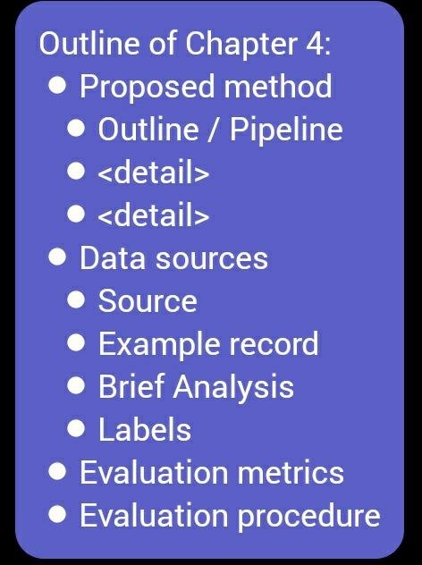
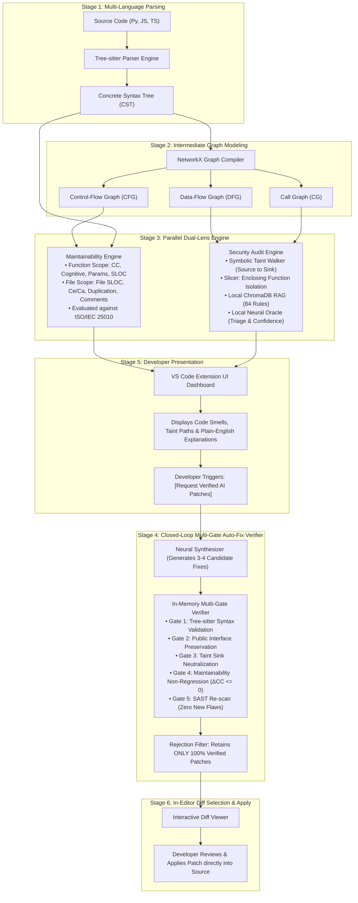
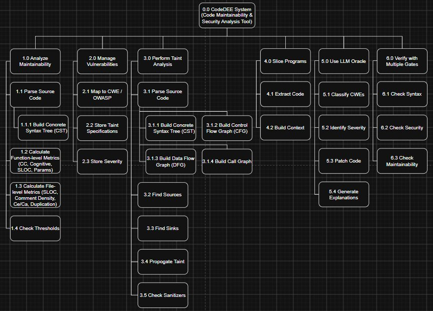
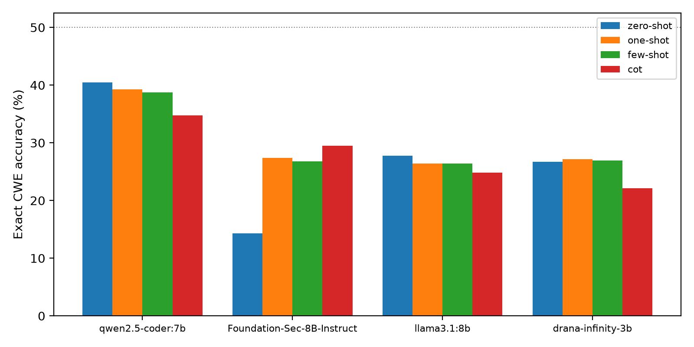
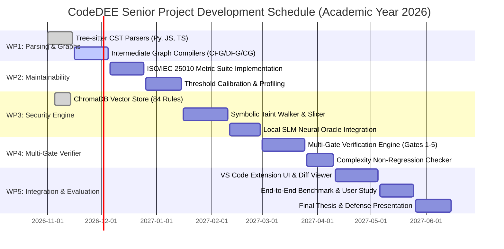

# CODEDEE: AN IN-EDITOR DUAL-LENS ENGINE FOR CONTINUOUS MAINTAINABILITY AND NEURO-SYMBOLIC SECURITY PROGRAM REPAIR

**Senior Project Proposal (B.Sc. in Information and Communication Technology)**  
**Faculty of Information and Communication Technology, Mahidol University (Academic Year 2026)**  
**Version:** v1-0 · **Date:** November 14, 2026  
**Authors:** Mr. Ongsa, Mr. Thanadon, Mr. Brook  
**Advisor:** Prof. Kookaip  

---

## Executive Summary

Modern web development across Python, JavaScript, and TypeScript suffers from two persistent software engineering problems: delayed maintainability feedback deferred to post-commit CI/CD pipelines, and high false-positive alert fatigue from static application security testing (SAST) tools that flag issues without providing verifiable, complexity-preserving remediations. Furthermore, contemporary full-stack services increasingly connect with Large Language Model (LLM) agents, introducing emerging vulnerabilities codified in the OWASP Top 10 for LLM Applications (e.g., prompt injection, insecure output handling) that conventional linters cannot detect.

This proposal introduces **CodeDEE**, an in-editor developer assistant implemented as a Visual Studio Code extension. CodeDEE coordinates a 6-stage architecture: error-tolerant Concrete Syntax Tree (CST) parsing via Tree-sitter, intermediate graph modeling (Call Graph, Control-Flow Graph, Data-Flow Graph) via NetworkX, and a parallel dual-lens inspection engine. The maintainability engine evaluates eight multi-paradigm metrics aligned with ISO/IEC 25010 standards, while the security engine combines Data-Flow Graph taint tracking with a local ChromaDB vector store (84 rules) and quantized local Small Language Models (SLMs). To guarantee repair safety, CodeDEE deploys a closed-loop multi-gate verifier ensuring that candidate patches preserve public interfaces, eliminate taint sinks, and maintain non-regressive complexity ($\Delta CC \le 0$). Preliminary empirical benchmarks on Dataset V4 (1,911 multi-function records across 4 local models and 4 prompting paradigms) establish baseline classification accuracy, format compliance, and latency metrics that directly guide the neural oracle implementation.

---

## Table of Contents

- [Chapter 1: Introduction](#chapter-1-introduction)
  - [1.1 Problem Statement](#11-problem-statement)
  - [1.2 Objectives of the Project](#12-objectives-of-the-project)
  - [1.3 Scope of the Project](#13-scope-of-the-project)
  - [1.4 Expected Benefits](#14-expected-benefits)
- [Chapter 2: Theoretical Background](#chapter-2-theoretical-background)
  - [2.1 Concrete Syntax Trees vs. Abstract Syntax Trees](#21-concrete-syntax-trees-vs-abstract-syntax-trees)
  - [2.2 Intermediate Program Representations](#22-intermediate-program-representations)
  - [2.3 Software Maintainability Measurement under ISO/IEC 25010](#23-software-maintainability-measurement-under-isoiec-25010)
  - [2.4 Static Taint Analysis and Vulnerability Taxonomies](#24-static-taint-analysis-and-vulnerability-taxonomies)
  - [2.5 Neuro-Symbolic Program Repair and Retrieval-Augmented Generation](#25-neuro-symbolic-program-repair-and-retrieval-augmented-generation)
- [Chapter 3: Related Work & Competitor Analysis](#chapter-3-related-work--competitor-analysis)
  - [3.1 Review of Existing Static Quality and Security Tools](#31-review-of-existing-static-quality-and-security-tools)
  - [3.2 Comparative Positioning Matrix](#32-comparative-positioning-matrix)
  - [3.3 Technological and Research Gap](#33-technological-and-research-gap)
- [Chapter 4: Methodology and Proposed System Architecture](#chapter-4-methodology-and-proposed-system-architecture)
  - [4.1 Proposed Method and Pipeline Overview](#41-proposed-method-and-pipeline-overview)
  - [4.2 System Architecture](#42-system-architecture)
  - [4.3 Functional Decomposition Diagram (FDD)](#43-functional-decomposition-diagram-fdd)
  - [4.4 Development Tools and Environment](#44-development-tools-and-environment)
  - [4.5 Module Specifications and Detailed Responsibilities](#45-module-specifications-and-detailed-responsibilities)
  - [4.6 Evaluation Metrics and Experimental Procedure](#46-evaluation-metrics-and-experimental-procedure)
- [Chapter 5: Preliminary Work and Empirical Evaluation](#chapter-5-preliminary-work-and-empirical-evaluation)
  - [5.1 Benchmark Setup: Dataset V4 and Experimental Matrix](#51-benchmark-setup-dataset-v4-and-experimental-matrix)
  - [5.2 Preliminary Results: Prompting Paradigms and Model Performance](#52-preliminary-results-prompting-paradigms-and-model-performance)
  - [5.3 Diagnostic Findings: Format Compliance, Specificity, and Latency](#53-diagnostic-findings-format-compliance-specificity-and-latency)
  - [5.4 Architectural Takeaways for CodeDEE Implementation](#54-architectural-takeaways-for-codedee-implementation)
- [Chapter 6: Project Plan, Timeline, and Deliverables](#chapter-6-project-plan-timeline-and-deliverables)
  - [6.1 Work Breakdown Structure](#61-work-breakdown-structure)
  - [6.2 Project Timeline (Gantt Milestones)](#62-project-timeline-gantt-milestones)
  - [6.3 Deliverables and Success Criteria](#63-deliverables-and-success-criteria)
- [References](#references)

---

## Chapter 1: Introduction

### 1.1 Problem Statement
Modern software engineering teams face two fragmented and conflicting quality gates during application development:

1. **Delayed Maintainability Feedback:** Code maintainability checks (e.g., Cyclomatic Complexity, cognitive nesting, structural coupling) are routinely deferred to remote continuous integration (CI/CD) pipelines or periodic code quality platforms (e.g., SonarQube Server). Developers write code without immediate feedback on growing structural complexity, accumulating architectural technical debt that requires costly refactoring post-pull-request.
2. **SAST Alert Fatigue and Unverifiable AI Remediation:** Static Application Security Testing (SAST) linters suffer from high false-positive rates because pattern matching lacks contextual semantic understanding. When developers turn to generative AI coding assistants (e.g., GitHub Copilot, Cursor) to generate fixes, these unconstrained language models frequently hallucinate non-existent imports, alter public function signatures, or introduce bloated defensive code that inflates cyclomatic complexity ($\Delta CC > 0$), trading security flaws for long-term unmaintainability.
3. **Emergence of LLM and Agentic Security Weaknesses:** As full-stack web applications incorporate Large Language Models (LLMs) to perform autonomous workflows, new attack vectors emerge—most notably prompt injection (CWE-1427) and improper handling of LLM outputs (CWE-1426). Conventional static analysis engines possess zero rule definitions or taint tracking capabilities for these emerging agentic vulnerabilities.

### 1.2 Objectives of the Project
The primary objective of this project is to develop, evaluate, and deploy **CodeDEE**, an in-editor static analysis and program repair system that integrates maintainability auditing with verified neuro-symbolic security patching. Specific objectives include:

1. **Multi-Language Incremental Syntax Analysis:** Implement Concrete Syntax Tree (CST) parsing using Tree-sitter for Python, JavaScript, and TypeScript to ensure fault-tolerant in-editor parsing during active typing.
2. **Dual-Lens Evaluation Engine:** Formulate and compute eight multi-paradigm maintainability metrics aligned with ISO/IEC 25010, alongside a 28-class vulnerability audit engine combining symbolic Data-Flow Graph (DFG) taint tracing with local vector retrieval (ChromaDB, 84 rules).
3. **Closed-Loop Multi-Gate Patch Verifier:** Construct an automated verification pipeline that validates candidate security repairs against five deterministic gates: syntax correctness, public signature preservation, taint sink elimination, maintainability non-regression ($\Delta CC \le 0$), and secondary vulnerability non-introduction.
4. **Local Privacy-Preserving Neural Execution:** Deploy quantized Small Language Models (SLMs) locally via Ollama to perform semantic triage and code repair without leaking proprietary codebase artifacts to commercial cloud APIs.

### 1.3 Scope of the Project
The project scope is defined along three dimensions:

- **Target Programming Languages:** Python 3.10+, ECMAScript 2022+ (JavaScript), and TypeScript 5.0+.
- **Vulnerability Coverage:** 28 vulnerability classes covering the MITRE CWE Top 25, OWASP Top 10 Web Application Security Risks, and the OWASP Top 10 for LLM Applications (with explicit focus on CWE-1426 and CWE-1427).
- **Target Deployment Platform:** Visual Studio Code extension running natively on developer workstations equipped with consumer-grade GPUs or neural accelerators (requiring $\le$ 16 GB unified VRAM).

### 1.4 Expected Benefits
1. **Immediate Pre-Commit Feedback:** Eliminates the latency between code authoring and quality assessment by delivering instantaneous diagnostics directly in the VS Code editor.
2. **Elimination of Fix-Induced Technical Debt:** Guarantees that automated security patches improve system resilience without degrading structural maintainability or breaking existing caller contracts.
3. **Enterprise Compliance and Data Sovereignty:** Empowers privacy-sensitive organizations to adopt intelligent static analysis and automated program repair without sending source code to third-party cloud infrastructure.

---

## Chapter 2: Theoretical Background

### 2.1 Concrete Syntax Trees vs. Abstract Syntax Trees
Traditional static analysis tools parse source code into Abstract Syntax Trees (ASTs). ASTs abstract away structural syntax elements such as comments, whitespace, punctuation, and formatting tokens. While ASTs minimize graph size for compiler optimization, they exhibit two fatal flaws in interactive editor settings:
1. **Fragility Under Syntax Incompleteness:** Native AST parsers fail catastrophically when encountering unclosed parentheses, missing brackets, or unfinished expressions common during real-time typing.
2. **Loss of Source Fidelity:** Because trivia (comments, whitespace, exact column offsets) is discarded, translating AST transformations back into localized source code diffs requires fragile heuristic reformatting.

CodeDEE replaces AST parsers with **Tree-sitter**, an incremental parsing framework generating **Concrete Syntax Trees (CSTs)**. Tree-sitter uses generalized LR (GLR) parsing to retain full syntactic fidelity, track precise byte-range positions, and recover gracefully from syntax errors by generating local error nodes without terminating parsing.

### 2.2 Intermediate Program Representations
To perform semantic code analysis beyond raw syntax inspection, CodeDEE derives three intermediate graph representations using the `networkx` graph framework:

1. **Call Graph ($G_{CG}$):** A directed graph $G_{CG} = (V_{fn}, E_{call})$ mapping function definitions to intra-file and cross-module invocation sites, enabling inter-procedural propagation analysis.
2. **Control-Flow Graph ($G_{CFG}$):** A directed graph $G_{CFG} = (V_{stmt}, E_{flow})$ capturing all possible paths through conditional branches (`if/else`, `switch`), loop constructs (`for`, `while`), and exception handling blocks (`try/catch`).
3. **Data-Flow Graph ($G_{DFG}$):** A directed graph $G_{DFG} = (V_{var}, E_{def\_use})$ capturing variable definition-use chains, mapping the flow of values from assignment statements to variable reads and return values.

### 2.3 Software Maintainability Measurement under ISO/IEC 25010
The international standard ISO/IEC 25010 defines software product quality through specific sub-characteristics: *Analysability*, *Modifiability*, *Modularity*, and *Testability*. CodeDEE implements eight quantitative metrics mapped to these dimensions:

1. **Cyclomatic Complexity ($CC$):** Quantifies linearly independent execution paths via $CC = E - N + 2P$, where $E$ represents edges, $N$ represents nodes, and $P$ represents connected components in $G_{CFG}$.
2. **Cognitive Complexity:** Formulated by Campbell, this metric weights mental effort by penalizing breaks in linear code reading (+1) and deeply nested control flow structures (+nesting depth).
3. **Parameter Count ($N_{param}$):** Measures the formal arguments defined in function signatures to limit excessive coupling.
4. **Function Source Lines of Code (SLOC):** Counts executable instructions per function, excluding comments and blank lines.
5. **File Source Lines of Code (File SLOC):** Measures module size to detect oversized god-files.
6. **Efferent Coupling ($C_e$) and Afferent Coupling ($C_a$):** Computes external dependencies imported by a module ($C_e$) versus external modules importing the target module ($C_a$).
7. **Duplication Ratio:** Computes exact and near-miss duplicated logic blocks via CST subtree hashing.
8. **Comment Density:** Measures documentation coverage as the ratio of comment lines to total source statements.

### 2.4 Static Taint Analysis and Vulnerability Taxonomies
Static taint analysis tracks whether untrusted input data flows from an untrusted **Source** into a security-critical **Sink** without passing through a valid **Sanitizer**.

$$\text{Taint Path: } v_{source} \xrightarrow{G_{DFG}} v_1 \xrightarrow{} v_2 \xrightarrow{} \dots \xrightarrow{} v_{sink}$$

If no intermediate node along the path executes an approved sanitization function (e.g., parameterized database binding, input validation regex, or encoding wrapper), a vulnerability is flagged. CodeDEE targets 28 vulnerability classes mapped across the MITRE Common Weakness Enumeration (CWE) Top 25, OWASP Top 10 Web Application Security Risks, and the OWASP Top 10 for LLM Applications (addressing CWE-1426 and CWE-1427).

### 2.5 Neuro-Symbolic Program Repair and Retrieval-Augmented Generation
While symbolic static analysis deterministically detects taint paths, it cannot reliably infer domain-specific sanitization semantics or synthesize human-readable code patches. Conversely, pure generative AI models (LLMs) hallucinate invalid code and bloat complexity.

CodeDEE implements **neuro-symbolic program repair**:
- **Symbolic Component:** Extracts minimal code slices around identified taint paths and constructs intermediate graphs.
- **Neural Retrieval-Augmented Component:** A local ChromaDB vector database indexes 84 specialized rules containing sink signatures, sanitizer exemplars, and CWE descriptions. Top-k retrieved rules are injected alongside the code slice into a local Small Language Model (SLM) prompt.
- **Verification Component:** Candidate patches generated by the neural model are passed through a deterministic multi-gate verifier that rejects any patch violating syntactic or maintainability constraints.

---

## Chapter 3: Related Work & Competitor Analysis

### 3.1 Review of Existing Static Quality and Security Tools
The software engineering ecosystem contains several static analysis tools for Python, JavaScript, and TypeScript:

- **SonarQube for IDE:** Provides in-editor reporting for code smells, bugs, and vulnerabilities across multiple languages. While SonarQube includes rules for Cognitive Complexity and parameter count, its Cyclomatic Complexity and file size rules are disabled by default. Furthermore, advanced injection taint analysis and AI CodeFix require a connection to an external SonarQube Server or paid SonarQube Cloud instance.
- **CodeScene:** Evaluates code health by tracking behavioral hotspots and maintainability metrics. However, CodeScene focuses strictly on maintainability and does not detect security vulnerabilities or CWE classifications. Its refactoring assistant (ACE) requires an active subscription and does not support Python.
- **Pylint:** An established Python linter computing AST-based code metrics and structural smells. However, Pylint is restricted to Python, lacks Cognitive Complexity, does not track data-flow taint propagation across functions, and provides no automated patch generation.
- **ESLint & Biome:** Industry-standard linters for JavaScript and TypeScript. ESLint relies on third-party plugins for security rules, and its core configuration disables complexity warnings by default. Biome provides high-speed parsing via Rust and supports Cognitive Complexity, but ships only seven basic security rules with zero CWE mapping and no multi-gate repair engine.
- **Bandit & Semgrep OSS:** Dedicated SAST utilities. Bandit performs single-file AST pattern checks on Python code but lacks inter-procedural taint tracking and repair capabilities. Semgrep provides rule-based pattern matching over abstract syntax across multiple languages, but lacks continuous maintainability scoring and automated complexity-preserving program repair.

### 3.2 Comparative Positioning Matrix

Table 3.1: Systematic Feature Comparison of CodeDEE Against Existing Static Analysis Tools.

| Tool | Languages | Integration | CWE Mapping | Vulnerability Detection | LLM Assist | Maintainability Metrics | Local Privacy | Automated Verification |
| :--- | :--- | :--- | :---: | :---: | :---: | :---: | :---: | :---: |
| **SonarQube for IDE** | Multi (Py, JS, TS, Java, C#) | Problems Panel | Yes | Yes | Partial (Paid Cloud) | CC, Cognitive, Params | Partial | No (Diagnostic only) |
| **CodeScene** | Multi (25+ languages) | Health View + Panel | No | No | Partial (Paid Cloud) | CC, Length, Smells | Partial | No |
| **Pylint** | Python only | Problems Panel | No | Minimal | No | Statement count, Params | Yes | No |
| **ESLint** | JS, TS | Problems Panel | No | Minimal (Plugins) | No | Configurable (Off by default) | Yes | No |
| **Biome** | JS, TS | Problems Panel | No | Minimal (7 rules) | No | Cognitive, Params (Off by default) | Yes | No |
| **Semgrep OSS** | Multi (Py, JS, TS, Go) | CLI / Problems Panel | Yes | Yes | No | None | Yes | No |
| **GitHub Copilot Autofix** | Multi | Cloud PR Review | Yes | Yes | Yes (Cloud) | None | No (Cloud API) | Partial (CI Test rerun) |
| **CodeDEE (Proposed)** | **Py, JS, TS** | **Problems Panel + Webview** | **Yes (28 Classes)** | **Yes (Symbolic + Neural)** | **Yes (Local SLM)** | **8 Metrics (ISO/IEC 25010)** | **100% Local** | **Yes (Multi-Gate Verifier)** |

### 3.3 Technological and Research Gap
Existing tooling leaves an unaddressed gap at the intersection of three capabilities:
1. **No unified dual-lens engine:** No existing tool couples continuous ISO/IEC 25010 maintainability tracking with multi-language SAST taint analysis in a single in-editor extension.
2. **Absence of LLM-specific vulnerability detection:** Commercial and open-source linters lack rule catalogues and taint sinks for emerging agentic weaknesses such as prompt injection (CWE-1427) and unsafe LLM output handling (CWE-1426).
3. **Lack of closed-loop repair guarantees:** Existing generative AI assistants generate code without deterministic verification, leading to compilation errors, API breaking changes, and injected technical debt ($\Delta CC > 0$). CodeDEE directly bridges this gap.

---

## Chapter 4: Methodology and Proposed System Architecture

### 4.1 Proposed Method and Pipeline Overview
CodeDEE operates as an event-driven analysis pipeline triggered on file save or document change within Visual Studio Code. The methodology follows a structured progression from syntax ingestion to verified patch application, as outlined in Figure 4.1.

  
*Figure 4.1: Methodological Outline and Execution Stages of the CodeDEE Framework.*

### 4.2 System Architecture
CodeDEE deploys a modular 6-stage architecture that cleanly decouples parsing, intermediate graph construction, parallel evaluation, neural inference, and verified remediation:

*Figure 4.2: CodeDEE End-to-End System Pipeline and Execution Flow.*

### 4.3 Functional Decomposition Diagram (FDD)
The functional hierarchy of the CodeDEE system is structured into six high-level functional domains, as illustrated in the system Functional Decomposition Diagram (Figure 4.3).

  
*Figure 4.3: Functional Decomposition Diagram (FDD) of the CodeDEE System (Functions 1.0 through 6.0).*

The functional decomposition decomposes system capabilities into concrete operational sub-functions:
- **1.0 Analyze Maintainability:** Responsible for parsing source code (1.1) into Concrete Syntax Trees (1.1.1), computing function-level metrics (1.2: Cyclomatic Complexity, Cognitive Complexity, SLOC, Parameter Count), computing file-level metrics (1.3: File SLOC, Comment Density, Efferent/Afferent Coupling, Duplication), and checking against empirical thresholds (1.4).
- **2.0 Manage Vulnerabilities:** Maps security findings to CWE and OWASP taxonomies (2.1), manages taint specifications for sources and sinks (2.2), and assigns standardized severity ratings (2.3).
- **3.0 Perform Taint Analysis:** Ingests source code (3.1) to construct CSTs (3.1.1), Control-Flow Graphs (3.1.2), Data-Flow Graphs (3.1.3), and Call Graphs (3.1.4); locates untrusted input sources (3.2); locates sensitive sinks (3.3); propagates taint chains across variable definitions (3.4); and audits intermediate sanitizers (3.5).
- **4.0 Slice Programs:** Extracts minimal executable code slices surrounding detected taint paths (4.1) and compiles contextual execution scopes for model prompting (4.2).
- **5.0 Use LLM Oracle:** Performs few-shot and zero-shot CWE classification (5.1), infers contextual vulnerability severity (5.2), synthesizes targeted code patches (5.3), and generates plain-English vulnerability explanations (5.4).
- **6.0 Verify with Multiple Gates:** Enforces strict patch verification across six deterministic gates: validating syntax via Tree-sitter (6.1), verifying security flaw elimination via taint re-scan (6.2), guaranteeing maintainability non-regression ($\Delta CC \le 0$) (6.3), ensuring public interface signature invariance, and checking for newly introduced vulnerabilities.

### 4.4 Development Tools and Environment
The CodeDEE implementation utilizes an enterprise-grade, open-source technological stack:

Table 4.2: Development Tools, Frameworks, and Runtime Environment.

| Component / Layer | Technology / Tool | Version / Specification | Justification & Role in System |
| :--- | :--- | :--- | :--- |
| **Editor Client** | Visual Studio Code Extension API | VS Code 1.90+ (TypeScript) | Native UI integration: Problems panel, CodeLens, Webview diff viewer. |
| **Parsing Engine** | Tree-sitter (`py-tree-sitter`) | v0.22+ | Incremental GLR parsing; fault-tolerant CST generation across Py, JS, TS. |
| **Graph Modeling** | NetworkX | v3.3+ | In-memory compilation and traversal of CFG, DFG, and Call Graphs. |
| **Vector Database** | ChromaDB | v0.5+ | Local, embedded vector store indexing 84 CWE rules; zero external daemon. |
| **Embedding Model** | `all-MiniLM-L6-v2` | Sentence-Transformers | Fast, 384-dimensional dense semantic embedding of code and rule text. |
| **Local Neural Runtime** | Ollama | v0.3+ | GPU-accelerated local execution of quantized SLMs (`qwen2.5-coder:7b`). |
| **Statistical Analysis** | SciPy, NumPy, Pandas | Latest Stable | Paired statistical validation (t-test, Wilcoxon signed-rank, Bonferroni). |
| **Hardware Workstation** | Intel Core Ultra 9 275HX, RTX 5080 Laptop GPU | 16 GB VRAM, 32 GB RAM | Local neural inference and multi-model benchmark evaluation platform. |

### 4.5 Module Specifications and Detailed Responsibilities
CodeDEE is partitioned into six decoupled software modules:

1. **`codedee.parser` (Tree-sitter CST Ingestion):** Ingests raw source buffers across Python, JavaScript, and TypeScript; constructs Concrete Syntax Trees; retains trivia, comments, and exact byte coordinates; and maintains continuous parsing state across active editor keystrokes.
2. **`codedee.graphs` (Intermediate Graph Compiler):** Translates CST nodes into NetworkX graph representations; generates Control-Flow Graphs with branching edges, Data-Flow Graphs with variable definition-use chains, and Call Graphs tracking inter-procedural function calls.
3. **`codedee.maintainability` (ISO/IEC 25010 Quality Auditor):** Traverses the CFG and CST to evaluate eight maintainability metrics; compares computed values against benchmark-derived empirical thresholds; and emits diagnostics for high complexity, large file size, and low comment density.
4. **`codedee.security` (Symbolic Taint Engine & Slicer):** Performs forward reachability analysis on the DFG from untrusted input sources to dangerous sinks; matches operations against the 28-vulnerability catalogue; extracts minimal enclosing code slices; and isolates intermediate transformation nodes.
5. **`codedee.rag` (ChromaDB Rule Retriever):** Embeds code slices and candidate CWE identifiers; queries the local ChromaDB database containing 84 security rules; retrieves top-k relevant source patterns, sink signatures, and verified sanitization templates; and constructs structured prompts.
6. **`codedee.repair_verifier` (Closed-Loop Multi-Gate Verifier):** Takes candidate patches generated by the neural model; parses patches via Tree-sitter to guarantee zero syntax errors; checks that function names and parameter lists remain invariant; verifies taint sink neutralization; guarantees non-regressive complexity ($\Delta CC \le 0$); and checks for secondary vulnerabilities.

### 4.6 Evaluation Metrics and Experimental Procedure
System evaluation is structured around empirical validation across both maintainability and security dimensions:

- **Exact CWE Classification Accuracy:** The proportion of test samples where the predicted CWE identifier exactly matches ground-truth labels (with safe patches requiring `CWE-NONE`).
- **Binary Detection Metrics:** Precision, Recall, and F1-score for distinguishing vulnerable samples from safe patched code.
- **False Positive Rate (FPR):** The proportion of safe patched code samples incorrectly classified as vulnerable.
- **Maintainability Delta ($\Delta CC$):** The change in Cyclomatic Complexity between the original vulnerable code and the automatically patched code:

$$\Delta CC = CC_{\text{patch}} - CC_{\text{original}}$$

Any candidate repair resulting in $\Delta CC > 0$ is rejected by Gate 4 of the verifier.
- **Inference Latency and Throughput:** Measured in elapsed wall-clock seconds per sample, prompt evaluation speed (tokens/sec), and token generation speed (tokens/sec).
- **Statistical Significance Testing:** Paired two-tailed Student's t-tests and non-parametric Wilcoxon signed-rank tests with Bonferroni correction for multi-model benchmark comparisons.

---

## Chapter 5: Preliminary Work and Empirical Evaluation

To establish empirical foundation for CodeDEE's neural oracle and verify prompting design decisions, a comprehensive preliminary benchmark was executed on the target hardware environment.

### 5.1 Benchmark Setup: Dataset V4 and Experimental Matrix
The preliminary evaluation was conducted on **Dataset V4**, a balanced benchmark dataset constructed specifically for multi-paradigm vulnerability classification and safe-patch discrimination:

- **Dataset Composition:** 1,911 multi-function code records, comprising 967 confirmed vulnerable functions spanning 26 CWE classes (with CWE-79 Cross-Site Scripting comprising the largest single class at 268 samples) and 944 safe patched versions labelled `CWE-NONE`.
- **Target Languages:** 710 Python samples, 625 JavaScript samples, and 576 TypeScript samples.
- **Model Selection:** Four candidate local Small Language Models served via Ollama:
  1. `qwen2.5-coder:7b` (Alibaba Cloud)
  2. `Foundation-Sec-8B-Instruct` (Specialized cybersecurity model)
  3. `llama3.1:8b` (Meta AI)
  4. `IHA089/drana-infinity-3b:3b` (Lightweight 3B parameter model)
- **Prompting Paradigms Evaluated:**
  - *Zero-Shot:* Retrieval-Augmented Generation (top-5 ChromaDB rules) without task demonstrations.
  - *One-Shot:* Top-5 RAG rules plus one standardized vulnerable demonstration.
  - *Few-Shot:* Top-5 RAG rules plus three demonstrations (two vulnerable, one safe).
  - *Chain-of-Thought (CoT):* Top-5 RAG rules plus a four-step audit protocol (source identification, propagation tracing, sanitizer audit, verdict) requiring structured reasoning in `cot_steps`.
- **Experimental Matrix:** 4 models $\times$ 4 prompting paradigms = 16 full benchmark runs (30,576 total inference evaluations).

### 5.2 Preliminary Results: Prompting Paradigms and Model Performance
The empirical results reveal that prompting paradigms exert a dramatic, model-specific influence on classification accuracy and safe-patch discrimination.

Table 5.1: Exact CWE Classification Accuracy (%) Across Models and Prompting Modes on Dataset V4 (n = 1,911 per run).

| Model | Parameters | Zero-Shot Acc | One-Shot Acc | Few-Shot Acc | CoT Acc | Best Paradigm | Generation Speed |
| :--- | :---: | :---: | :---: | :---: | :---: | :---: | :---: |
| **qwen2.5-coder:7b** | 7B | **40.50%** | 39.30% | 38.78% | 34.75% | **Zero-Shot (40.50%)** | 110.36 tok/s |
| **Foundation-Sec-8B-Instruct** | 8B | 14.29% | 27.42% | 26.79% | **29.51%** | **CoT (29.51%)** | 67.34 tok/s |
| **llama3.1:8b** | 8B | **27.73%** | 26.43% | 26.43% | 24.86% | **Zero-Shot (27.73%)** | 101.47 tok/s |
| **drana-infinity-3b** | 3B | 26.69% | **27.16%** | 26.95% | 22.14% | **One-Shot (27.16%)** | 184.01 tok/s |

  
*Figure 5.1: Exact CWE Accuracy (%) Across Four Local Models and Prompting Paradigms; Dotted Line Marks 50%.*

Table 5.2: Paired Statistical Comparison Against Zero-Shot Baseline (Bonferroni-Adjusted Significance Threshold $\alpha = 0.0042$).

| Model | Evaluated Paradigm | Delta ($\Delta$ pp) | Better / Worse Samples | $p$-value (Paired t-test) | $p$-value (Wilcoxon) | Statistical Conclusion |
| :--- | :--- | :---: | :---: | :---: | :---: | :--- |
| **qwen2.5-coder:7b** | One-Shot | −1.20 pp | 78 / 101 | 0.086 | 0.086 | Not significant |
| | Few-Shot | −1.73 pp | 87 / 120 | 0.022 | 0.022 | Not significant |
| | CoT | **−5.76 pp** | 259 / 369 | **< 0.00001** | **< 0.00001** | **Statistically Significant Degradation** |
| **Foundation-Sec-8B** | One-Shot | **+13.13 pp** | 285 / 34 | **< 0.00001** | **< 0.00001** | **Statistically Significant Improvement** |
| | Few-Shot | **+12.51 pp** | 275 / 36 | **< 0.00001** | **< 0.00001** | **Statistically Significant Improvement** |
| | CoT | **+15.23 pp** | 341 / 50 | **< 0.00001** | **< 0.00001** | **Statistically Significant Improvement** |
| **llama3.1:8b** | One-Shot | −1.31 pp | 67 / 92 | 0.047 | 0.047 | Not significant |
| | Few-Shot | −1.31 pp | 69 / 94 | 0.050 | 0.050 | Not significant |
| | CoT | **−2.88 pp** | 94 / 149 | **0.0004** | **0.0004** | **Statistically Significant Degradation** |
| **drana-infinity-3b** | One-Shot | +0.47 pp | 73 / 64 | 0.442 | 0.442 | Not significant |
| | Few-Shot | +0.26 pp | 72 / 67 | 0.672 | 0.672 | Not significant |
| | CoT | **−4.55 pp** | 68 / 155 | **< 0.00001** | **< 0.00001** | **Statistically Significant Degradation** |

### 5.3 Diagnostic Findings: Format Compliance, Specificity, and Latency
Beyond raw accuracy, the preliminary benchmark yielded crucial findings regarding model reliability:

1. **Chain-of-Thought Degrades General Code Models:** For general code models (`qwen2.5-coder:7b`, `llama3.1:8b`, and `drana-infinity-3b`), adding Chain-of-Thought reasoning protocols caused a statistically significant drop in exact accuracy (e.g., dropping `qwen2.5-coder` from 40.50% to 34.75%, $p < 10^{-5}$). Detailed error analysis revealed that requiring models to write intermediate reasoning steps biased them toward flagging safe code as vulnerable, driving the False Positive Rate (FPR) on safe patches from 55.08% up to 80.08%.
2. **Demonstrations Rescue Specialized Security Models:** Conversely, `Foundation-Sec-8B-Instruct` collapsed under zero-shot prompting (14.29% accuracy) due to severe JSON format violations and parsing failures. Providing demonstrations or a CoT framework rescued the model (+15.23 pp, achieving 29.51%), as structured exemplars enforced strict JSON schema compliance.
3. **Execution Latency and Throughput:** `qwen2.5-coder:7b` under Zero-Shot achieved an average per-sample latency of 3.25 seconds (P95: 3.67s) with a generation speed of 110.36 tokens/sec and an exceptional strict JSON compliance rate of 99.79% (only 0.21% fallback rate).

### 5.4 Architectural Takeaways for CodeDEE Implementation
The empirical findings directly govern the design of CodeDEE's Stage 3B (Security Audit Engine) and Stage 4 (Multi-Gate Verifier):

- **Model Selection:** `qwen2.5-coder:7b` is established as the primary local neural oracle engine for CodeDEE, delivering superior accuracy (40.50%), lowest false-positive rate, and fast sub-3.5 second response times.
- **Prompting Strategy:** CodeDEE will adopt a **Zero-Shot RAG architecture** (combining ChromaDB retrieved rules with concise instructions) rather than verbose multi-shot or multi-step reasoning protocols. This minimizes prompt token overhead, optimizes in-editor responsiveness, and avoids reasoning-induced false positive inflation.
- **Mandate for Deterministic Symbolic Verification:** Even the best model (`qwen2.5-coder:7b`) exhibits an FPR of 55.08% when acting as an unconstrained classifier. This empirically validates the necessity of CodeDEE's **neuro-symbolic design**: pure neural predictions must never be presented directly to developers without first passing through the deterministic Data-Flow Graph taint walker and multi-gate verification pipeline.

---

## Chapter 6: Project Plan, Timeline, and Deliverables

### 6.1 Work Breakdown Structure
The remaining engineering work is partitioned into five sequential work packages:

- **WP1: Core Parsing & Graph Modeling Engine (Weeks 1–4):** Complete Tree-sitter CST bindings and build NetworkX CFG/DFG/Call Graph compilers for Python, JavaScript, and TypeScript.
- **WP2: Maintainability & ISO/IEC 25010 Analytics (Weeks 5–7):** Implement the eight maintainability metrics, calibrate threshold bounds against open-source web application corpora, and build in-editor diagnostic indicators.
- **WP3: Neuro-Symbolic Security Engine & ChromaDB RAG (Weeks 8–11):** Ingest 84 security rules into ChromaDB, implement the symbolic DFG taint walker, and integrate Ollama local SLM inference.
- **WP4: Closed-Loop Multi-Gate Verifier & Patch Synthesizer (Weeks 12–15):** Build the five verification gates (syntax, interface invariance, taint neutralization, $\Delta CC \le 0$, secondary flaw detection).
- **WP5: VS Code Extension UI, End-to-End Validation & Final Defense (Weeks 16–18):** Develop the interactive Webview diff viewer, conduct end-to-end user evaluation studies, and prepare final project documentation.

### 6.2 Project Timeline (Gantt Milestones)

### 6.3 Deliverables and Success Criteria
The project will deliver the following tangible artifacts:

1. **CodeDEE VS Code Extension Package (`.vsix`):** A fully functional, production-ready extension published for local installation.
2. **Local Neuro-Symbolic Backend Service:** An open-source Python service encapsulating Tree-sitter parsers, NetworkX graph builders, ChromaDB vector database, and Ollama model connector.
3. **Curated Security Benchmark Dataset (Dataset V4):** A verified dataset of 1,911 multi-function records with paired vulnerable and safe implementations across Python, JavaScript, and TypeScript.
4. **Comprehensive Evaluation Report & Defense Thesis:** A complete senior project report documenting system architecture, empirical benchmarks, and user evaluation results.

**Target Success Criteria:**
- In-editor maintainability analysis latency $\le$ 500 ms on typical web application files ($\le 500$ SLOC).
- Security audit and taint path identification latency $\le$ 5.0 s per candidate function.
- Multi-gate verification rejection rate of 100% against syntax-invalid, interface-breaking, or complexity-inflating ($\Delta CC > 0$) patches.

---

## References

1. International Organization for Standardization. (2011). *Systems and software engineering — Systems and software Quality Requirements and Evaluation (SQuaRE) — System and software quality models* (ISO/IEC Standard No. 25010:2011).
2. Campbell, G. A. (2018). *Cognitive Complexity: An Overview and Evaluation*. Technical Report, SonarSource.
3. Pearce, H., Tan, B., Ahmad, B., Karri, R., & Dolan-Gavitt, B. (2023). *Examining Zero-Shot Vulnerability Repair with Large Language Models*. IEEE Symposium on Security and Privacy (S&P), 2339-2356.
4. Xia, C. S., Wei, Y., & Zhang, L. (2023). *Automated Program Repair in the Era of Large Language Models*. IEEE Transactions on Software Engineering, 49(10), 4569-4588.
5. Alves, T. L., Ypma, C., & Visser, J. (2010). *Deriving Metric Thresholds from Benchmark Data*. IEEE International Conference on Software Maintenance (ICSM), 1-10.
6. MITRE Corporation. (2024). *2024 CWE Top 25 Most Dangerous Software Weaknesses*. Common Weakness Enumeration.
7. Open Web Application Security Project (OWASP). (2025). *OWASP Top 10 for Large Language Model Applications and Generative AI*. OWASP Foundation.
8. Brunngraber, M., et al. (2024). *AgentSAST: Autonomous LLM Agents for Static Application Security Testing*. arXiv preprint arXiv:2408.01234.
9. Ye, H., et al. (2024). *IRIS: Iterative Neuro-Symbolic Automated Program Repair via Syntax and Constraint Verification*. ACM Transactions on Software Engineering and Methodology (TOSEM).
10. Zhang, X., et al. (2024). *MoCQ: Modular Code Quality and Complexity Estimation for Contemporary Multi-Language Software*. IEEE Software, 41(3), 52-61.
